# SmartCar 验收记录与调参波形 · 更新至 2026-10-22

## 2026-10-21—22：自主探索效率优化（仿真）

用户授权优化陌生环境自主探索速度并提交推送。优化使用在线地图估计信息收益/预计耗时，减少低收益短目标、到达强制转向和固定等待，远行前检查附近补盲；仍使用NavFn A*/RPP，0.20m/s、±0.35rad/s及原停车保护保持。自主模式另加SLAM匹配覆盖配置；手动建图、AMCL默认、固件与实车接口保持。[操作与原理](EXPLORATION_SPEED.md) · [报表、全部尝试和原始文件](evidence/exploration-speed-20261021/README.md)。

**STM32源码v131；设备最后确认v127，本轮未连接。P右反0.45→0.45，其余0.30→0.30；I稳态0.010→0.010、启动0.030→0.030，每10ms按电机轴rpm误差累计，D=0。PI未改、未在Gazebo运行。** 算法变化为上述前沿策略及自主SLAM配置，NavFn/RPP本体不改；波形为真实ROS消息，不是实车轮速或电流。所有点保留、长缺口断线，不平滑、补点或删除异常。

|实验室两轮|优化前|最终v6|说明|
|---|---:|---:|---|
|同一95%参考观测指标平均用时/仿真秒|371.608|114.425|减少69.2%；连续3次真实地图更新确认|
|任务结束平均用时/仿真秒|558.464|346.659|减少37.9%；前后都为部分结束，不能称全图完成|
|目标数平均|25|10|减少频繁交接|
|里程计路程平均/m|32.287|42.462|第二轮路程增加，不宣称所有路线更短|
|累计转角平均/rad|87.342|45.466|转向开销减少|
|近静止平均/仿真秒|93.320|23.676|实际消息派生，定义见离线工具|
|最终占据格至场景表面距离P95/m|0.568 / 0.832|0.065 / 0.064|仿真代理，未配准；不等于完整地图准确率|

固定参考分母由SDF**仅离线**计算：与出生点连通、距障碍至少0.37m的机器人中心区，以5cm采样；实验室38.615m²。观测比例不等于全部地面覆盖、障碍召回率或物理测绘精度，真值从不反馈给探索器、SLAM或控制。最终两轮参考观测均99.676%，原始终止原因均为`NO_REACHABLE_FRONTIERS_PARTIAL / complete=false`，停车并保存，不冒充完整建图。基线几何质量较差，同一观测指标也不等于同等几何质量。

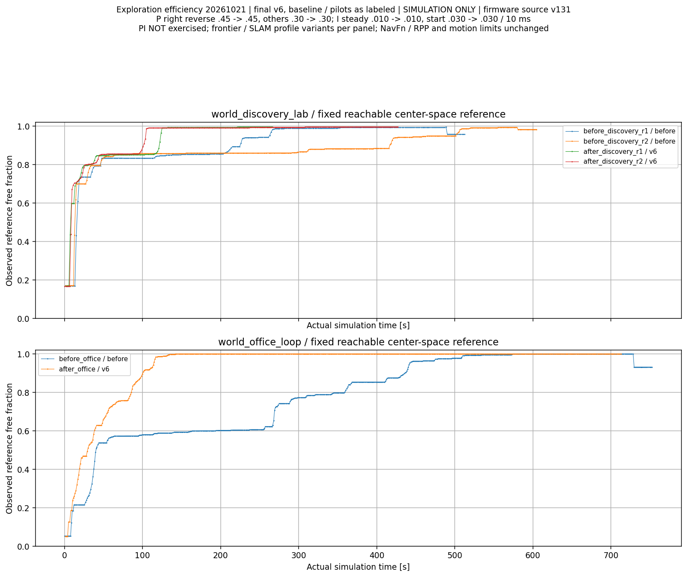

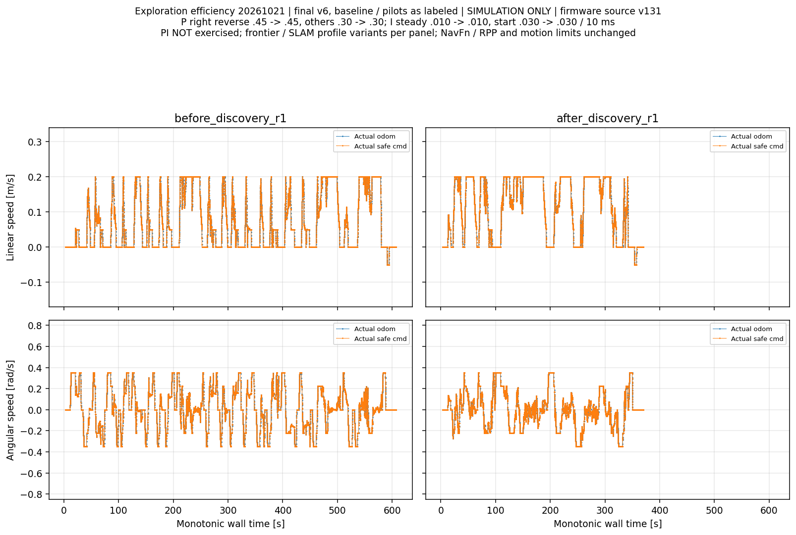

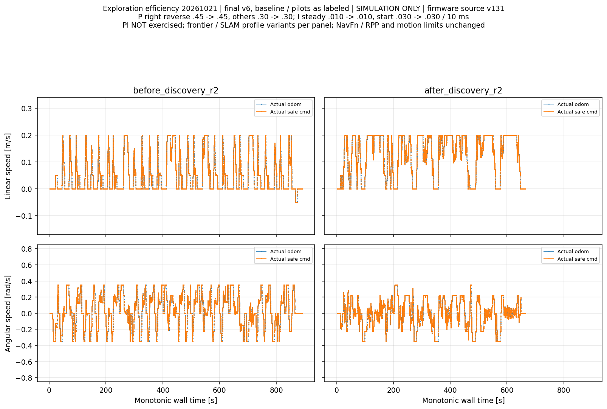

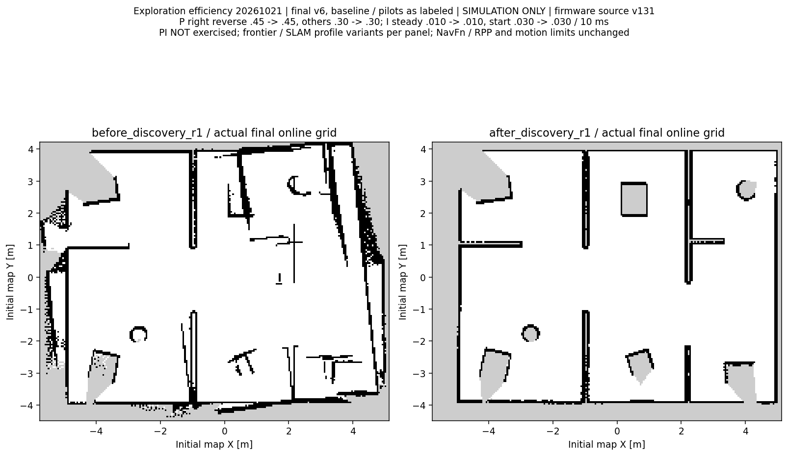

上述图P右反0.45→0.45、其余0.30→0.30，I稳态0.010→0.010、启动0.030→0.030/10ms；PI未执行。基线/最终v6前沿和SLAM配置分别标注，NavFn/RPP及速度/保护上限保持。图与[逐轮指标](evidence/exploration-speed-20261021/summary.json)共同评价耗时、停等、转角和地图质量，不能只依据单条速度曲线。

开发v5在返回走廊时地图变差。对已保存处理后扫描及原始轮式位姿做离线重放，最终失败栅格与实测**逐格相同且哈希相同**，复现271.5/327.5秒错误闭环，细响应约0.734/0.724。禁闭环消融及保留闭环、门槛0.65→0.80的重放均使P95从0.426m降至0.061m。最终v6保留闭环、Huber损失及更严格候选条件，再执行上述两轮新仿真；重放不代替新环境验证，更严格条件也可能漏掉真实闭环。全部开发失败、提前结束和环境中断保留，不计作最终重复。

自动地图导出另修复`free_thresh: 0.25→0.196`，使PGM未知灰度205经Nav2重载仍为未知。最终两张图真实逐格重载均通过，分别2624→2624、2349→2349未知格；实际PGM另算几何P95约0.070/0.060m，均通过相同门槛，不以在线末帧代替交付图。旧阈值失败记录保留。手动保存工具和历史地图未改，不据此宣称旧图已修复。

办公室独立对照同样通过：95%参考观测指标442.327→114.972仿真秒（减少74.0%），部分任务结束752.538→712.894秒（仅减少5.3%，尾段长途补盲仍明显）；参考观测终值93.198%→100%，在线末图几何代理P95约1.071→0.076m，实际PGM约0.080m。仍为`NO_REACHABLE_FRONTIERS_PARTIAL`；参考中心区全被观测也不能当成全部空间/表面完成。办公室结果单列，不混入实验室平均值。

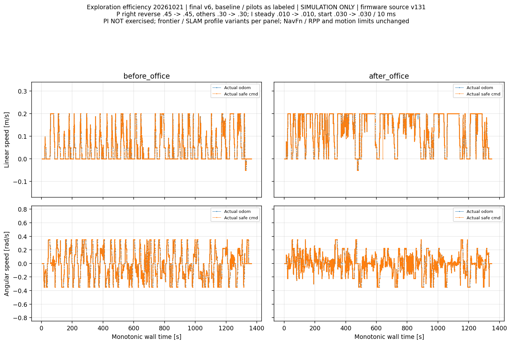

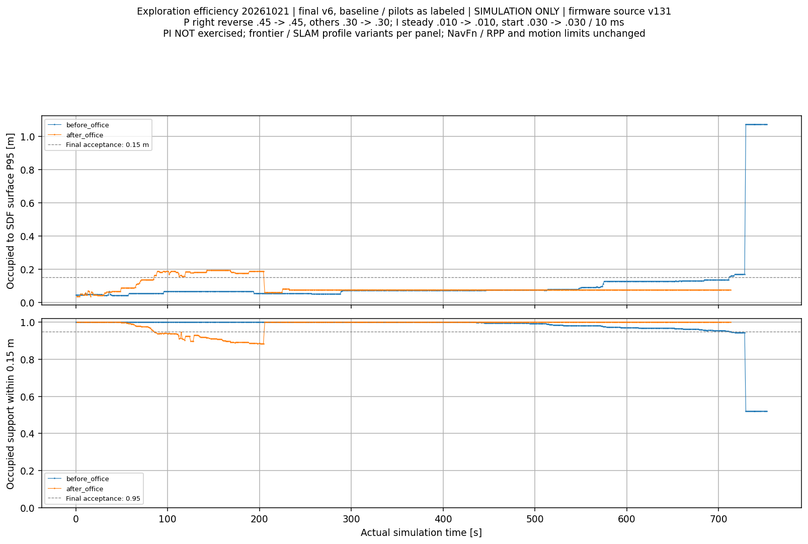

P右反0.45→0.45、其余0.30→0.30，I稳态0.010→0.010、启动0.030→0.030/10ms，固件v131、PI未执行；算法为基线与最终v6的前沿/SLAM配置，NavFn/RPP和运动/保护边界保持。地图中途偏差曾超过终图门槛，回访及闭环后降低，不能只截取最佳时段。

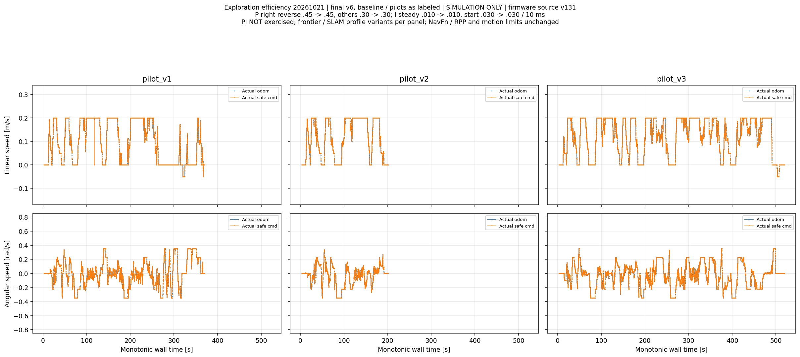

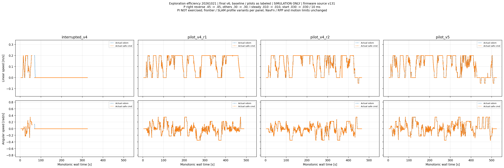

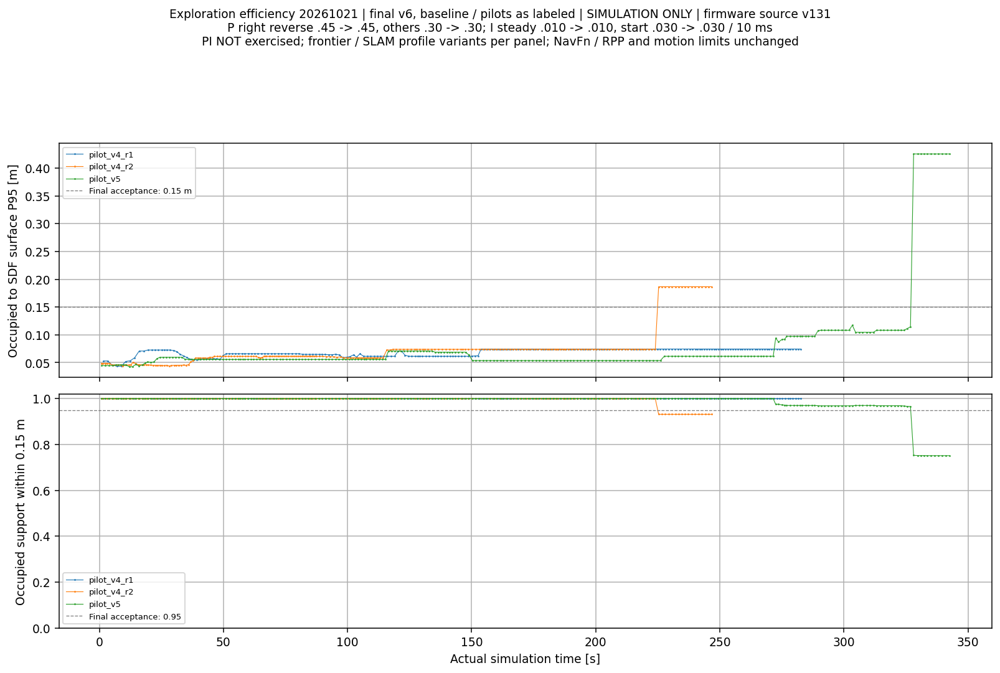

上述开发图同为源码v131、P右反0.45→0.45/其余0.30→0.30、I稳态0.010→0.010/启动0.030→0.030每10ms；PI未执行，探索配置按v1—v5区分，均不是最终v6重复。所有异常、提前结束和缺测保留，环境中断不计入速度比较。

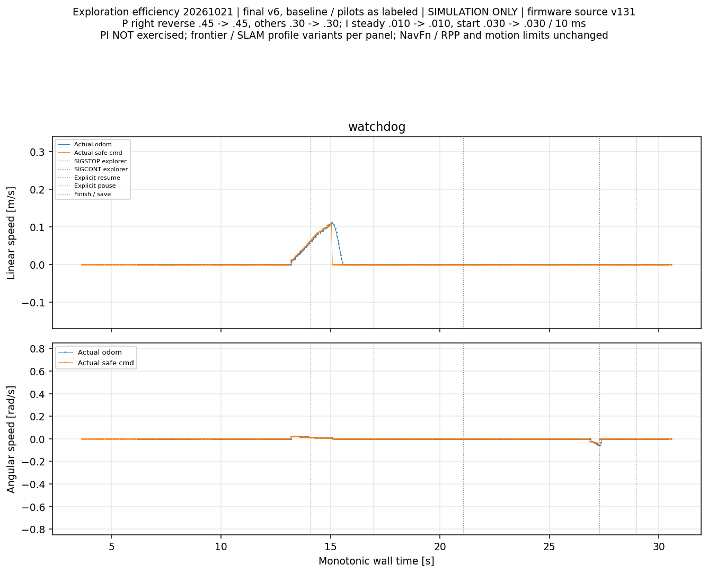

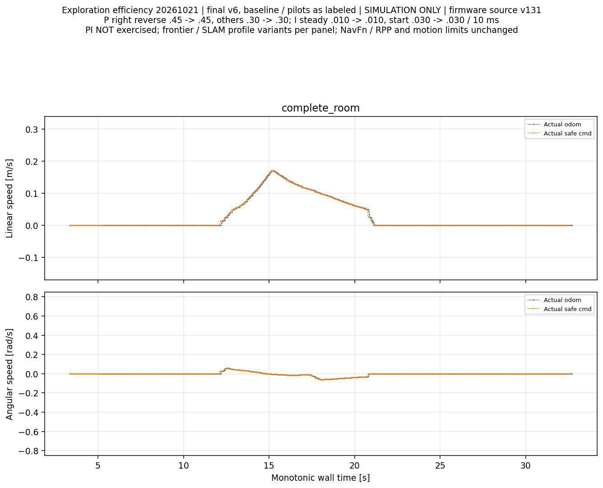

上述保护图P右反0.45→0.45/其余0.30→0.30、I稳态0.010→0.010/启动0.030→0.030每10ms；源码v131、PI未运行，最终v6前沿/SLAM配置。实际SIGSTOP后停止锁存、SIGCONT不续跑、显式继续选新目标、暂停及结束保存通过；可观测房间`NO_FRONTIERS / complete=true`通过，不能推广为实验室或办公室完整结束。

最终实验室新地图在独立AMCL导航启动中重载成功，短距离目标到达并持续停车通过；不是只检查文件存在。

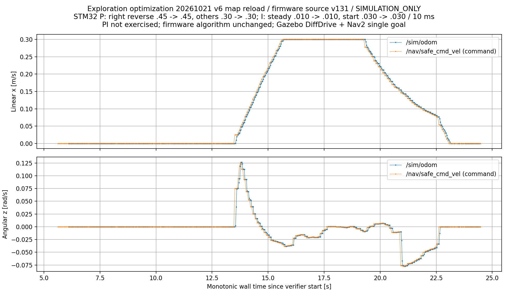

图为源码v131，P右反0.45→0.45/其余0.30→0.30、I稳态0.010→0.010/启动0.030→0.030每10ms，PI未执行；本图为常规AMCL/NavFn/RPP单目标回归，目标来自独立验证器，非探索期间真值引导。仅覆盖一次新图短距离导航，不代表任意目标/实车通过。

三包构建与77项colcon检查通过，软件测试与Gazebo、实车结论分开。全部原始数据/源码及失败已归档；最终提交/推送/CI以本轮分支与PR为准。未合并PR，实车桥尚未实现。

## 2026-10-21后续：全新discovery_lab场景与用户自主建图验收准备

用户要求独立新场景供亲自验收。新增10×8m非对称实验室，全部墙体/障碍布局本轮重新设计，不复用办公室布局，不向探索器提供预存地图或SDF真值。[启动和验收步骤](DISCOVERY_LAB_ACCEPTANCE.md) · [全部5次运行、失败与源码](evidence/discovery-lab-20261021/README.md)。

短测发现门控晚订阅会漏收静止SLAM非持久的首个pose，导致90秒无目标。修复为唯一SLAM图源、新鲜地图和原TF时间窗联合判断SLAM定位；不改变AMCL来源，时间回退等待新地图，原扫描/里程计/时钟/碰撞/失联停车阈值不放宽。实际延迟到首帧地图3.016秒后创建门控，此后0个pose仍能就绪，检查期间安全输出全零。

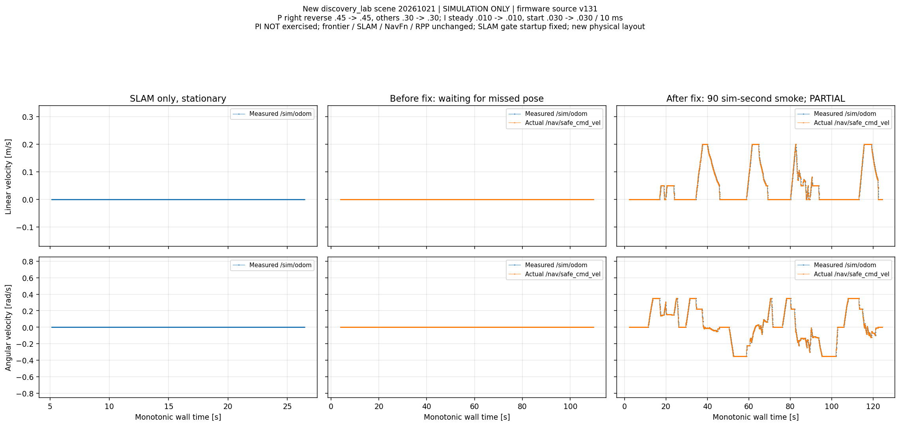

**STM32源码v131：P右反0.45→0.45，其余0.30→0.30；I稳态0.010→0.010、启动0.030→0.030，每10ms按电机轴rpm误差累计，D0。** PI未改、未运行；前沿探索/SLAM Toolbox/NavFn A*/RPP算法本体不变，建图0.20m/s、±0.35rad/s不变。新增场景并修复建图门控启动；同场景失败和最终90秒短测全部保留。图来自真实ROS/Gazebo消息，全部点、长缺口断线，无平滑、补点或删异常；不是实车电机轮速/电流。

最终短测自动发5目标、4到达、末个90仿真秒预算取消，行驶4.047m，已知格2967→22194；持续停车后地图四件套保存通过，`TIME_LIMIT_PARTIAL / complete=false`。三包构建和64项colcon检查零失败。助手完成短时启动/运动/保存检查，整张新场景探索、GUI、几何精度和导出后重载仍由后续验收区分，不宣称全覆盖；用户启动使用1800仿真秒预算。

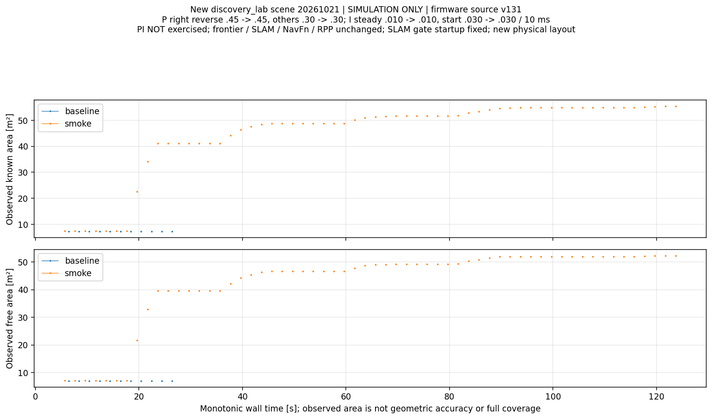

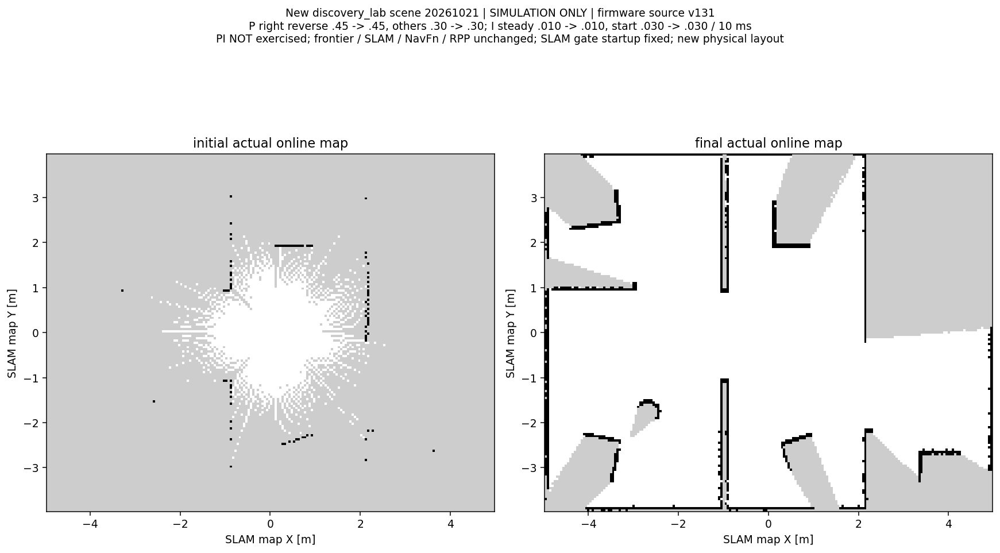

图上版本、PI和算法说明同上；初次离线检查探针落入箱体边界导致的FAIL、实际启动FAIL、诊断复测和最终修复分别保留。原始133份文件哈希一致，前轮自主建图634份及控制器比较2228份证据未改，自建运行组无残留；未操作用户GUI/硬件、实车桥未实现、未提交/推送/合并。

## 2026-10-21：陌生环境自主探索建图（仅软件/仿真）

用户要求无需键盘遥控或人工导航目标。新增`smartcar_nav2/exploration.launch.py`：空白在线SLAM→前沿聚类→在已知自由区选择观察点→NavFn/RPP导航→继续观测→停车保存。建图模式不启动AMCL/map_server，SLAM独占地图及map→odom。探索器只发送导航动作，速度仍经过原平滑器、导航门控和底层超时保护；新增自主任务失联锁存，恢复心跳不自行续行。[操作说明](AUTONOMOUS_MAPPING.md) · [全部运行与失败](evidence/autonomous-mapping-20261021/README.md)。

**STM32源码v131：P右反0.45→0.45，其余0.30→0.30；I稳态0.010→0.010、启动0.030→0.030，每10ms按电机轴rpm误差累计，D0。** PI未改、未运行。新增探索决策、地图来源检查、任务心跳及保存流程；NavFn、RPP、SLAM算法本体不改。建图专用巡航0.30→0.20m/s、原地转向0.60→0.35rad/s、平滑器角速度上限0.80→0.35、加速度0.50→0.25m/s²/1.50→0.50rad/s²，目的为减少轮滑和扫描匹配退化。原`nav2.yaml`、`slam.yaml`和已知地图导航默认未改，全部原停车/TF/传感器阈值不放宽。

| 运行 | 实际结果 | 验收边界 |
|---|---|---|
| office_loop静止基线 | 20秒已知格2107→2107，无移动 | 单独SLAM不具备自主探索 |
| office_02 | 自动30目标，29到达，末个600仿真秒预算取消；里程计路程28.021m；停车、PGM/YAML/posegraph/data保存通过 | `TIME_LIMIT_PARTIAL`，不说成全覆盖 |
| 同轮地图 | 已知格2106→44826，自由格1956→40756 | 面积增长不等于地图几何准确 |
| complete_room最终接口 | 4×4m可观测房间自动观察目标成功，前沿稳定消失后停车保存 | `NO_FRONTIERS / complete=true`，仅本算法阈值下完成 |
| watchdog_04最终接口 | 冻结任务进程后停车锁存，恢复进程不续跑；显式继续、暂停、结束保存均通过 | 实际SIGSTOP/SIGCONT及服务响应，不是仅单元测试 |
| 两次地图重载 | office_02输出、最终保存接口输出分别在新AMCL仿真中导航成功并停稳 | 各一次短距离使用验证，不覆盖任意路线 |

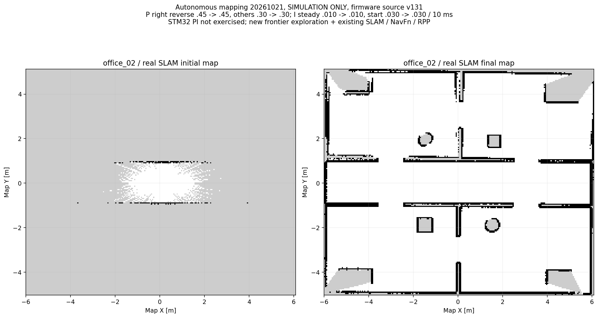

图上P/I与版本如上不变；新增前沿探索，不预载office_01，不把Gazebo几何交给探索器或SLAM。前沿长度阈值0.8m、多代表点搜索，通行圆与原Nav2一致为0.37m，观察目标额外要求0.40m已知自由圆。部分地图、受阻、预算耗尽、人工结束和异常分开标记，避免把未完成任务说成完全建图。

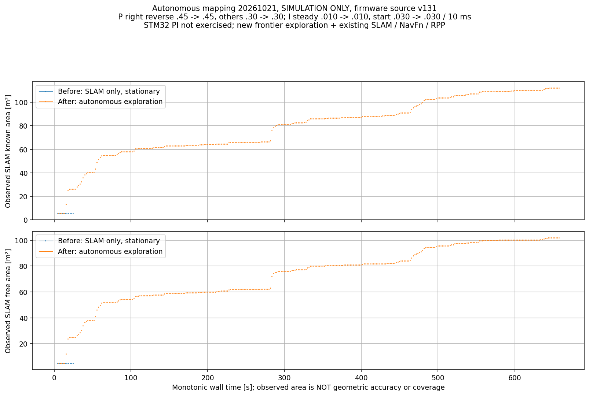

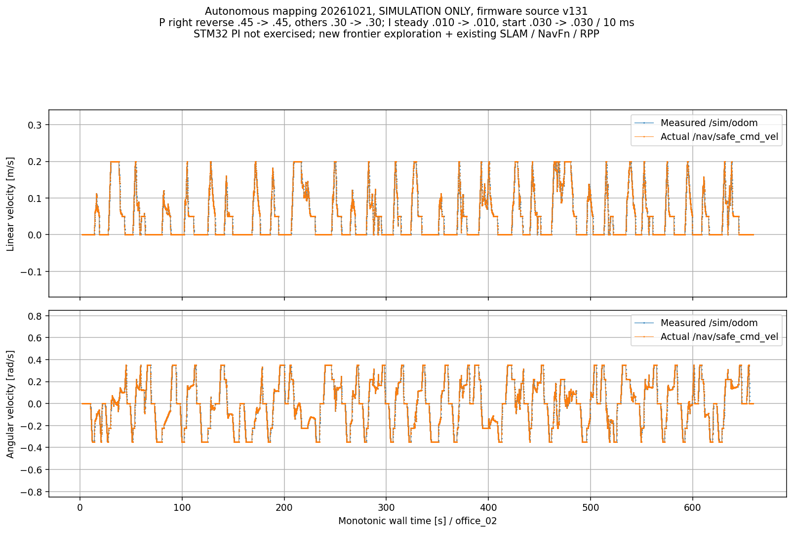

以上P/I、版本和算法如上；原始CSV点未平滑、删异常或补点，长缺口断线。是Gazebo/ROS数据，不是实车左右轮编码器或电流。观测栅格面积不等于可通行覆盖率。原始地图占据值NPZ及同名SVG保留。

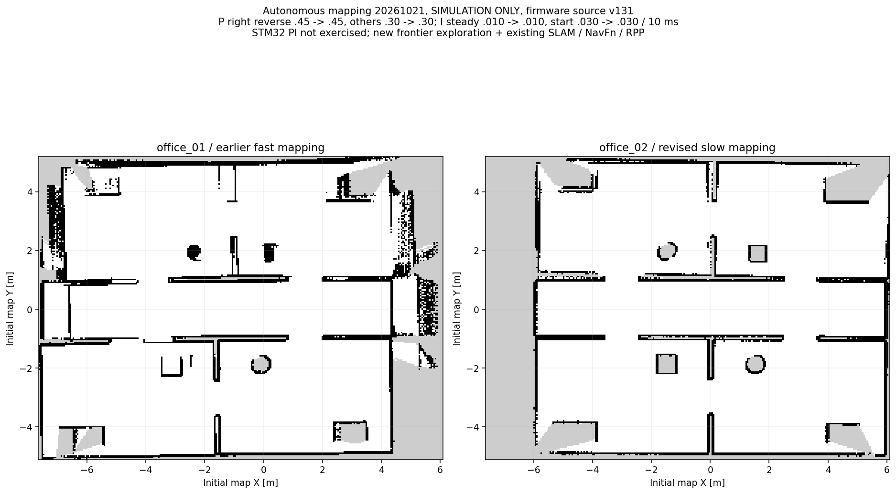

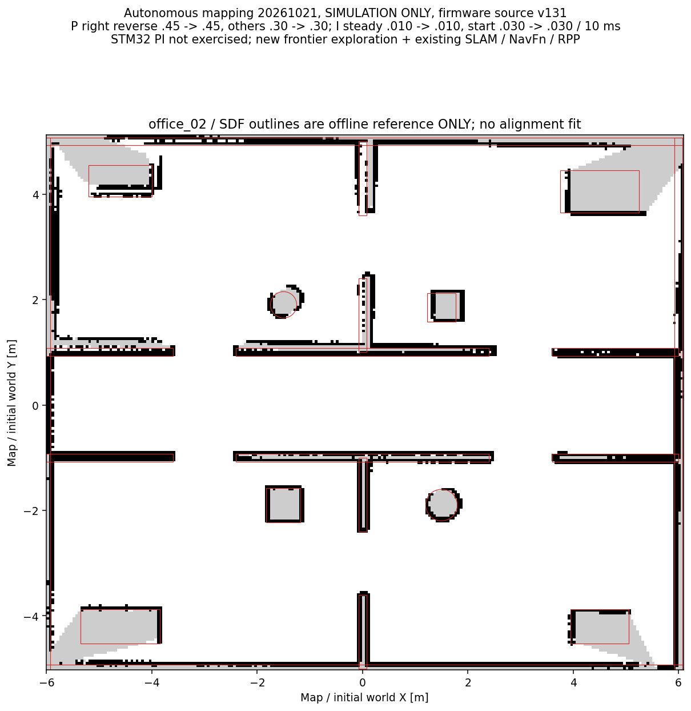

图旁P/I未改；早期office_01采用导航速度及较少前沿代表点，office_02采用上述组合改动，非同轨迹单变量试验。占据格中心到原场景障碍表面的距离中位数0.191→0.0258m，P95为1.391→0.142m；5cm地图分辨率下，0.15m内支持比例47.06%→97.30%。**这是固定初始map/world坐标下的仿真几何代理，不是“地图准确率”、全部障碍召回率或实车精度；未拟合坐标、删点或以面积代替精度。** 早期room_03和office_01虽通过移动/保存功能检查但地图质量差，原图和所有异常均保留。

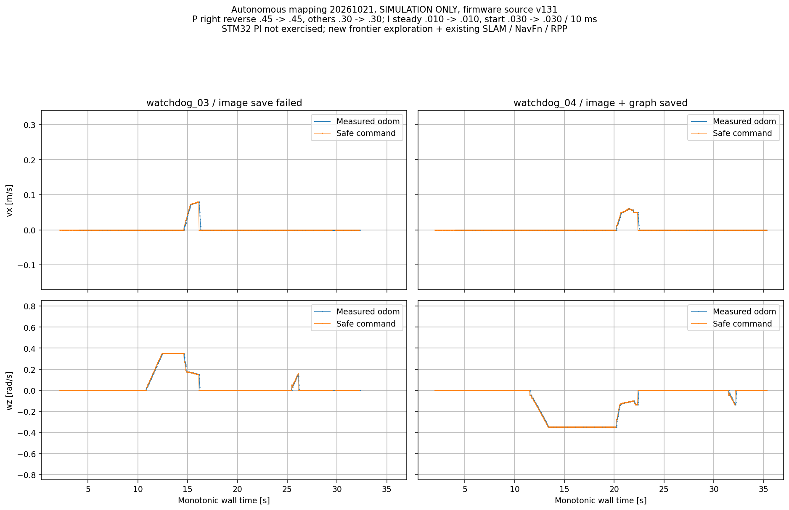

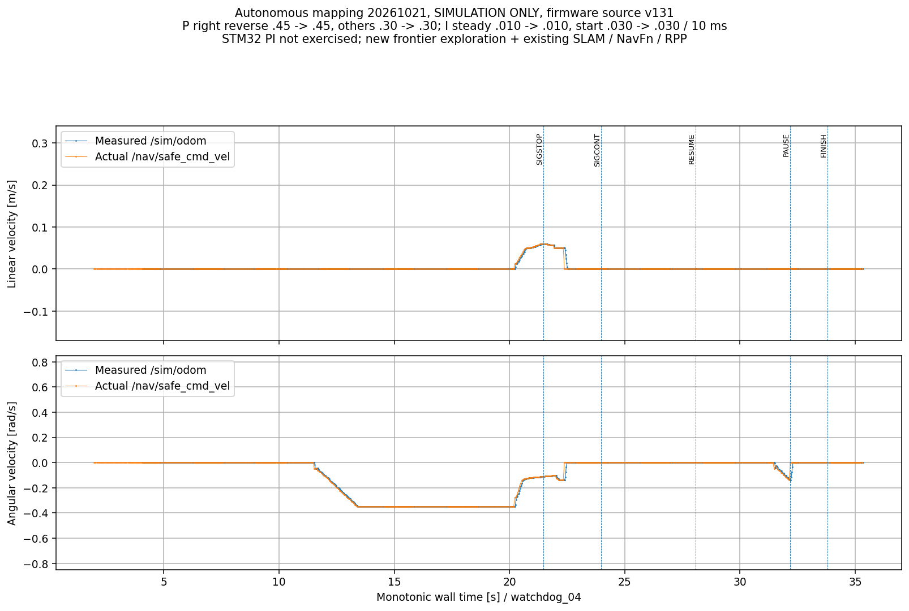

图上P/I不变。watchdog_03安全停止通过但SLAM图片保存返回255，内部保存器2秒订阅等待失败；最终改用独立Nav2保存服务、瞬态地图缓存和10秒只读保存等待，SLAM仍保存图结构，watchdog_04与complete_room验证后又进行最终接口地图重载。只改变保存等待，不扩大任何运动保护容差。目标由实时地图自动决定，两轮不保证轨迹相同；原失败未覆盖。

版本需分阶段读取：office_02验证最终运动/几何方案；其后修正图片保存接口并增加建图专用RViz显示，最终接口由故障、自动完成及重载三类运行验证。逐轮`source/`保留真实执行源码，`source_current/`为最终代码，不混称同一个实测版本。嵌套参数作用域错误、ClockType兼容错误、恢复进程时旧输入误结束、保存255、早期偏差和末次位姿采样缺测全部保留。

三包构建通过，54个pytest、colcon63项含9个包装零错误/失败/跳过。全部13次运行原始证据、361份原始文件哈希核对一致，最终自建测试命名空间无进程残留。未连接硬件、未实现实车桥，固件/协议/控制台/场景模型未改，用户窗口未重启或发送目标；本轮未提交/推送/合并。

[运行总表](evidence/autonomous-mapping-20261021/trials.json) · [地图质量代理](evidence/autonomous-mapping-20261021/map_quality_proxy.json) · [最终软件测试](evidence/autonomous-mapping-20261021/logs/exploration-20261021-tests-final.log) · [原始完整性](evidence/autonomous-mapping-20261021/integrity.json) · [进程审计](evidence/autonomous-mapping-20261021/process_audit.json) · [SHA256](evidence/autonomous-mapping-20261021/SHA256.json)。

## 2026-10-19—20：DWB、RPP、MPPI 对比（仅软件/仿真）

完成36轮正式矩阵：三种局部控制器×直线、过门、途中加箱体、双出口封堵×3次重复。工程上优先验证**MPPI性能候选**，生产默认RPP保持；严格预设门槛无全部通过者，不能宣称已得到完整验收的最优算法。全部失败、超时和启动未就绪记录保留，见[完整选型及限制](evidence/controller-comparison-20261019/README.md)、[HTML报表](evidence/controller-comparison-20261019/formal/REPORT.html)。

| 控制器 | 可达目标完成 | 封堵正确退出停车 | 途中绕障到达 | 已发目标 | 启动未就绪 |
|---|---:|---:|---:|---:|---:|
| DWB | 5/9 | 3/3 | 0/3 | 11 | 1 |
| RPP | 7/9 | 3/3 | 2/3 | 11 | 1 |
| MPPI | 7/9 | 3/3 | 2/3 | 11 | 1 |

DWB两次在同一门口附近无进展、有限恢复后自行ABORTED，第二组绕障三者都在240秒单调墙钟预算后取消；后三次未发目标的失败为导航系统启动未就绪，不能归因局部控制器。33次已发目标轮次都验证持续停车。模型重叠采样点和安全命令限幅违规均0；二维模型几何代理不是接触或实车碰撞证据。内部进程关闭升级异常完整保留，最终自建进程组无残留。

**STM32源码v131：P右反0.45→0.45、其余0.30→0.30；I稳态0.010→0.010、启动0.030→0.030，每10ms按电机轴rpm误差累计，D0。** PI未改、未运行；对比改变ROS局部控制器DWB/RPP/MPPI，Nav2均1.1.20。共同NavFn A*、1Hz重规划、代价地图、定位、最多4轮不清图恢复、保护及到达容差不变。为最终角速度一致，仅三个测试副本将共同平滑器±0.8降至±0.6rad/s；前进0.30m/s，生产参数未改。此处“前后”为既有RPP基线与三种冻结测试配置，不是固件修复前后。

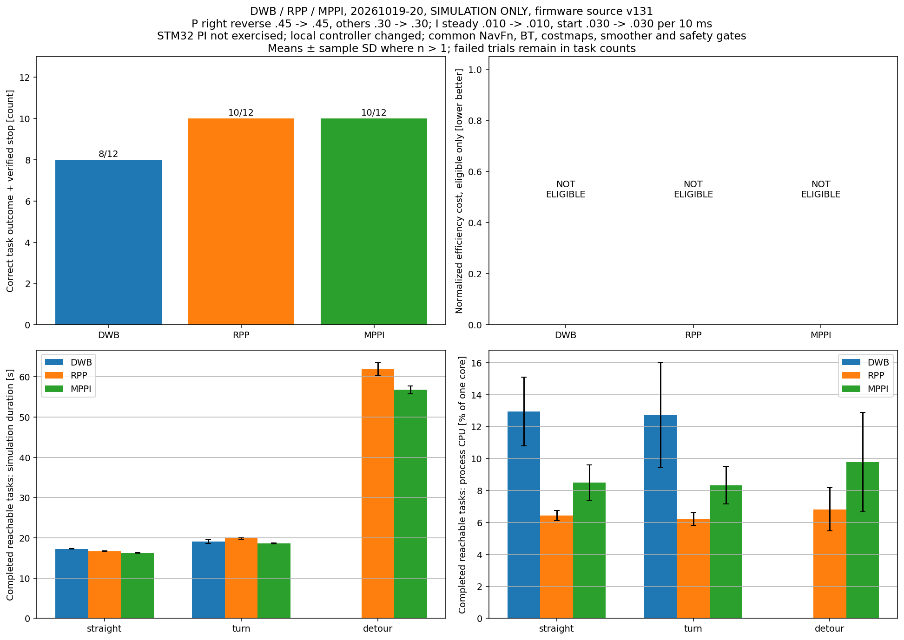

图中P/I、版本及算法如上。正式协议先要求全部任务通过再排名，因此正式效率分数均不合格；事后仅在正确次数并列最多的RPP/MPPI中按原权重比较成功场景均值，探索代价MPPI0.367、RPP0.633，只用于验证优先级，未删除失败或改写正式门槛。MPPI完成绕障平均56.743仿真秒，RPP61.879秒，分别n=2；对应进程CPU9.766%和6.824%（一个核=100）。RPP直线/过门角速度总变差更小，算力和模型间隙更保守，不能概括MPPI处处更平滑或普遍最优。

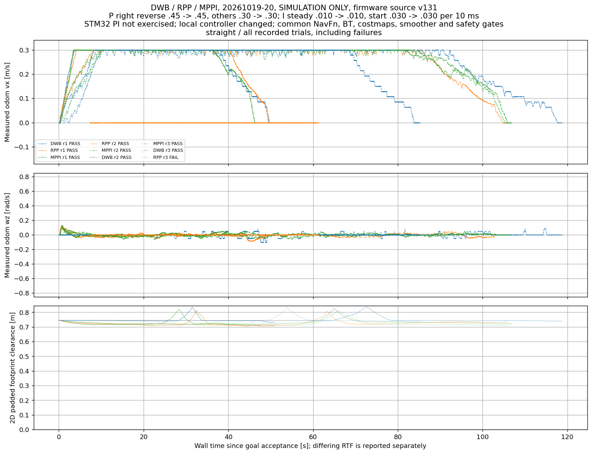

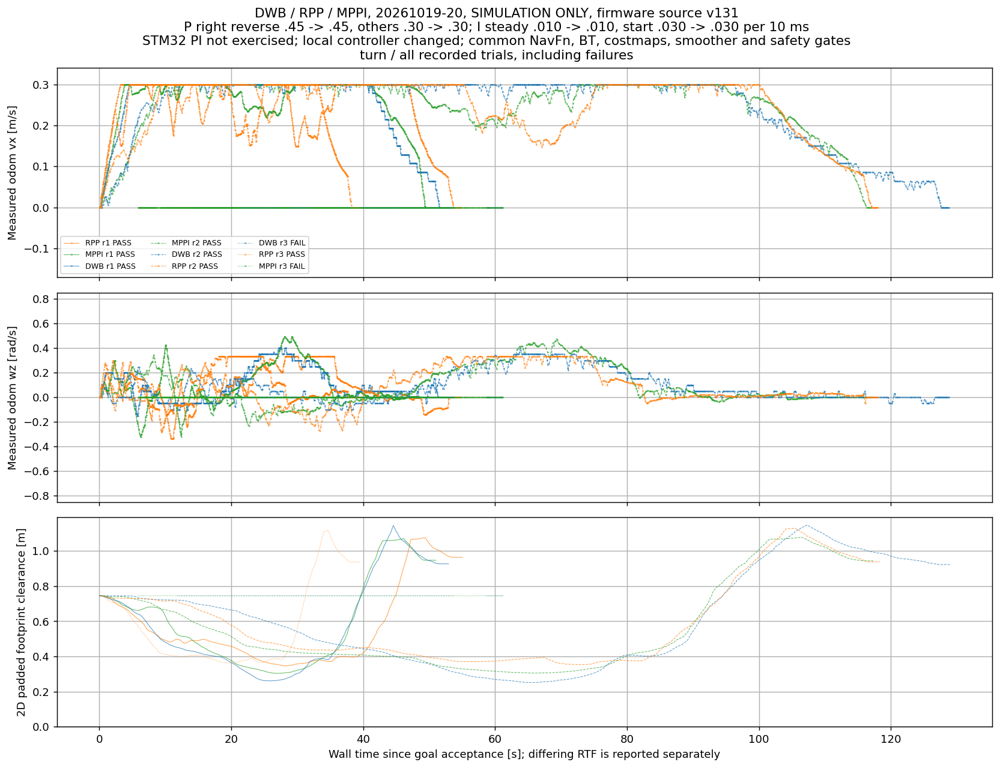

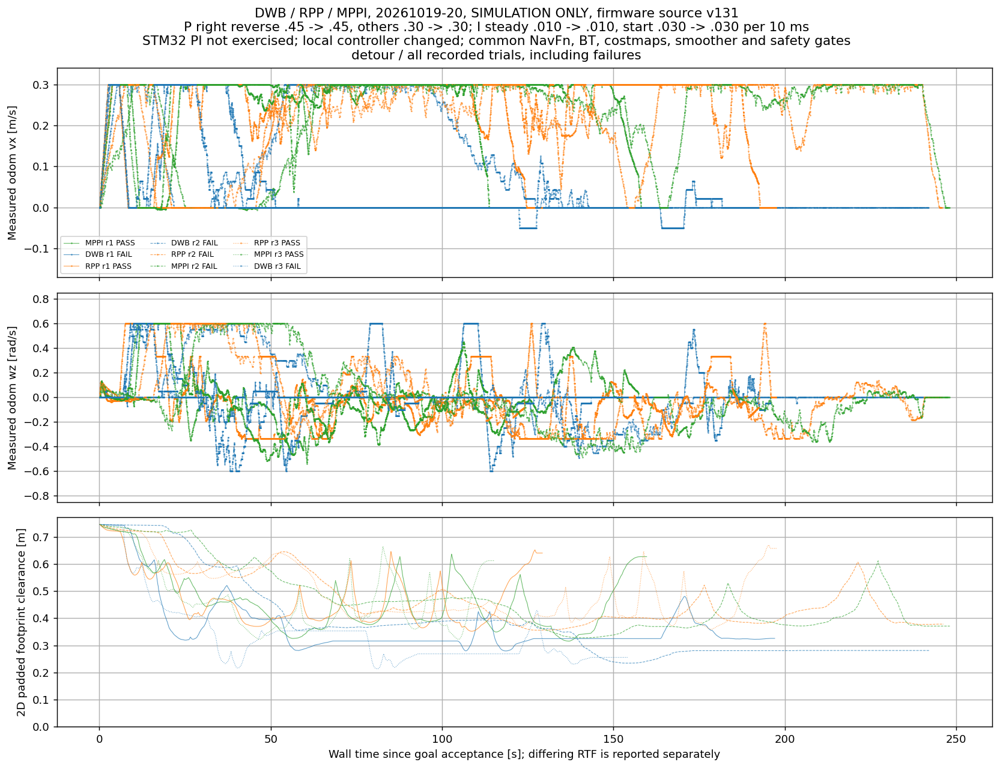

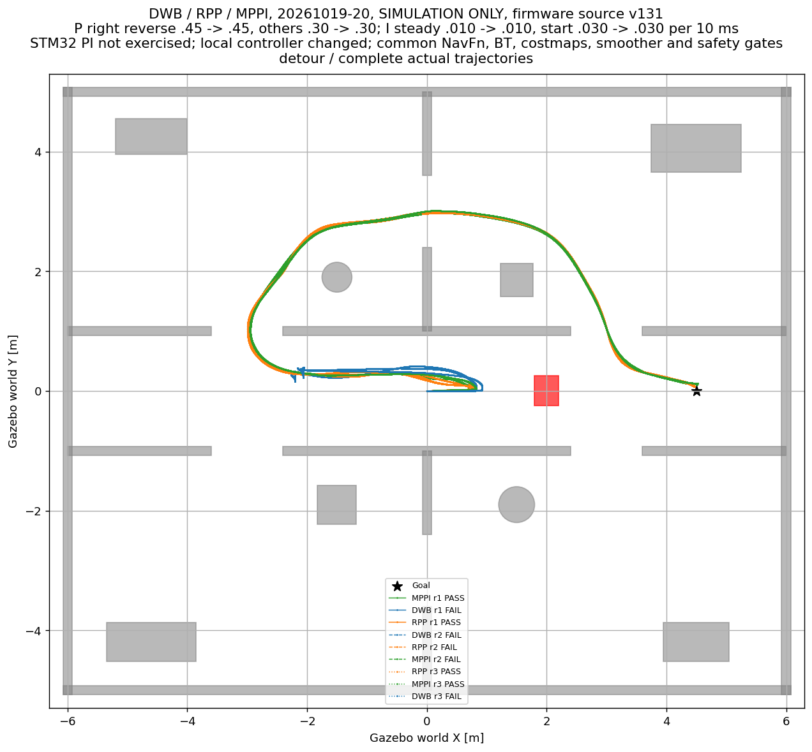

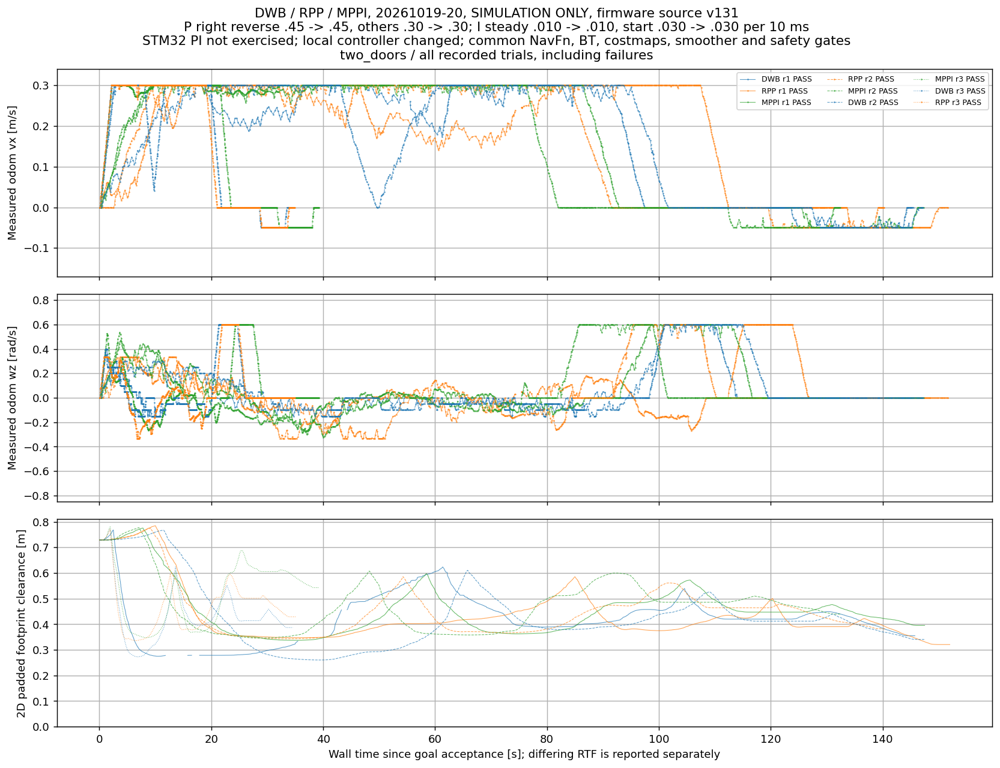

以上每图P/I前后不变、算法对比如上。记录来自本轮Gazebo/ROS实收点，不是左右轮编码器或电机电流；原始CSV/JSON完整保留，无平滑、删异常或补点，长缺口断线，SVG同名保存。几何间隙为世界位姿与带padding矩形/已知场景几何派生量。系统日历与单调计时差约3653秒、主机GUI负载和RTF变化均保留，耗时不由UTC相减。仅3次重复、随机种子未统一、RPP已有调参而另外两者按同版官方示例适配，不能作统计显著性或普遍算法结论。

三包构建和45个pytest通过，colcon53项含8个包装，零错误/失败/跳过；不是36轮仿真全部通过。正式665份原始文件哈希一致，含预检共755份核对一致；302份大JSONL无损gzip并逐份解压验证，所有中间失败和关闭阶段中断保留。原始未压缩目录仍在本机忽略路径。未连接硬件、未实现实车桥，用户原窗口和默认RPP未修改，本轮未提交/推送/合并。

[全部轮次CSV](evidence/controller-comparison-20261019/formal/trials.csv) · [分场景数据/标准差](evidence/controller-comparison-20261019/formal/case_summary.csv) · [正式协议](evidence/controller-comparison-20261019/formal/protocol.json) · [原始数据完整性](evidence/controller-comparison-20261019/integrity.json) · [压缩原字节映射](evidence/controller-comparison-20261019/compression.json) · [SHA256](evidence/controller-comparison-20261019/SHA256.json)。

## 2026-10-19：TF失败误报到达与Reset清理卡住（仅软件/仿真）

现场约6m目标3.752秒即报告成功，前一刻map→odom变换落后0.776秒、超过0.5秒容差；随后Reset停在控制器清理。隔离复现确认两处问题：Nav2 1.1.20忽略到达检查的目标变换失败；tf2 0.25.23的TF到达与MessageFilter异步请求存在锁序反转，可冻结观测并阻塞清理。现场旧日志、真实GDB堆栈、基线和全部中间失败均保存。

新增仓库本地控制/规划服务，目标TF失败停车并返回失败，禁止用默认零位姿判到达；代价图TF、扫描过滤与超时回调串行执行，清理先停止回调线程再析构资源。保留原MessageFilter、marking/clearing、NavFn/RPP、全部速度/到达/TF容差和门控保护；不覆盖系统ROS库。Reset重建代价图，显式新目标才会继续，不自动重发旧任务。

**STM32源码v131：P右反0.45→0.45、其余0.30→0.30；I稳态0.010→0.010、启动0.030→0.030，每10ms按电机轴rpm误差累计，D0。**PI、启动、IMU与固件导航算法未改、未运行；上层修改TF错误处理、动作调度及回调执行策略。以下是本轮控制器真实输出/ROS仿真记录，不是实车左右轮速或电机输出。

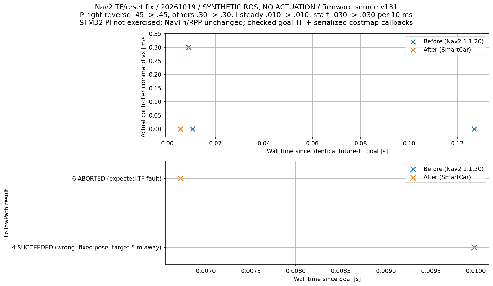

图中P/I未变、算法改动如上。车体合成位姿固定为零、目标5m，路径时间故意超前最新TF 3秒；复现相同失败路径，时间差不是现场0.776秒。原系统返回4，修复返回6并保持零命令。所有散点为真实命令/动作响应，没有驱动订阅者；不以此图证明物理运动性能。

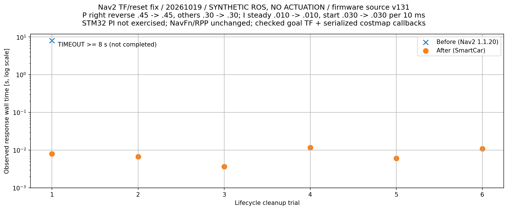

图中P/I未变、改变回调串行策略。原第1次cleanup超过8秒无响应；最终版本5次空闲重复清理和第6次执行中清理均返回，重启后不续跑旧目标；显式有效目标、持续执行和取消通过。首次编译缺少头文件、首次封装第二轮配置超时完整保留，最终构建和40个pytest通过（colcon47项含7个包装，零错误/失败/跳过）。

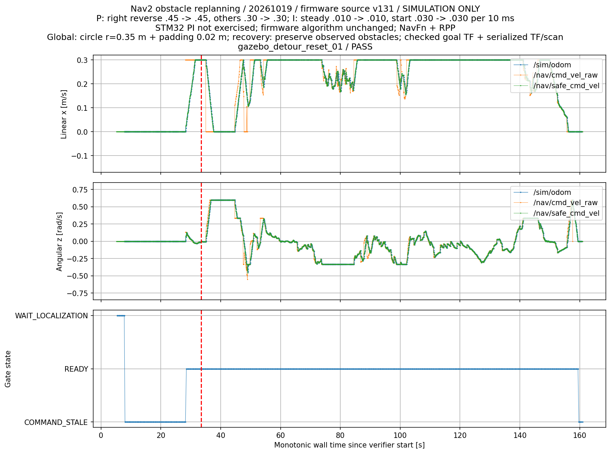

图中P/I、NavFn/RPP及保护未改。office_loop目标(4.5,0,0)只发一次，车x约0.45m插入(2,0)处0.4×0.5×0.6m箱体。两轮Reset后九节点active、无目标时静止；原目标实际绕行成功，世界终点约(4.4716,0.0773,0.099rad)。43个连续新鲜样本约1.459秒满足|vx|<0.02m/s、|wz|<0.03rad/s、位移<0.02m、安全命令新鲜且为零。此样本后仅调整构造时释放旧代价图的顺序消除短暂日志重名；最终二进制另有下图及完整软件回归。

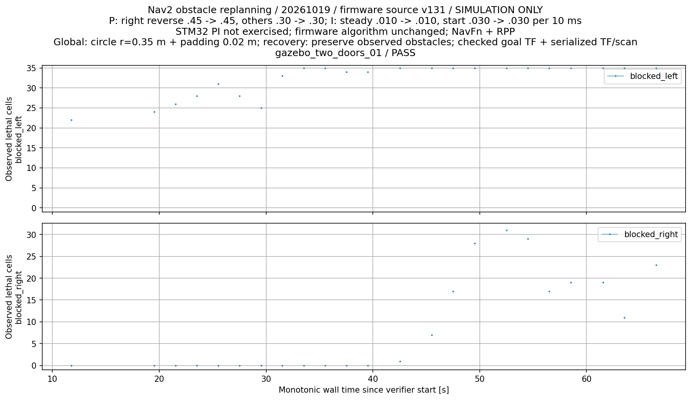

图中P/I未改、TF/调度修改如上。球/方块位置和上一轮双门验收一致，静态且从启动前存在；Reset/Startup后只发一次目的地。两处均观测后没有归零，有限恢复返回ABORTED，整图清空调用0。计数仍为±0.7m区域内静态底图原空闲的致命格，非物体分割。

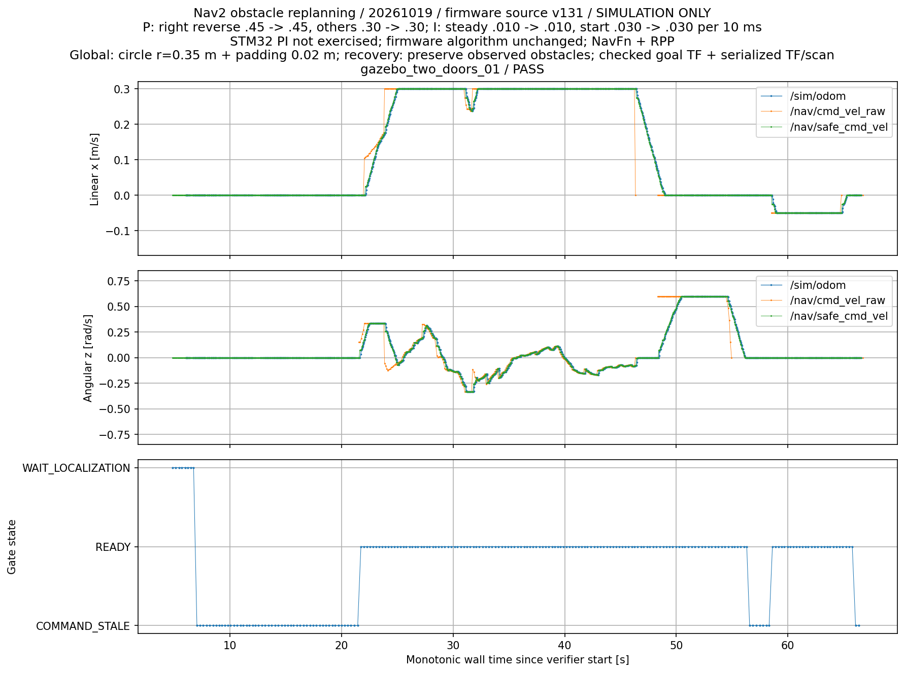

图中P/I和阈值未改，37个新鲜样本约1.443秒满足相同静止判据，最大线速度0.01858m/s、安全命令为零。全部点原样保留，无平滑、补点或删异常，长缺口断线。两轮Gazebo自建进程组仅SIGINT即退出，无遗留。未重启用户旧窗口、未连接硬件，实车桥未实现，未提交/推送/合并；用户手动GUI、任意路线/移动障碍/长期运行仍须分别验证。

[本轮详细工况、失败与边界](evidence/nav2-tf-reset-20261019/README.md) · [汇总JSON](evidence/nav2-tf-reset-20261019/summary.json) · [故障注入结果](evidence/nav2-tf-reset-20261019/after_final/result.json) · [绕行结果](evidence/nav2-tf-reset-20261019/gazebo_detour_reset_01/result.json) · [双门结果](evidence/nav2-tf-reset-20261019/gazebo_two_doors_01/result.json) · [SHA256](evidence/nav2-tf-reset-20261019/SHA256.json)。

---

## 2026-10-19：双通道封堵后的障碍记忆与有限恢复（仅仿真）

用户手动堵住两处出口后，小车反复往返。只读现场规划日志记录6次全局整图清空；隔离仿真按现场球体/方块位置复现：原BT约44.04墙钟秒已看到两障碍，之后5次全局清空令视野外障碍格归零，再次选择旧通路，160秒仍未结束后验收器取消。不能把用户取消或验收器超时写成导航自行ABORTED。根因不只是局部地图，而是自动恢复清空全局障碍记忆，以及内层重试反复绕过外层有限恢复预算。

单目标和连续多目标树均改为不自动清空两图，规划/跟踪失败统一进入最多4次外层恢复（等待、碰撞检查下转向、等待、短距离后退）。启动器显式绑定两棵树，避免连续多目标仍回落到系统旧树。全局圆形轮廓0.35m、局部矩形、NavFn A*、RPP、扫描marking/clearing、速度及停机保护不变；移走障碍后通过新射线正常清除，不靠关闭clearing或长期重放旧扫描来保存障碍。

**STM32源码v131：P右反0.45→0.45、其余0.30→0.30；I稳态0.010→0.010、启动0.030→0.030，10ms按电机轴rpm误差累计，D=0。**固件PI、起步、IMU及相对导航算法未改、未运行。上层规划/跟踪算法未换，恢复/失败处理策略改变。下面为本轮真实Gazebo/ROS记录，未平滑、补点或删异常，长缺口断线；不是实车波形。

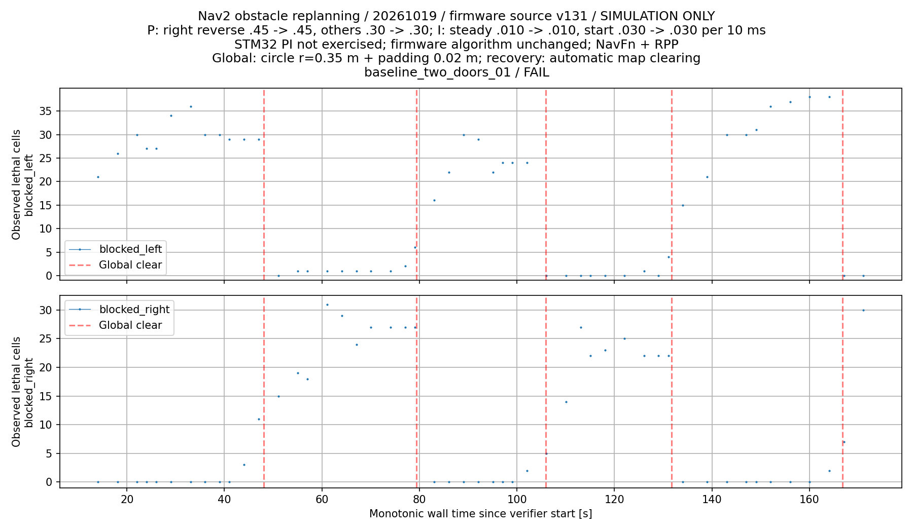

图中P/I未改、采用旧清图恢复策略；红线对应真实日志中的全局清空。统计范围为障碍中心±0.7m、静态底图原为空闲而实际全局图为致命值100的格子，排除已知墙格；仍可能含定位/栅格误差，不是物体分割或尺寸测量。两障碍在仿真中一直保持存在。

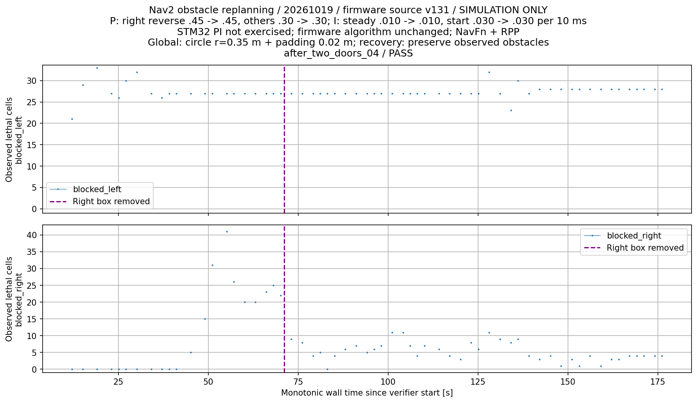

图中P/I未改、新恢复策略不清图。初始(-2.99,1.91,0)，目标map(1.03,-2.92,0)，球体/方块按用户世界位置建模并设为静态。先发一次目标，两障碍逐渐被扫描确认，均保留到ABORTED且持续停车；随后明确移走右箱体，显式发观察目标(3,2.7)重新看到通道，再显式发原目的地，SUCCEEDED并停稳。三个目标各有明确操作，不自动续跑已失败任务；整轮全局和局部清空调用均0。

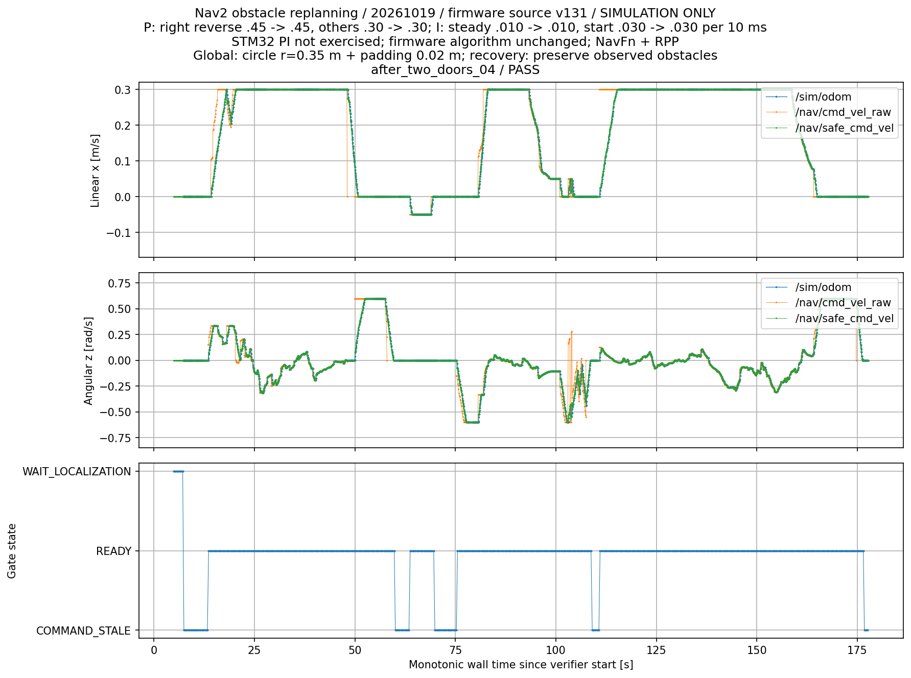

图中P/I、固件和保护均未改，仅上层恢复算法改变。两次停车各有42个新鲜样本，窗口约1.46秒，满足|vx|<0.02m/s、|wz|<0.03rad/s、窗口位移<0.02m且新鲜安全命令为零；移除后到达窗口角速度最大约0.01066rad/s。无法看到旧障碍位置时会保留旧格，不能要求删除Gazebo物体后机器人立即凭空知道空闲。

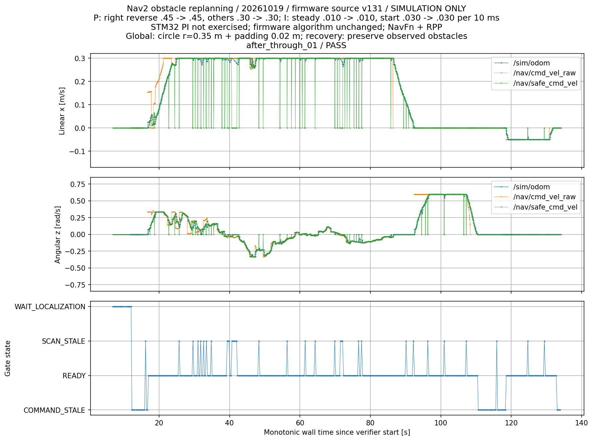

此图P/I未改，使用新多目标恢复树；实际ROS动作入口包含已到达起点和封堵后的目的地，不代表任意GUI队列通过。两处记忆保留，0次整图清空，停止检查通过。

全部失败保留：一次AMCL生命周期服务应答超时，未发目标；一次移除箱体后因柜子遮挡而未充分重观测，直接重发远目标仍失败；重新观察后导航成功的一轮，以及普通绕行回归的一轮，固定3墙钟秒采集尚含减速尾段，停车检查FAIL。最终验收改为最多等15墙钟秒寻找上述连续静止窗口，**增加采集等待，没有改控制/故障超时或放宽静止阈值**。各轮实际结果保持原样，详见完整说明。

三包构建、39个pytest通过（colcon45项含6个CTest包装，0错误/失败/跳过）。用户原场景和窗口未重启/改动，已保存恢复模板和手动启动脚本。未连接或烧录硬件、未实现实车桥，未提交/推送/合并。用户下一轮手动GUI验证、其它地图/移动障碍/长期运行仍需各自记录。

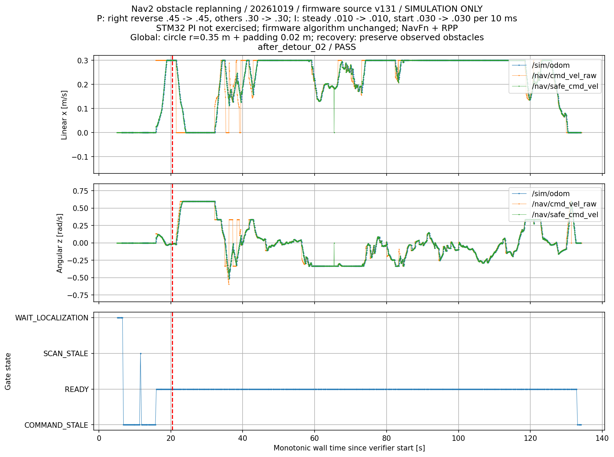

此图P/I未改，恢复算法改变但NavFn/RPP与保护不变。普通绕行回归PASS，原目标SUCCEEDED、实际轨迹改道、清图次数0，47个连续新鲜样本约1.46秒满足停车判据，新鲜安全命令为零。该窗口角速度最大约0.01554rad/s；未以动作成功直接代替停稳证据。[本轮绕行结果](evidence/nav2-blocked-passages-20261019/after_detour_02/result.json)。

[本轮工况、全部尝试及恢复场景步骤](evidence/nav2-blocked-passages-20261019/README.md) · [双门封堵/移除后重新观察结果](evidence/nav2-blocked-passages-20261019/after_two_doors_04/result.json) · [连续多目标入口结果](evidence/nav2-blocked-passages-20261019/after_through_01/result.json) · [障碍记忆CSV](evidence/nav2-blocked-passages-20261019/after_two_doors_04/obstacle_memory.csv) · [原始速度CSV](evidence/nav2-blocked-passages-20261019/after_two_doors_04/velocity.csv) · [记忆SVG](evidence/nav2-blocked-passages-20261019/after_two_doors_04/obstacle_memory.svg) · [软件测试](evidence/nav2-blocked-passages-20261019/ros_tests.log) · [SHA256](evidence/nav2-blocked-passages-20261019/SHA256.json)。

---

## 2026-10-19：导航途中遇障重规划与转向空间修复（仅仿真）

用户报告遇障停住后Goal failed。原配置实测在约1.21秒内已经生成绕行路径，但路径从箱体侧面窄缝通过，门控累计569条`OBSTACLE_NEAR_TURN`，控制器多次`Failed to make progress`；180秒未结束后验收器取消。**这次基线没有等到顶层ABORTED，不把主动取消写成Goal failed。**首次测试因验收器未启动世界位姿记录桥，60秒未就绪且未发目标，也完整保留。

全局规划由矩形轮廓改为半径0.35m保守圆，保留0.02m padding；覆盖局部带padding矩形的约0.3245m最大转弯半径及半个0.05m栅格余量。NavFn A*、RPP、每秒重规划、局部矩形、速度、碰撞预测、近障保护与所有超时不变。算法没有换成其它规划/控制器，改变的是规划碰撞空间；可能改走更长路线或排除只适合固定姿态的窄缝。

**STM32 v131，P右反0.45→0.45、其余0.30→0.30；I稳态0.010→0.010、启动0.030→0.030，10ms按电机轴rpm误差累计，D=0。**固件轮速PI、起步、IMU和相对导航均未改、未在Gazebo执行。下面波形直接来自本轮Gazebo/ROS实收点，未平滑/补点/删异常，长缺口断线；不是实物轮速波形。

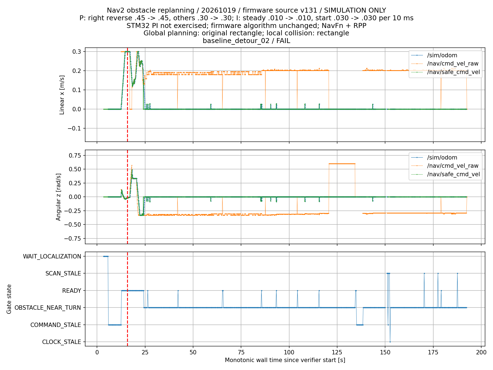

图中P/I同上未改，全局为原矩形。控制器持续请求速度而保护输出基本为零，证明仅“生成新路径”不足以完成绕行；原因是规划预留空间小于执行转向要求。原始扫描、代价图、路径、故障与超时取消记录均保留。

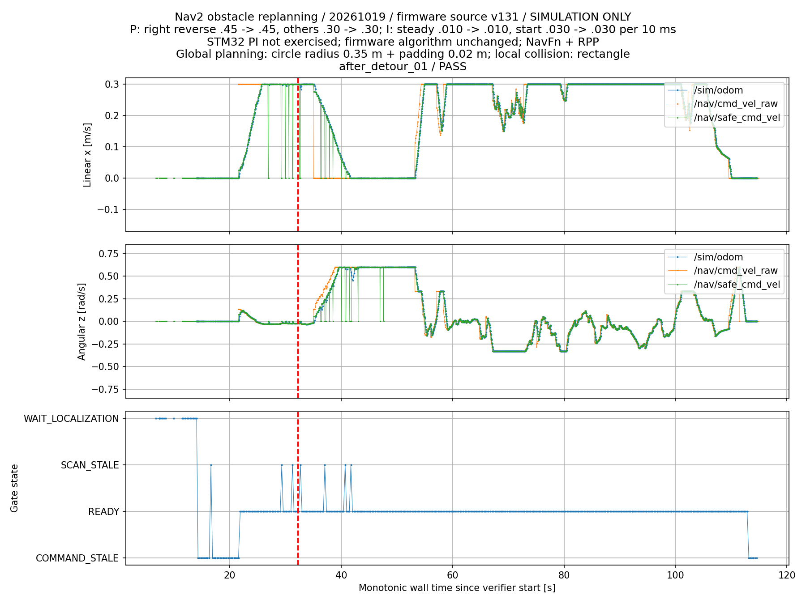

图中P/I同上未改，采用保守圆形全局轮廓，局部矩形及保护不变。在office_loop中向map(4.5,0,0)只发一次目标，车辆x约0.45m时插入中心(2,0)、0.4×0.5×0.6m箱体，约2.67墙钟秒收到绕行路径；该延迟包括运行负载，不是上限。车辆经左门→上方两间房→右门绕过，返回SUCCEEDED，最终世界位姿约(4.4532,0.0693,0.0981rad)，86条连续停车样本通过；该轮无近障转向门控阻塞。启动和并行负载中的扫描过期告警原样保留，未调整保护阈值。前后运行部分时间在不同ROS域/随机Gazebo分区并行，不能当同负载性能比较。

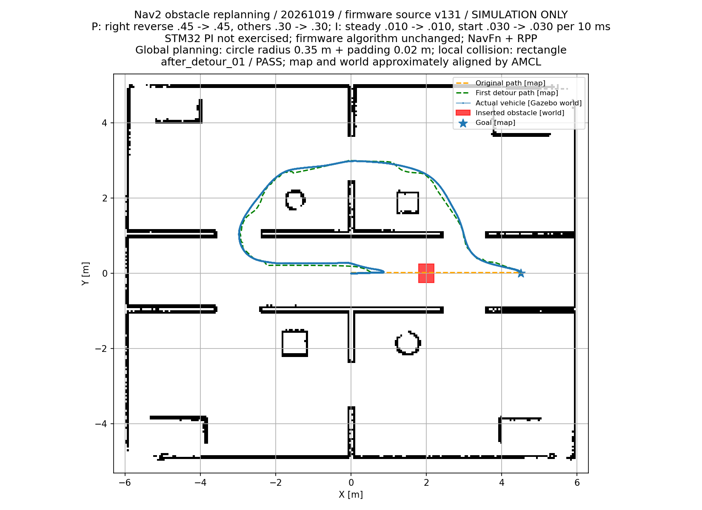

图中P/I同上未改，修改全局规划轮廓的原因是让规划器选择有转弯空间的路线。橙色原路径、绿色首条绕行路径来自map，蓝色世界轨迹仅用于验收，按AMCL近似对齐；不从两者差标定定位误差。离线模型轮廓到箱体最小间隙约0.625m，不是实车间隙/接触传感器实测。

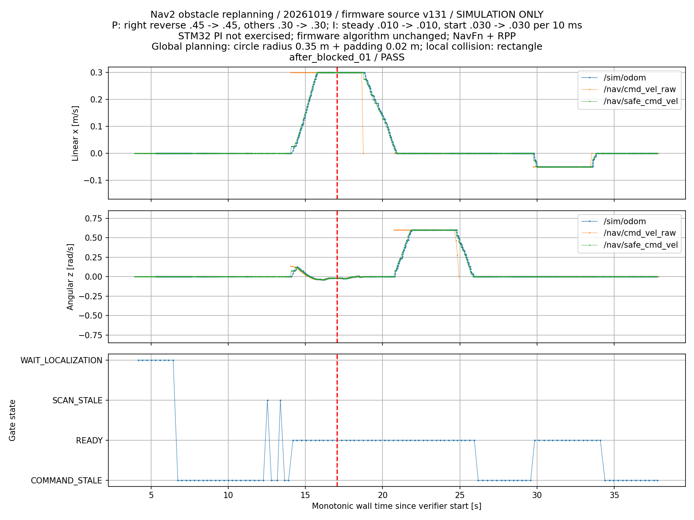

图中P/I未改、采用同一修改后配置，向同一目标只发一次，随后以1.2×1.85×0.6m箱体占住目标；原有恢复后返回ABORTED，70条持续停车样本通过。此工况是目标占据，不能推广为所有完全封路；目标距离超出局部4m窗口，局部图没有箱体格属于窗口范围，实际全局图已标记障碍。

三包构建通过，34个pytest通过（colcon39项含5个CTest包装，0错误/失败/跳过）；新增全局转弯空间与双代价图扫描输入回归。全部自建进程退出，未打开用户RViz、未连接硬件、未提交/推送/合并。移动障碍、多目标GUI、其它门口/地图、长期运行与实车仍待各自验收。

[工况/限制和全部尝试](evidence/nav2-replanning-20261019/README.md) · [修改后结果](evidence/nav2-replanning-20261019/after_detour_01/result.json) · [目标占据结果](evidence/nav2-replanning-20261019/after_blocked_01/result.json) · [原始世界位姿CSV](evidence/nav2-replanning-20261019/after_detour_01/world_pose.csv) · [原始速度CSV](evidence/nav2-replanning-20261019/after_detour_01/velocity.csv) · [速度SVG](evidence/nav2-replanning-20261019/after_detour_01/velocity.svg) · [软件测试](evidence/nav2-replanning-20261019/ros_tests.log) · [证据SHA256](evidence/nav2-replanning-20261019/SHA256.json)。

---

## 2026-10-18—19：ROS 2 仿真、SLAM 与 Nav2 迁入同一仓库

本轮新增 `ros2_ws`，让原来独立目录中的 `smartcar_sim`、`smartcar_slam`、`smartcar_nav2`、office_01 栅格地图与底层固件一起版本管理；新增可移植环境、依赖/构建/测试入口、CI 和硬件接口说明。导航默认地图从安装包加载，不再固定开发机旧目录。原单包不完整打包入口停用，静态检查改为写新目录，避免覆盖历史证据。原固件、协议与电脑控制台未修改。

**P 右反 0.45→0.45、其余 0.30→0.30；I 稳态 0.010→0.010、启动 0.030→0.030，每 10 ms 按电机轴 rpm 误差累加，D=0。** STM32 v131 轮速 PI、起步、IMU 与相对坐标导航算法均未改，也未在本轮 Gazebo 中执行；图上标注的参数仅用于追溯固件未变。本轮改动原因是整合上层源码并消除旧目录依赖，不是实车调参。

三包本机编译通过；32 个 pytest 用例通过（colcon 合计 36 项含 CTest 包装）。在新仓库构建产物上实际启动无界面 Fortress 6.18.0、办公室场景、模拟 C1、AMCL 与 Nav2，域 88/随机 Gazebo 分区隔离。九个生命周期节点、地图/扫描/里程计/时钟和 TF 就绪后，发送 `map(1.5, 0, 0)`，返回 `SUCCEEDED`；里程计净位移 1.39869 m。配置位置容差为 0.15 m，成功不表示精确落在数值目标上。摄像头、GUI、实车均未参与。

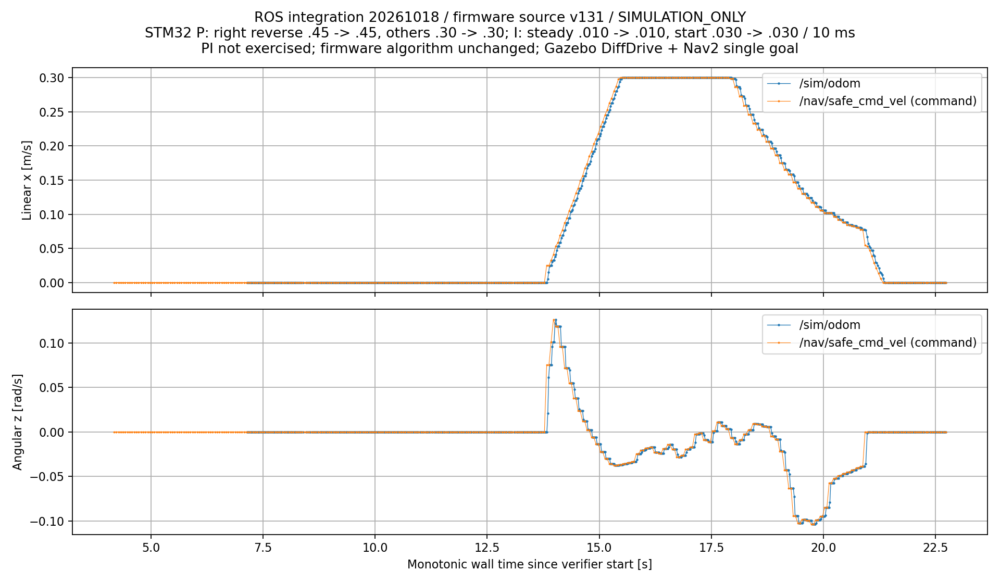

图中保留启动、运行、减速和关闭阶段全部实收点，无平滑或补造。目标后检查到连续 1.46754 s / 68 个里程计样本低于 0.02 m/s 与 0.03 rad/s，位移 0.000674 m，末次新鲜安全速度为零；窗口保留减速尾段，线速度峰值 0.01470 m/s。图中速度来自 Gazebo 里程计与 ROS 命令，不能用于证明实物轮速 PI 性能。

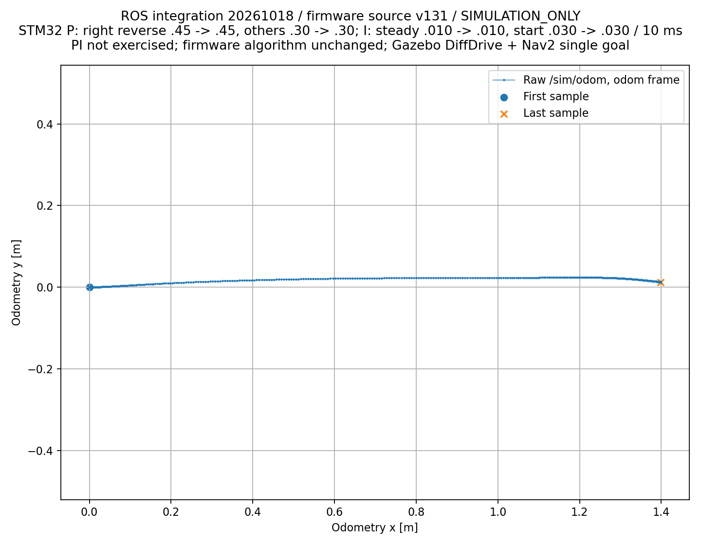

首轮静态检查将 Fortress 原生多顶层 GUI 配置误报为非法 XML，已修正检查器并保留首次 FAIL 与复测 PASS。实际运行保留 VMware/EGL 警告、唯一 goal checker 提示，以及成功后主动 SIGINT 关闭期间的 -2 退出记录；运行结果与关闭时间线可复核，测试自建进程组无遗留。

**原固件全套主机回归本轮未全通过**：27 个协议用例通过，Boot Guard 的 `test_current_built_images` 因新克隆目录没有 `out/app/app.bin` 报错，后续套件未继续。没有借用历史镜像或跳过检查改成成功；本机未配置原 Keil 构建环境，未重新构建/安装固件。与基线核对的 576 个原有固件/协议/控制台文件保持一致。

**结论：三包构建、软件测试与本轮实际单目标仿真通过；硬件桥、真实 C1、实车里程计/标定与运动尚未接通/验收。** 临时障碍、恢复、多目标、未知初始位置重定位、GUI 和长期稳定性没有在迁入仓库后重新验证；原工作空间历史结果不代替本轮证据。没有本轮实物 CSV/波形，未连接设备，也未降低硬件限速或停机保护。

[本轮工况与完整说明](evidence/ros2-integration-20261018/README.md) · [结果 JSON](evidence/ros2-integration-20261018/runtime_01/result.json) · [原始里程计 CSV](evidence/ros2-integration-20261018/runtime_01/odom.csv) · [原始安全命令 CSV](evidence/ros2-integration-20261018/runtime_01/safe_cmd_vel.csv) · [速度 SVG](evidence/ros2-integration-20261018/runtime_01/velocity.svg) · [完整运行日志](evidence/ros2-integration-20261018/runtime_01/launch.log) · [失败的固件回归日志](evidence/ros2-integration-20261018/firmware_tests_full.log) · [摘要](evidence/ros2-integration-20261018/summary.json) · [证据校验](evidence/ros2-integration-20261018/SHA256.json)。

---

## v127：MPU6050、导航外环与相对里程计的软件交付

**本轮只完成软件实现及离线验证，未连接设备、未烧录、未发送运动指令、未重启现有后台。P0–P5实物验收全部NOT_RUN。** 下面v125的波形仍是历史数据，不能代表v127。完整操作及协议见[MPU6050升级说明](MPU6050_UPGRADE.md)。

### 改动依据、参数前后与验证边界

当前工程PB10/PB11未分配，HAL I²C未启用，编码器已有累计位置。新增100Hz IMU采集、五秒静止校准、小倾角姿态解算、相对里程计、航向/转角外环、网关透传、网页及只读诊断采集。为避免新增遥测阻塞10ms控制，UART改为4槽异步队列；I²C直接启动当前HAL中断状态机，跳过公共Mem_IT启动函数内的BUSY自旋，5ms事务超时后有界恢复。

| 参数/算法 | v125 → v127 |
|---|---|
| 轮速P | 左轮双向/右轮正转0.30→0.30；右轮反转0.45→0.45 |
| 稳态I | 0.010→0.010，每10ms按电机轴rpm误差累加 |
| 低速启动I/释放策略 | 0.030→0.030，原启动增量/限幅和150/180释放策略保留 |
| 原轮速算法 | `drive.c`无改动；未实现交接中150ms短暂支撑假设 |
| 新外环 | 航向P=0、角速度阻尼=0默认只观察；转角模式要求非零P |
| 初始外环边界 | 0.6rad/s、1rad/s²；导航目标≤10rpm；动作最长15秒 |
| 姿态/定位算法 | 新增互补滤波tau=0.5s；转角增量权重gyro0.98/encoder0.02 |
| 参数前提 | 几何、安装方向、校准、原点均需确认；只接受现有36:1传动比 |
| 停机保护 | 原300ms控制心跳、100ms电机反馈保持；导航新增50ms IMU有效期 |

### 本轮结果

| 项目 | 结果及证据 |
|---|---|
| STM32 v127 App/Bootloader脚本构建 | PASS；App 22,152/47,104字节，静态RAM 10,856/20,480字节；Boot 3,744字节。静态RAM不等于实测栈高水位。[报告](evidence/imu-v127-20260920/stm32-build.json) |
| ESP32 PlatformIO构建 | PASS；Flash 802,161字节、RAM 93,608字节。[报告](evidence/imu-v127-20260920/esp32-build.json) |
| 离线C/Python/Node回归 | PASS；包含原PI、IMU解析/校准、编码器回绕/断流、里程计、导航重复包/心跳/停止、HAL替身故障、协议及网页回归。[完整输出](evidence/imu-v127-20260920/host-tests-full.log) |
| Edge真实浏览器+全部API替身 | PASS；离线禁用、导航心跳、IMU过期停车、移动布局、脚本错误0。[报告](evidence/imu-v127-20260920/browser-tests.json) |
| 安装、通信、电气和实物性能 | NOT_RUN；不能将构建或替身测试视为设备通过 |
| EIDE/Keil IDE、CubeMX重新生成 | 未实际执行；源列表与配置已同步 |

首份中间构建使用v126（App22,384字节），随后改进I²C启动路径和回归覆盖，最终另构建v127。初轮测试因串口测试桩仍假设同步发送而失败，保留[原始失败日志](evidence/imu-v127-20260920/initial-v126-tests.log)及[中间构建记录](evidence/imu-v127-20260920/initial-v126-build.json)；改为异步队列寿命、ACK预留槽及超时测试后完整通过。v126和v127均未安装。

### 实物波形与未完成项

本轮没有硬件CSV/JSON采样，因此没有可嵌入的v127实物波形；不使用模拟曲线或v125旧图替代。以下图片仅为浏览器替身测试截图，**不是姿态/控制精度或实物波形证据**。真实测试后必须在本节追加原始PNG/SVG并标注当轮实际P/I、外环参数和结论。

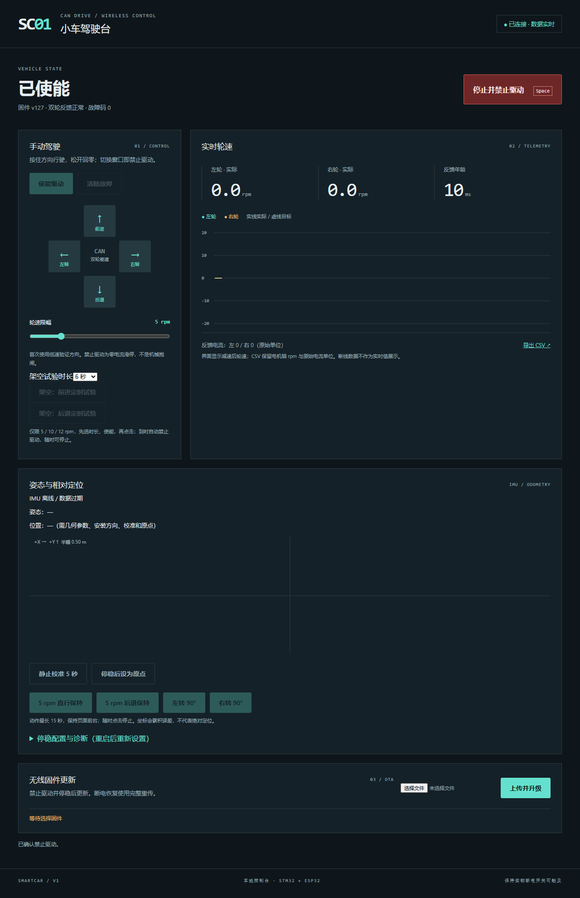

目前不能确认主控已从交接记录中的离线状态恢复。接下来先执行P0，再做IMU10分钟静止/总线故障测试，完成安装轴向及几何标定后逐阶段验证1米直行5次、左右90°各5次和闭合路径。精度目标仍为位置估计误差/横向偏移≤10cm、转角误差≤5°，没有放宽。

软件记录：[验证摘要](evidence/imu-v127-20260920/verification.json)、[实物待验矩阵CSV（非采样）](evidence/imu-v127-20260920/physical-acceptance.csv)、[源码/构建哈希](evidence/imu-v127-20260920/source-and-build-sha256.json)、[证据哈希](evidence/imu-v127-20260920/SHA256.json)。

---

## 以下为v125及更早的历史实物记录

**当前记录状态：v125复测停止正常、故障0且输出0，但高频记录再次发现右轮起转后停转；180释放上限未解决该现象。整体实物验收未完成。** 下文保留初始交付历史；调参部分按“参数前后值 → 算法与修改原因 → 原始波形 → 结果”直接穿插展示，不必跳到图表索引才能对照。

图中的点来自真实保存的采样，连线仅帮助阅读；没有绘图平滑或补造样本。v114以后实际轮速已是固件采用的约30ms角度差分结果，与早期C610原始速度字段不同，不能把两者的噪声差直接当成机械振动改善。

## 构建

| 项目 | 结果 |
|---|---|
| STM32 HAL App / Arm Compiler 6 | PASS，BIN 9,272 字节 / 47,104 字节上限 |
| Bootloader / Arm Compiler 6 | PASS，BIN 3,744 字节 / 16,384 字节上限 |
| App Keil MDK 工程 | PASS，0 errors / 0 warnings |
| Bootloader Keil MDK 工程 | PASS，0 errors / 0 warnings |
| ESP32 / PlatformIO | PASS，程序 792,921 字节，静态 RAM 91,848 字节 |
| OTA 包 | 版本 100，元数据 CRC / 程序 CRC / 初始栈 / 复位向量检查通过 |

命令行 armasm 提示旧汇编器弃用警告；编译和链接无错误。当前 ESP32 为无私密配置构建；正式上板前先配置 Wi-Fi 并重新构建。
脚本与 MDK 的优化选项可能导致二进制大小不同；正式出厂镜像与 OTA 包统一由 `tools/build.py` 生成。

## 离线测试

| 范围 | 结果 |
|---|---|
| C/Python 帧协议、超时、分包、CRC | 27 项通过 |
| 实际 C 启动校验模块 | 11 项通过，包含本次构建的真实 App 镜像 |
| 实际 C OTA 接收器 | 18 项通过 |
| 实际 C 固件缓存 | 15 项通过 |
| 实际 C ESP32 发送器连接实际 C STM32 接收器 | 14 项通过，App 身份适配为 SC01，版本 100+ |
| 电脑端会话、过期请求、错误包、运行中禁止上传 | 6 项通过 |
| 实际 C 运动控制核心 | 安全边界断言通过，999 个 PI 周期限幅验证通过 |
| Playwright + Edge | 桌面/窄屏布局、离线禁用、方向按压/松开、失焦停车、迟到 ARM 应答不能覆盖停止、升级结果均通过；页面脚本错误 0 |

合计 **91 项 Python 测试**，另有 C 控制程序和浏览器测试。浏览器运动/升级应答全部被测试路由拦截，不访问硬件。
早期遥测样本编解码仅保留在 `tests/legacy/` 供帧协议回归测试，新车不编译或使用巡线功能。

## 工程完整性

- 原工程 1,113 个记录文件逐一 SHA-256 比对，未改变；Git 修改状态与工作开始时一致。
- 新工程的两个 MDK 项目中引用的源文件均存在，全部位于新目录内。
- 扫描的 104 个 C/C++ 业务函数有中文前置注释；Python 业务工具函数有中文文档字符串。
- 自行编写的页面函数有中文说明；厂商 HAL/CMSIS 不批量改写。
- 新项目没有提交或推送 Git；没有复制原项目的 Wi-Fi 密码、令牌或旧 Flash 备份。
- CubeMX 当前配置已保留并调整；未实际运行 CubeMX 重新生成验收。

证据：`out/build_report.json`、`out/test_report.json`、`out/tests.log`、`out/ui_report.json`、`out/project_audit.json`、`out/keil-build.log`、`out/keil-boot-build.log`。
界面截图：`out/console-offline.png`、`out/console-mobile.png`。

## 下一次实物验收顺序

1. 确认新板 HSE/CAN 收发器、SWD 和 UART，电机断电时备份当前 Flash，再安装新版 Bootloader+App、ESP32 网关。
2. 验证上电禁止驱动、身份与遥测、无反馈时拒绝 ARM 和 OTA。
3. 架空驱动轮后给 C610 供电，确认静止反馈、ID 与正反方向，从最低轮速检查速度闭环。
4. 验证松开回零、禁止驱动滑停、关闭页面/Wi-Fi、断开 UART/CAN、故障清除和看门狗复位；测实际停车行为。
5. 静止状态无线更新真实 App，确认更新后仍禁止驱动；在新版固件上重做真实断电重传验收。

未完成这些步骤前，不把“构建通过”或“模拟测试通过”称为实车运行通过。

## 后续实物记录：ESP32 新网关已烧录

用户确认 USB 已连接、电机/C610 断电后，完成整片 4 MB Flash 备份及 verify_flash 校验，再写入含本机 Wi-Fi 配置的 SG01 固件，烧录 Hash 校验通过。实际地址 http://172.20.10.4，Wi-Fi、LittleFS、HTTP 正常。认证检查使用空正文，在转发 UART 前被参数校验拒绝，未发送运动命令。电脑控制台已重启并加载配置。

STM32 仍为 M2B2 Bootloader，尚未安装 SmartCar App；遥测 valid=false 属于当前预期，不能声称新版实车控制已通过。备份、构建、烧录及验收证据位于 out/flash_v1/。以上更新取代本文件开头关于 ESP32 尚未烧录的历史状态，STM32 待验收状态不变。

## 后续实物记录：STM32 Bootloader＋App v100 已安装

用户授权后，通过 ST-Link 读取两遍 64 KiB Flash，一致后备份。烧录前根据厂商 HAL_IWDG_Init 核对并修正看门狗初始化顺序：先启动 IWDG/LSI，再等待配置寄存器同步。重新构建并通过 91 项 Python 测试及 C 控制测试后，安装 factory 镜像。

烧录器校验通过；另完整读回 64 KiB，前 0xFC00 字节与 factory 精确一致，最后 1 KiB 参数页与原备份一致。SC01 / v100 App 运行时间持续增长，UART 错误计数 0；ESP32 与电脑控制台均收到真实遥测。电机/C610 按用户确认保持断电，反馈掩码 0，CAN 故障锁存（state=2/fault=3），双轮目标及输出为零；这不代表真实运动功能已验收。证据见 out/stm32_install_v1/acceptance.json 和该目录中的备份、读回及日志。

### 2026-09-18：使能后心跳超时排查

- 实物报告：点击使能后故障码 1，未切换页面；双轮反馈有效，输出为零。
- 修改前空控制包拒绝路径 16 次探测最高 355.2 ms（另一次 328.6 ms），不涉及 STM32 控制。
- ESP32 关闭 Wi-Fi modem sleep，USB 烧录与校验通过；修改后 30 次同类探测最高 123.6 ms，多数 20–70 ms。100 ms 保守余量检查未通过，不能作为完整控制验收。
- 网页收到使能应答后立即发首个零速心跳；保留 300 ms STM32 超时，不增加后台续命。
- node tests/test_first_heartbeat.cjs：旧代码失败，新代码通过；覆盖立即零速心跳及停止后迟到使能应答，不触达硬件。
- 实物使能后的连续心跳、运动及停机验证仍待用户复测；未自动使能或发送运动指令。

### 2026-09-18：重复故障 1，定位到遥测轮询饥饿

- 前两项优化后用户再次复现；带诊断记录的零速使能试验仍出现故障 1。
- 浏览器日志：telemetry_cancel valid=false,state=1,age=629,sequence=16。对应命令日志显示心跳已连续接受，随后网页因遥测过期主动停发。
- 根因之一：Console.poll 在控制锁被占用时跳过遥测，连续控制请求可饿死轮询。改为仅 uploading/installing 期间暂停，控制请求期间继续读遥测。
- 回归：python -B tests/test_console.py，旧代码 test_control_inflight_does_not_starve_telemetry 失败，修复后 8 项通过；上传/安装暂停轮询和不排队控制约束保留。首个心跳 Node 回归通过。
- 300 ms 心跳期限、遥测过期禁用及手动清故障均未放宽。控制时序诊断暂保留，日志只记录操作码、时序和应答，不记录凭据。
- 已部署电脑服务并刷新页面，等待用户完成本轮 5 秒零速使能复测。实物连续运动尚未验收。

- 后续实物复测：用户确认零速使能 5 秒无故障并已停止；命令记录和最终遥测复核通过（out/zero_speed_acceptance.json）。仅确认本次零速使能/停止，非持续运动或长时间网络可靠性验收。

### 2026-09-18：修正心跳跳过节拍后的额外等待

- 真实前进试验末尾再次故障 1：seq148 成功，seq149 请求耗时 213.4 ms，STM32 拒绝过期命令。
- 用虚拟时钟及真实网页控制函数重放 101/213 ms 请求：旧 setInterval 在 pending 时跳过节拍，模拟命令间隔超过 300 ms；旧代码测试失败。
- 改为单请求完成后按发送起点调度，短请求保持 100 ms 周期，慢请求完成即安排下一次；每次重新采集当前目标，不排队旧速度。
- 保留失焦/隐藏、过期遥测、停止/epoch、升级时的停发条件；不调整 STM32 的 300 ms 期限，不在服务器后台续命。
- node tests/test_heartbeat_timing.cjs、node tests/test_first_heartbeat.cjs、python -B tests/test_console.py（8 项）通过。
- 已刷新真实页面，等待用户 30 秒零速使能复测；本条不代表硬件稳定性验收。

- 串行调度修复后实物仍复现：seq31 请求耗时 610.2 ms，故障 1；未通过 30 秒测试。
- 后续 ESP32 HTTP 响应启用 TCP_NODELAY 与 keep-alive，电脑控制与遥测分别持久连接；请求失败只关闭连接，不自动重发。ESP32 构建、USB 写入校验通过。
- tests/test_gateway_connections.py：旧代码复用检查失败，新代码 2 项通过；覆盖通道隔离及错误不重试。控制台 8 项回归通过。
- 无效操作码（完整 16 字节、网关前置拒绝、不进入 UART）100 次测量：仅 1 条连接，平均 55.2 ms，最大 308.7 ms，4 次超过 100 ms。不能宣布无线链路稳定或恢复运动验收。
- 电脑 Wi-Fi 报告 2.4 GHz、信道 1、信号 62%；等待用户确认近距离无遮挡测试条件，继续无动作测量。

- 用户确认设备本已靠近路由器。并行 ICMP 探测 60 轮、600 ms 超时：PC→路由器超时 2 次，PC→ESP32 超时 3 次，其中 2 轮同时超时；不能仅归因于应用层调度，也不能把 ICMP 超时直接等同于所有业务包丢失。
- Windows 到 ESP32 最优路由为 WLAN 的 192.168.10.0/24 直连，不经默认虚拟接口；未修改系统代理或网卡设置。无线电源方案 AC 已为最高性能，DC 为中等节能。
- 已请用户让电脑改用同一路由器 5 GHz 或有线，ESP32 保持 2.4 GHz，用于隔离 PC 无线段影响；等待新网络下测量，问题仍未完成实物验收。

### 2026-09-18：速度心跳改为无应答阻塞的 UDP

- 5 GHz + TCP 持久连接测试曾连续约 80 秒正常，随后 seq779 等待应答约 486 ms 超时；STM32 后续遥测序号为 779，说明命令已收到但应答等待阻塞了续发。未将该轮误记为长期稳定。
- 改为 HTTP 负责 ARM/DISARM/CLEAR/OTA，UDP 3232 负责每个当前 SPEED 包；带原令牌、会话与序号，不自动补发或后台续命。STM32 固件及 300 ms 期限未变。
- 新增 control_datagram.c/h 的生产解析函数及 C 边界测试；主机 UDP 发送、不重试、不伪造应答测试通过；tools/test.py 完整主机回归通过。
- ESP32 新版构建、USB 烧录及 Flash 校验通过，/status 确认 udp-v1。当前部署 PC 服务 PID 9032（仅本次进程记录）。
- 正在进行用户零速使能验证：首个 40 秒窗口每帧有效、state=1/fault=0，STM32 实际序号 70→439。等待完整时长及停止确认，暂不宣布实物验收完成。

- UDP 持续测试最终失败：用户报告提前故障。网页 telemetry_cancel valid=false,state=1,age=607,sequence=958；PC 仍以约 100 ms 发出 seq960–964，STM32 最后接受序号 960，随后 fault=1、输出零。不能将 UDP 修改或首个 40 秒窗口作为稳定性通过结论。
- 当前仍有超过保护期限的通信中断；等待 PC 有线同路由器（ESP32 保持 Wi-Fi）或独立热点隔离测量。不放宽 300 ms 停机期限。运动起步差异调校仍暂停。

### 2026-09-18：手机热点隔离测试

- 用户在本机重新配置热点；ESP32 USB 重编译、烧录校验通过，DHCP 地址 172.20.10.4，电脑与配置的热点匹配，控制台地址已更新。
- 主控仍 fault=1、输出零；未自动使能。电脑无线为 2.4 GHz、信道 6，报告信号 85%。
- 2 分钟完整无效操作码探测（不进入 UART）：1194 次，0 错误，0 次超过 300 ms，最大 187.5 ms，平均 50.0 ms。原始记录见 out/last_hotspot_test.txt 对应目录 latency_120s.json。
- 已请用户进行热点下 2 分钟零速使能/停止测试，待真实序号与停止结果核对。

- 本轮热点实物验证通过：零速使能持续 142.86 秒，PC 发出 1337 个 UDP 心跳、控制请求无错误；采样窗口 STM32 state=1/fault=0、序号持续增长；最终 DISARM 获 MCU state=0/fault=0，应答后双轮反馈有效、输出零。证据：本轮热点目录 acceptance.json 与 telemetry_window1/2.json。结论仅限热点环境下本轮零速度保持与停止，原路由器环境及非零运动长期稳定性仍未通过。

### 起步基准：热点下 5 rpm 与 10 rpm

- 5 rpm：28 个非零目标样本，采样峰值左 14.83 rpm、右 15.58 rpm；相对首个目标样本，首次超过 1 rpm 为左约 600 ms、右约 700 ms。
- 10 rpm：19 个样本覆盖 2600 ms，采样峰值左 16.86 rpm、右 12.22 rpm；首次超过 1 rpm 为左约 300 ms、右约 200 ms。全段 fault=0；最终 state=0/fault=0，双轮输出零。
- 采样约 100–200 ms，以上不是精确起步时间；10 rpm 本次反而右先升速，不能据此固定增加右侧补偿或延迟左轮。两档都有明显超调，优先处理速度环阻尼与积分，再重新标定起步。
- 原始记录：out/startup_baseline_hotspot.csv/.json 与 out/startup_10rpm_hotspot.csv/.json。本轮只采集基准，尚未修改 PI 参数或宣称调校完成。

### v101 首轮速度环试调及 5 rpm 复测

- 比例增益由 0.4 调至 0.8，积分增量 0.03、电流限幅和全部超时保护保持不变；版本号 101。新增超速纠偏测试在旧参数失败、新参数通过；完整主机测试及构建通过。该测试不证明实物闭环稳定性。
- OTA 成功，9272 字节、73 块、0 重试，实际遥测 version=101。保留 out/tuning_v101 中的 v100 源文件和包；.ioc 与两个 MDK 工程文件构建前后相同。
- 用户反馈“已停止，感觉差别不大”。记录包含四段 5 rpm 指令，不能混为一次起步。首段 uptime 27500–30400 ms，22 个样本，采样峰值左 10.47、右 9.97 rpm；首次超过 1 rpm 相对首目标样本为左 400、右 500 ms。后续三段峰值分别为左/右 8.72/6.94、6.50/10.39、9.44/8.67 rpm，存在残留运动或积分影响，不作为独立冷启动对照。
- 与 v100 首轮 5 rpm 采样峰值 14.83/15.58 相比，本轮首段峰值降低，但仍约为目标两倍，起步一致性尚未解决；100–200 ms 采样和有限次数不足以宣称稳定改善。当前 DISARMED、fault=0、输出均为 0。
- 证据：out/tuning_v101/motion_5rpm.csv、motion_5rpm_summary.json、ota_result.json、startup.json。保留 v101 试验状态，下一步先验证 10 rpm，暂不叠加新参数修改。

- v101 完整 10 rpm 复测：uptime 355212–358014 ms，共 21 个非零目标样本，全部 fault=0；采样峰值左 13.72、右 14.17 rpm。对照 v100 的 16.86/12.22 rpm，左侧下降、右侧上升，不能认定整体超调改善。最后约 1 秒采样范围左 7.61–11.08、右 7.64–11.19 rpm，仍有波动。停止后 state=0/fault=0、目标/转速/输出均零。原始与汇总见 out/tuning_v101/motion_10rpm.csv 和 motion_10rpm_summary.json。当前 v101 为试调版，未验收；下一轮应检查积分积累及目标阶跃，不能继续仅提高比例增益。

### 串口故障及自动试验准备
- v101 故障 4：io_errors=1 持续不变，遥测新鲜，但清故障返回 no_control_ack。用户复位后故障清零，网页零速使能应答成功，实际遥测 state=1、序号增长、io_errors=0；随后通过网页停止。不能认定串口故障根因已解决。
- 已按用户授权添加架空三秒前进测试按钮，仅允许已使能、页面前台、新鲜遥测及 5/10 rpm；到时禁止驱动，失焦/异常遥测/超速取消，不自动重新使能。虚拟时钟定时退出和取消测试、既有首心跳及慢请求调度测试通过。
- 自动运动试验尚未执行。准备过程中遥测 uptime 从约 147 秒变成数秒，控制台曾短暂离线，正在确认是否用户手动复位；确认前不使能运动。证据 out/tuning_v101/post_reset_zero.json、post_reset_record.csv、post_reset_state.json。PI 参数仍为 v101，未调整。

- 用户确认准备期间的重启为手动复位。随后侧边网页使能并尝试三秒试验时故障 4 再现，未获得有效运动数据，已执行停止；暂停 PI 调参。
- v102 仅修复 UART 接收重挂失败后的主循环恢复，PI 保持 P=0.8、每周期积分增量 0.03。恢复丢弃残帧并保留故障锁定，不自动使能。HAL 发送初始化持锁与 RX 回调重挂有冲突窗口，但尚未用实物寄存器证明本次根因。
- tests/test_uart_recovery.py 使用生产回调和恢复函数，模拟 HAL 持锁：旧逻辑无法恢复（预期失败），新逻辑恢复通过；正在接收不重复重置、恢复保持 IRQ 屏蔽状态等检查通过。完整主机回归及构建通过，App 9344 字节。修复版 out/SmartCar-v102.ota 尚待安装，旧固件停止接收需用户复位后 OTA。备份 out/uart_recovery_v102。

- v102 已 OTA 安装并确认实际版本：9344 字节、73 块、0 重试。零速采样20帧及三秒 5 rpm 运动段（20帧）io_errors=0；运动段全部 fault=0，采样峰值左278/36=7.72、右268/36=7.44 rpm。参数未变且启动条件不同，不能将峰值下降归因于 UART 修复或调参。
- 自动停止后约 uptime58813 ms 出现 fault=3，已零输出。原因尚未确认（CAN 邮箱重入发送、FIFO 溢出/总线错误均需区分），不继续运动。随后网页清故障得到成功应答，实际 state=0/fault=0/output=0/io_errors=0；串口目前可正常控制，但未验证真实 UART 故障注入后的恢复。证据 out/uart_recovery_v102/ota_result.json、zero_test.json、motion5.csv、final_state.json。PID 自动整定仍未完成。

### v102 三轮自动启停复测
- 用户报告手动停止未发生 CAN 异常，并授权继续测试。使用侧边控制台固定三秒前进：5 rpm 两轮、10 rpm 一轮，均自动停止；各20个运动样本均fault=0，各轮停止后state=0/fault=0/output=0/io_errors=0。最后实际双轮转速0。
- 5 rpm 两轮采样峰值左/右分别7.72/8.25、10.86/8.14 rpm；10 rpm为13.11/12.03 rpm。低速起步重复性和超调仍需改善，三轮不能证明偶发 CAN 异常已根治。未改 CAN 保护或 PI 参数。
- 证据 out/retest_v102/round1.csv、round2.csv、round3.csv、各轮_state.json及summary.json。当前保持禁止驱动。

### v103 积分增量减半试调
- 仅将每10ms积分增量系数0.03改为0.015，P=0.8、限幅、通信保护及v102接收恢复保持不变。完整主机回归、UART锁冲突恢复测试、固件构建通过；OTA9344字节/73块/0重试，实际版本103。旧版代码和OTA包保留out/tuning_v103。
- 自动三秒5rpm：19帧，采样峰值左7.42/右7.44rpm，首次超过1rpm相对首目标帧约600/500ms；后段左4.36–6.69、右3.47–7.25rpm。
- 自动三秒10rpm：21帧，采样峰值左13.42/右13.25rpm，首次超过1rpm约200/500ms；后段左8.03–12.31、右8.06–12.11rpm。两轮试验全部fault=0；最终DISARMED、目标/转速/输出全零、io_errors=0。
- 对照v102：5rpm峰值较低，但10rpm峰值未改善，单次且约100–200ms采样不足以确定稳定改善。保留v103试调状态，未宣称PID整定完成。证据out/tuning_v103/motion.csv、summary.json、final_state.json、ota_result.json。

## 自动调参：参数、算法与波形逐轮对照

本阶段仍为架空短时试验。稳态参考门槛为平均轮速误差≤0.5rpm、标准差≤1rpm，并重复验证5/10rpm及起停；只有曲线好看不能算通过。

**参数如何读：** `error = 目标电机轴rpm − 反馈电机轴rpm`，每个约10ms周期执行 `积分 += I × error`，`输出 = P × error + 积分`。这里I已经包含周期尺度，不是连续时间Ki。全程D=0，积分限幅±1200，输出限幅±2000；本阶段没有加入固定死区补偿或速度前馈，300ms命令超时保护未放宽。`I=0.010/0.050`表示按条件选用两个积分系数，不是左右轮不同参数。

**历史源码对应关系：** `tuning_vN/drive.c`及`.before`多为“改成N之前”的备份，必须结合配套`drive.h`的`DRIVE_VERSION`识别。例如v107源码在`tuning_v108`，v108在`tuning_v109`，v109在`tuning_v110`，v111在`tuning_v112`；v114/v115分别由`tuning_v115/drive.c.before`、`tuning_v116/drive.c.before`核对。其余结合保留的迭代记录和当前生产代码核对，不把目录名当编译版本。

| 版本 | P：修改前 → 本版 | I：修改前 → 本版（每周期） | 是否改变速度算法 |
|---|---|---|---|
| v107 | 0.7 → 0.3 | 0 → 0.010 | 恢复PI，未新增补偿 |
| v108 | 0.3 → 0.6 | 0.010 → 常规0.010、反向释放0.050 | 是：快速释放积分 |
| v109 | 0.6 → 0.6 | 仍0.010/0.050 | 是：收紧快速释放触发条件 |
| v110 | 0.6 → 0.3 | 仍0.010/0.050 | 否：只降P |
| v111 | 0.3 → 0.3 | 仍0.010/0.050 | 否：只加控制周期诊断 |
| v112 | 0.3 → 0.3 | 仍0.010/0.050 | 是：起转时削减过大的积分至±150 |
| v113 | 0.3 → 0.3 | 仍0.010/0.050 | 否：只加编码器角度诊断 |
| v114 | 0.3 → 0.3 | 仍0.010/0.050 | 是：闭环反馈改为约30ms角度差分 |
| v115 | 0.3 → 0.3 | 0.010/0.050 → 统一0.010 | 是：取消额外快速释放 |
| v116 | 0.3 → 0.3 | 0.010 → 0.010 | 是：起转由限积分改为限PI总输出 |
| v117 | 0.3 → 0.3 | 0.010 → 0.010 | 否：移除临时诊断 |
| v118 | 0.3 → 0.3 | 0.010 → 0.010 | 否：只修UART收发竞争，见后文 |

### v107：恢复积分，降低比例增益

**参数：P 0.7→0.3，I 0→0.010。** 前一版纯P低速输出可能不足以起转；恢复积分以消除静差，同时降低P。没有新增死区补偿、前馈或测速算法。

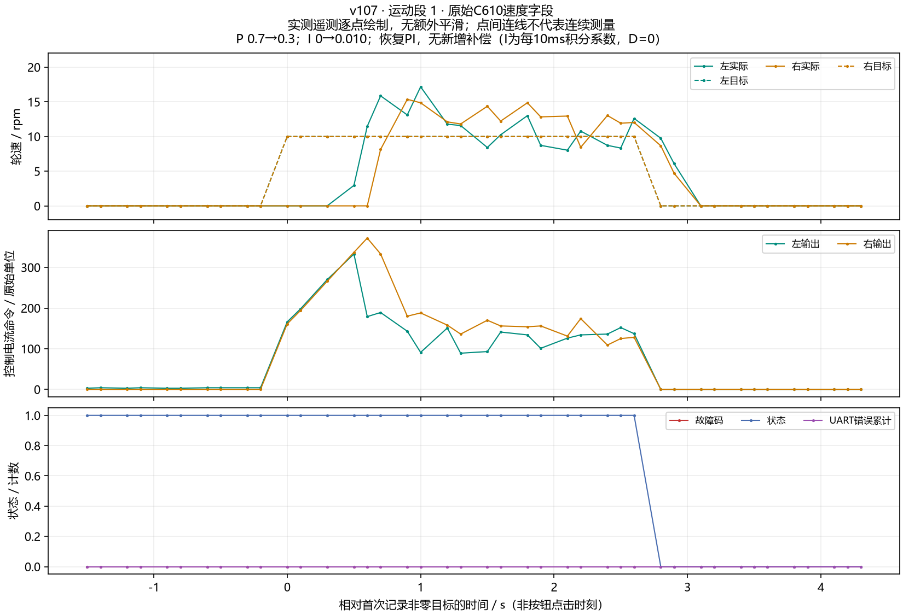

**看图结论：** 10rpm短测峰值左17.17/右15.36rpm，后1.5秒均值9.87/12.52、标准差1.79/1.72。恢复积分后能起转，但超调与波动仍大，**未通过**。构建、主机测试和OTA通过不能替代运动通过。

### v108：增大P，并尝试快速释放积分

**参数：P 0.3→0.6；I由统一0.010改为常规0.010、误差与积分反向时0.050。算法有改动。** 目的是超速时更快纠偏、减少起步积累的积分；此处是积分释放策略，不是D项或前馈。

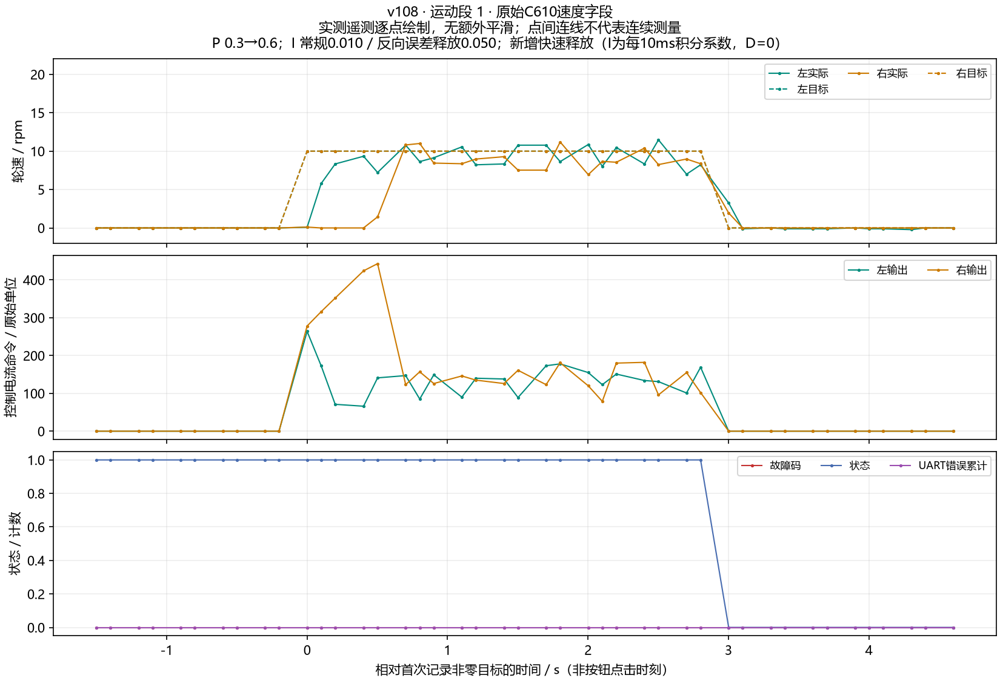

**对照v107：** 峰值降到左11.47/右11.19rpm，但后1.5秒均值9.46/8.64、标准差1.49/1.24，右轮持续偏慢。说明“释放更快”并不等于稳态更好，**未通过**；下一版收紧释放条件。

### v109：只在大幅超速时快速释放

**参数：P=0.6不变；I仍为0.010/0.050，改的是选择条件。** 只有`误差×积分<0`、`|误差|>36电机rpm`且`|误差|>目标幅值的50%`才用0.050，其余统一0.010。目的是避免目标附近反复快速泄放导致偏慢。试验从3秒延长到6秒；正负小误差积分对称性测试通过。

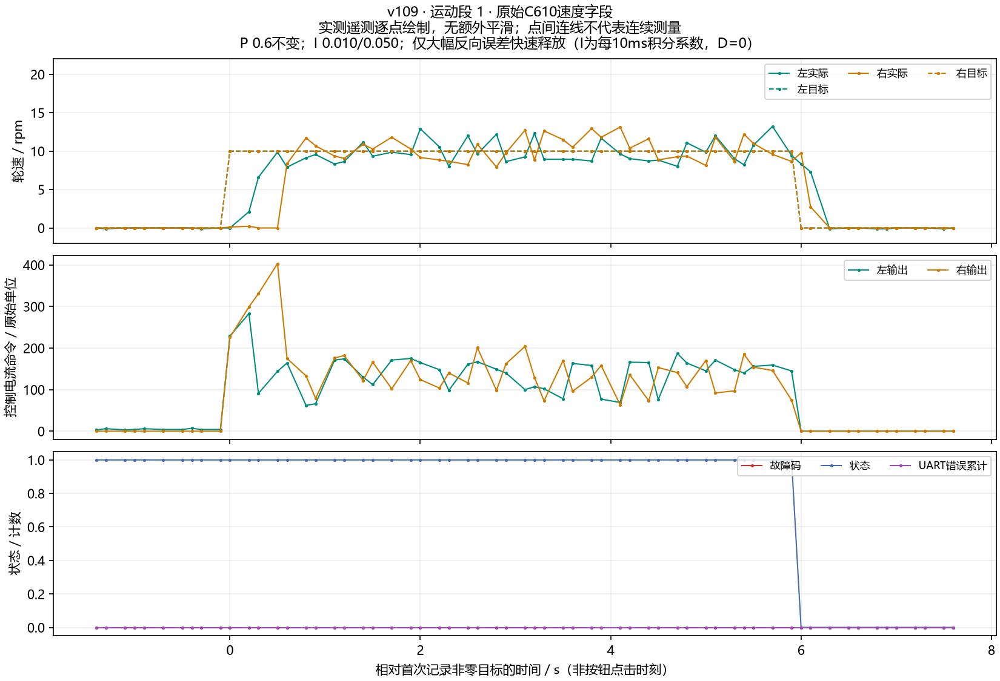

**看图结论：** 后3秒左均值9.83/标准差1.44，右10.68/1.61，峰值13.22/13.14rpm。仍有明显波动，**未通过**。

### v110：仅降低P，验证是否由比例项放大波动

**参数：P 0.6→0.3；I及v109释放条件完全不变。没有新增算法。** 这是单参数对照，目的是检查较小P能否减小速度反馈波动带来的电流变化。

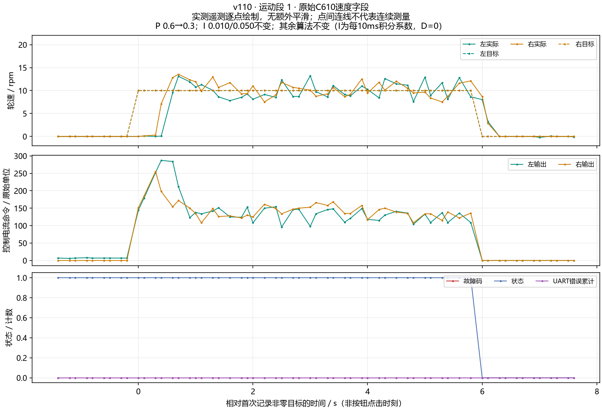

**对照v109：** 后3秒左均值10.33/标准差1.76，右10.03/1.40，峰值13.22/13.56rpm，改善不一致，**未通过**。因此不能继续仅凭低频遥测盲调P/I，转而记录控制周期数据。两版本停止后均零输出、无故障。

### v111：不调参数，捕获起步积分积累

**参数：P=0.3、I=0.010/0.050，沿用v110条件。速度控制算法未改。** 只增加RAM内最近128个控制周期的诊断记录，停机后导出，避免在运动时持续导出扰动串口。

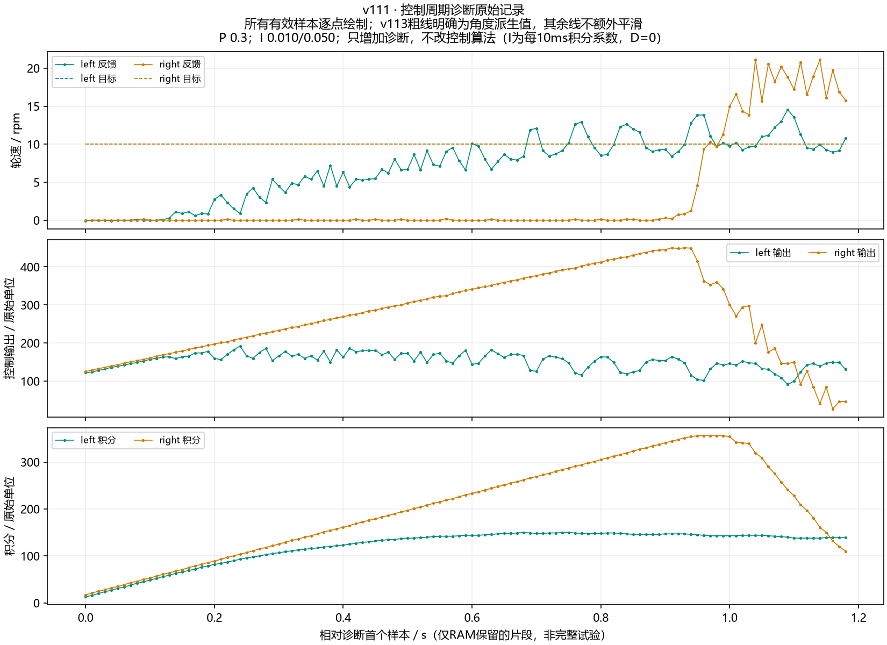

**看图结论：** 记录119帧/1180ms，协议错误0。右轮起转前积分约350，起转后峰值759电机rpm，即21.08轮rpm，网页触发超过20rpm停止条件。这是**提前停止的失败试验**，不是完整稳态波形。图仅覆盖诊断片段。

### v112：起转后削减过大的积分

**参数：P=0.3、I=0.010/0.050不变。算法有改动：** 新起步/换向标记置位，首次同方向速度达到36电机rpm（1轮rpm）时，将过大的历史积分削减至±150，再恢复普通积分。没有额外施加起转电流；同目标心跳不重复触发。

下图是同版保存的末段控制周期诊断，不是另一轮完整起步：

**对照v111：** 本轮能完成6秒，峰值左13.61/右12.53rpm；后3秒均值10.29/9.95、标准差1.61/1.43，仍**未达稳态门槛**。128个诊断周期dt约10–11ms，原始速度标准差1.68/1.52rpm；说明需要独立核对速度估计，不能把全部起伏都当机械振荡。起转标记、心跳不重复触发及完整主机回归通过；停止后fault=0、io_errors=0。

### v113：不调P/I，用编码器角度核对测速噪声

**参数：P=0.3、I=0.010/0.050，起转积分限幅±150，均不变。速度控制算法未改。** 只增加角度诊断，离线计算约30ms角度差分，与同一时段C610原始速度比较。

**看图结论：** 同段C610原始速度标准差约左1.66/右1.56rpm；角度差分为0.35/0.48，均值约10.12/10.04。派生曲线更平滑是**测量方法差异的证据**，尚不是控制改善证据。下一版才把角度差分用于真实闭环。原始计算记录：`out/tuning_v113/angle_analysis.json`。

### v114：把角度差分反馈用于实际闭环

**参数：P=0.3、I=0.010/0.050，起转积分限幅±150不变。算法有改动：** C610原始RPM反馈改为编码器角度展开后约30ms差分速度；窗口预热/断流时回退原始RPM，CAN新鲜度仍取真实接收时间。并非仅修改网页曲线。回绕、正反转、预热和断流恢复测试通过。

先看10rpm两轮：

**10rpm结果：** 两轮后3秒均值约9.98–10.07rpm，标准差0.34–0.53rpm，明显接近稳态目标。但这不能代替5rpm验证。

下面保留全部三轮5rpm，特别是第1轮右轮停转后再次冲起，不删除失败段：

**本版结论：未通过。** 5rpm第1轮右轮稳定段均值1.62、标准差4.36rpm、峰值17.31；另一次左轮也有较大过渡波动。诊断中匀速积分约120–140，结合快速泄放策略，下一步检验是否过量削减了维持低速转动所需的电流。

### v115：取消五倍积分释放，保持对称PI

**参数：P=0.3不变；I从常规0.010/快速0.050改为所有误差统一0.010。算法有改动：** 删除快速泄放分支，仍保留v112起转积分限幅和v114角度差分。目的不是盲目增大I，而是避免超调后过量泄放导致停转。

**对照v114失败段：** 后3秒左右均值5.02/5.05、标准差0.44/0.33rpm，稳态改善；但启动峰值8.56/9.83rpm仍高。**单轮不算验收完成**，继续修正起转总输出。对称积分及安全回归通过，未改电流/超时保护。

### v116：起转时限制总输出，而不仅限制积分

**参数：P=0.3、I=0.010不变。算法有改动：** 起转时积分上限由固定±150改为`limit = sign(目标)×150 − P×error`，仅削减过大的积分；然后仍执行本拍正常积分。因此当拍总输出约为±150，可能多出本拍I增量，并非严格150硬限幅。这样把比例项也算入起转控制，避免P项与残留积分叠加冲起。

首先保留这次因网页请求失败、约2秒就停止的无效验收段：

随后三轮完整5rpm：

再回归10rpm：

**看图结论：** 三次完整5rpm后3秒均值4.64–5.14、标准差0.36–0.56；10rpm均值10.01/10.02、标准差0.39/0.31。稳态改善，但低速起步仍存在延迟差与超调；不能称为两轮完全同步。完整试验结束均零输出、无故障。

### v117：参数不变，移除诊断后重复验证

**参数：P=0.3、I=0.010，测速及起转总输出算法均与v116相同。没有新增速度算法优化。** 只移除临时诊断缓冲和停机导出，目的是用清理后的程序重复验收。完整主机回归通过，App10208字节，OTA80块/0重试，实际版本117。

10rpm三轮全部展示：

**10rpm结果：** 后3秒均值9.81–10.10、标准差0.30–0.56rpm，峰值不超过11.23rpm。

5rpm两轮完整记录：

**5rpm结果：** 后3秒均值4.89–5.09、标准差0.31–0.45rpm，起步峰值最高7.31rpm。完整运动段fault=0，停止后目标/输出/速度归零。

**同测速方法下的修改方向对照：** 左图v114（P=0.3、I=0.010/0.050、起转只限积分），右图v117（P=0.3、I=0.010、起转计入P后限制总输出）；两者都用约30ms角度差分。因为中间改了两项策略，这张图不能独立证明某一项贡献；分步结果见上方v115、v116。

最后一轮5rpm尚未运动就发生故障1，必须与成功波形一起保留：

**故障与验收边界：** uptime209921ms仍ARMED、目标0、接收序号14；210121ms序号仍14；210321ms进入FAULT、输出0。记录中存在约620ms读取间隔，尚未区分浏览器/本机调度与无线丢包。显式停止已确认，未放宽300ms租期。**稳态改善，整体未验收完成**；第三轮5rpm未完成，起步同步、落地载荷、反向及长期运行均未由这些架空短测证明。原始记录、统计、OTA结果保留在`out/tuning_v117/`，图对应的只读快照在本页末尾的归档索引。

### v118：UART发送抢锁修复与零速观察（2026-09-18实测，09-19补齐图表）

**参数：P=0.3→0.3、I=0.010→0.010、D=0，均未改变。速度算法没有新增优化；改的是通信并发处理。** 保留约30ms角度差分和起转PI总输出限制。下面将修复前的UART故障与修复后的零目标观察穿插展示；它们不是运动性能对比。

- 先检查本地HTTP链路：旧服务使用HTTP/1.0、每次响应关闭连接；100次只读查询最高约28ms，未丢遥测。改为HTTP/1.1复用连接并关闭Nagle，真实本地TCP测试由失败转为通过。此项只证明消除了连接重建，不能证明间歇故障1已根治。
- 改完HTTP后，v117零目标观察在22.106秒记录窗口末端出现故障4：219个轮询快照、141个不同MCU时间点，UART错误由0变1，所有记录目标/控制输出均0，遥测未失效。对应[故障波形](evidence/2026-09-19/v117_UART故障观察.png)。

**修改原因和实现：** 用生产收发函数复现HAL发送初始化持锁时接收中断重挂返回BUSY；测试修复前失败。v118只在HAL_UART_Transmit_IT初始化阶段短暂屏蔽中断，随后恢复；等待完成期间继续排空CAN，保留8ms发送超时，超时撤销发送并计错。速度算法仍与v117相同。竞争注入、超时撤销及CAN服务测试通过，完整主机回归与构建通过；OTA实际版本118、10160字节、80块、0重试，原记录见 `out/tuning_v118/ota_result.json`。

- v118保存的零目标观察覆盖MCU uptime31103–90917ms，共59.814秒、593个轮询快照、385个不同MCU时间点；接收序号127→685，所有记录fault=0、io_errors=0、遥测有效，目标/速度/控制输出均0。对应[一分钟零速波形](evidence/2026-09-19/v118_一分钟零速观察.png)。这不是593个独立的MCU采样，也不是运动曲线验收。

**看图结论：** 保存窗口内未再出现UART错误；该短时结果不足以证明长期故障已根治。随后发现ESP32网络超时，网页撤销本地控制并尝试停止，返回连接被重置；最后缓存快照uptime139821ms、目标/速度/输出0、UART错误0，但已过期，不能证明断线后的实时状态。该段没有完整连续数据保存，不补造波形，不计作通过。09-19本地服务已重启且网页HTTP200，ESP32仍超时。
- **当前验收仍未完成**：v118尚无保存的运动试验，不能拿v117图证明v118运动已通过；还需网络恢复后的重复低速运动、起步同步及链路稳定性验证。没有放宽300ms控制租期、电流限幅或故障锁定。
- 工程观察补充：EIDE源清单曾在补入 `angle_speed.c` 后再次被写回，原因未最终确认；此前“已加入EIDE”不代表其导入状态长期有效。脚本和MDK包含该源文件，EIDE独立编译仍需复核。本次补档没有更改控制固件或重新驱动车轮。

### 真实波形补档与今后验收要求（2026-09-19）

### v118重新接线后的静止检查（2026-09-19 15:50起）

**P=0.3→0.3，I=0.010→0.010，D=0；未修改控制算法或固件。** ESP32重新联网后地址从172.20.10.4变为172.20.10.2，已修正本机配置。随后STM32恢复v118有效遥测，双轮反馈齐全。初次读数fault=0；之后保存的10.4秒静止记录中，50个不同MCU时间点全部为故障3，输出始终为0。故障发生瞬间未被这段记录覆盖，不能由图定位触发原因。

核对代码，故障3包含发送邮箱未清空、发送/接收HAL调用失败、总线关闭或接收FIFO溢出等路径；当前遥测未提供细分原因。保存现场后仅发送一次清故障命令，没有使能或发送运动目标。应答为禁止驱动、fault=0。随后100个有效轮询样本中的第一个仍是清除前缓存（uptime161200ms、fault=3），从161400ms开始到181900ms均为fault=0；这20.5秒内未观察到复发，不应把首个旧样本误判为清除后再次故障。

**结论：短时静止通信恢复，CAN故障根因尚未确定，运动验收仍待完成。** 没有用静止数据判断PID稳定性，也没有放宽保护。[原始数据与SHA256清单](evidence/2026-09-19-reconnect/manifest.json)；操作应答保存在`out/reconnect_v118_20260919_155026/clear_result.json`。运动试验等待当前架空状态确认。

### 波形归档规则

### v118重新接线后的5rpm运动复测（2026-09-19）

用户确认车轮架空、人在旁边后，通过驾驶台执行三轮6秒前进试验，每轮自动禁止驱动后检查零输出。**P=0.3、I=0.010未改，约30ms角度差分及一次性起转PI总输出限制未改。** 三轮运动段均fault=0；以下为全部三轮，不筛选较好结果。

第一轮后3秒左/右均值4.99/5.26rpm，标准差0.41/1.07rpm，右轮启动峰值约17.2rpm。**未通过稳定性要求。** 输出曲线中右轮在停转期间曾短暂回落，随后重新积累；仅凭低频遥测不能证明内部起转标志的切换时刻。

第二轮后3秒均值5.00/4.94rpm，标准差0.35/0.47rpm。

第三轮后3秒均值4.97/4.97rpm，标准差0.35/0.46rpm。后两轮稳态达标不抵消第一轮失败。[原始数据清单](evidence/v118-retest-20260919/manifest.json)。数据同时包含之前静止故障3，不能把该故障记作三轮运动期间新发生。

### v119：停转后重新启用起转保护（2026-09-19实物验证）

**P=0.3→0.3，I=0.010→0.010，D=0。算法有改动：** 非零目标下，已经退出起转保护的车轮持续100ms低于绝对轮速0.5rpm，则重新启用下一次起转的积分削减；短暂低速不重置。仍使用原来同方向达到1rpm的触发条件和约±150起转PI总输出处理，不新增固定死区电流或速度前馈，不放宽通信期限及输出限幅。

依据是生产C模块注入“短暂起转→停住超过100ms→再次起转”的正反向测试：v118在第二次起转保留过大积分，新增断言失败；修改后通过，短时低速不削减稳态积分的用例也通过。这证明代码存在该缺口，**并不单独证明它就是第一轮实物峰值的唯一原因**；需安装后保持同工况对照。

软件全量回归及构建通过；App10248字节，OTA81块、0重试，实际运行版本119。编译只出现旧armasm弃用警告。安装后沿用同一页面6秒试验，不发送独立后台运动心跳。下面三轮为全部5rpm试验。

| 5rpm轮次 | 后3秒均值 左/右 rpm | 标准差 左/右 rpm | 全段峰值 左/右 rpm | 首次达到1rpm的时间 左/右 s |
|---|---|---|---|---|
| 1 | 4.92 / 5.15 | 0.37 / 0.38 | 6.50 / 5.83 | 1.6 / 0.9 |
| 2 | 5.05 / 5.15 | 0.47 / 0.34 | 6.86 / 6.69 | 1.5 / 1.8 |
| 3 | 4.96 / 4.93 | 0.42 / 0.52 | 6.58 / 7.64 | 1.9 / 2.2 |

起步时间相对首个非零目标遥测样本，受遥测采样间隔限制。三轮均满足均值误差≤0.5rpm、标准差≤1rpm的既定稳态标准；相比本轮v118第一轮右轮约17.2rpm，本组三轮最大峰值7.64rpm，但工况重复不能穷尽静摩擦变化，不能声称峰值已被严格保证或两轮同步。低速启动仍有0.3–0.7秒差异。

10rpm第一轮后3秒均值9.99/10.03rpm，标准差0.36/0.31rpm，无故障并自动停止。第二轮刚使能、仍为零目标时发生故障1，未点击前进，立即显式停止。因此没有第二、第三轮10rpm成功数据。

**通信证据：** uptime165105ms和165205ms均为ARMED、接收序号14；165405ms进入故障1，序号仍14，目标/输出均0。遥测仍在更新、UART错误为0。该记录证明控制续期中断，不能区分浏览器调度、本机转发、无线UDP丢包或接收端原因；未放宽300ms期限。最后读回state=FAULT、fault=1、双轮反馈齐全、输出0。

**本轮结论：速度稳态与启动峰值有所改善，但自动调参目标尚未完成。** 接下来需要定位心跳中断并完成重复回归；不能靠继续修改PI解决通信故障。P/I未改，算法差异与证据均在本节。[原始CSV与SHA256](evidence/v119-20260919/manifest.json)、[逐轮统计](evidence/v119-20260919/measurements.json)；安装与软件测试日志在`out/tuning_v119/`。

### 通用波形归档规则

### 心跳定位：本机转发记录与零目标复现

左右轮已是独立PI状态，当前共同P=0.3、I=0.010；本次没有更改PI或STM32固件。v119三轮起步先后次序会变化，因此没有直接固定增大某一侧参数。

本机控制台增加有限的2000条控制诊断记录，通过`/api/control_trace`导出：接收时间、请求年龄、会话/序号、目标、调用耗时、返回或异常。记录不包含认证令牌和页面owner；UDP的`sent_unconfirmed`保持原义，不当作STM32收到。它用于将本机发送序号与实测遥测序号对照，不在后台续发运动命令。

新增控制记录用例在修改前失败，修改后通过；10项控制测试和真实本地HTTP处理器测试通过。**重启服务被工具自动审批策略拦截，诊断代码尚未加载到实际服务，未进行本轮硬件复现，无新实测波形，也不宣称心跳已修复。** 需恢复服务后在零目标使能状态复现，再决定修复位置。

**后续实测更新：用户手动重启后已确认诊断接口加载。** v119、P=0.3、I=0.010及所有控制算法均未改，只使能零目标。首段150个有效轮询样本正常，之后捕获遥测过期：最后缓存uptime883318ms、序号641、age680ms、valid=false。电脑在此期间继续正常发送至646，整段相邻发送最大间隔126.4ms，无发送异常；恢复后的新鲜STM32遥测为fault=1、sequence=646。这说明STM32确实收到末尾646，本次证据不支持“电脑没有发出末尾心跳”的解释；页面在遥测失效后停发，随后租期到期，符合现有保护行为。

点击停止得到应答；恢复遥测确认故障锁定、目标/输出0。独立连接随后80次只读请求全部成功、最长106.9ms，故障未在探测窗口复发；不能据此认为已根治。**待定位的是遥测间歇超时/链路恢复，不能通过改变左右PI或放宽300ms租期解决。** 这次未进行新的非零目标试验，没有修改STM32固件。[实测原始记录与哈希](evidence/v119-heartbeat-20260919/manifest.json)，复绘脚本`out/heartbeat_v119/plot_trace.py`。

### 遥测超时对照探测与90秒零目标观察

**P=0.3→0.3、I=0.010→0.010，算法及固件未改变。** 路由查询确认172.20.10.2通过WLAN直连；用户确认热点手机就在旁边，不能仅凭系统报告的信号53%/RSSI−76dBm认定距离是根因。12次ICMP探测无丢包、9–65ms。

独立持久HTTP连接（请求超时0.8秒，仅测试工具使用；运行控制台仍为0.2秒）完成400次只读请求，0错误，最大171.25ms；同步USB记录67条状态。另有120个控制台快照全部有效。本窗口没有复现此前中断，也没有证明延长请求超时能解决问题。

随后仅清故障、使能零目标，同步采集90秒：427个控制台轮询快照全部有效、fault=0、输出0；USB持续输出90条联网状态。到时显式停止，最终读回state=0、fault=0、输出0。

**结论：本轮未复现，心跳问题仍未根治。** 本轮未更改PI、通信阈值、网络配置或固件，不把正常窗口替代前一轮失败证据。尚需在异常发生期间捕获HTTP处理/USB状态，进一步区分Wi-Fi延迟与HTTP连接服务问题。[原始数据与SHA256](evidence/v119-linkprobe-20260919/manifest.json)，复绘脚本`out/heartbeat_v119/plot_link_probe.py`。

### 归档索引与说明

### v120：加快低速启动积分，缩小起步差

**参数前后：P=0.3→0.3；稳态I=0.010→0.010；5–10rpm未起转阶段I=0.010→0.030，D=0。** 每10ms启动积分增量限制±6，启动PI输出限制±450；同方向轮速达到1rpm后退出启动加速并沿用约±150起转积分削减，恢复稳态PI。v119的持续低速100ms重新启用起转保护仍保留，通信期限及通用输出限幅不变。两轮各自执行自己的PI状态，不固定增强某一侧。超出5–10rpm范围使用原逻辑。

**修改依据：** v119在5rpm下静止时输出约每秒增加180，实际起转前输出约190–420且左右顺序会变，缓慢积分把阈值差变成明显时间差。本版把低速起步累积加快，而不是提高已经较稳定的稳态I。生产C新增正反向启动、启动输出限幅和起转后恢复稳态增益测试：修改前启动速度断言失败，修改后全量软件回归通过。构建App10464字节，OTA82块、0重试，页面及遥测确认v120；仅旧armasm弃用警告。

五次均为同一手机热点、车轮架空、5rpm前进6秒后自动禁止驱动，无通信/CAN故障，停止后读回零目标、零速度、零输出。

| 轮次 | 首次达到1rpm 左/右 s | 起步差 s | 峰值 左/右 rpm | 后3秒均值 左/右 rpm | 后3秒标准差 左/右 rpm |
|---|---|---|---|---|---|
| 1 | 0.4 / 0.6 | 0.2 | 5.83 / 7.22 | 4.99 / 5.04 | 0.40 / 0.38 |
| 2 | 0.7 / 0.9 | 0.2 | 8.31 / 7.17 | 4.96 / 4.10 | 0.38 / 2.11 |
| 3 | 0.6 / 0.7 | 0.1 | 6.97 / 6.47 | 4.89 / 5.01 | 0.37 / 0.35 |
| 4 | 0.5 / 0.8 | 0.3 | 6.31 / 7.97 | 5.02 / 4.93 | 0.44 / 0.39 |
| 5 | 0.6 / 0.4 | 0.2 | 5.97 / 5.97 | 5.08 / 5.00 | 0.39 / 0.40 |

时间相对首个非零目标遥测样本，采样间隔约100–200ms，因此不是高精度机械同步测量。v119三轮差值为0.7/0.3/0.3秒，v120五轮为0.2/0.2/0.1/0.3/0.2秒；组间示例数量不同，不能保证未来每次都在此范围。第五轮右轮先动，不支持固定加大右侧I。

第二轮右轮在起转后及约4秒处出现停转再起；虽无故障码，但右轮均值误差与标准差不合格，不能算通过。

**结论：起步等待及先后差明显缩小，尚未完全同步；五轮中一轮低速运行不稳定，整体未通过。** 本轮没有10rpm及反向实物回归，不能由软件测试推定这些工况通过。下一步需解决间歇低速停转并继续验证起步重复性。[原始CSV与哈希](evidence/v120-20260919/manifest.json)、[逐轮稳态统计](evidence/v120-20260919/measurements.json)，起步统计`out/tuning_v120/startup_summary.json`，改前源码、构建/测试日志及安装结果位于`out/tuning_v120/`。

### v121：针对右轮反转抖动的单变量试验（首轮整体未改善）

用户截图对应12rpm，不是5rpm：先左轮正转、右轮反转，再双轮反转。v120末3秒统计中，双轮反转时左轮标准差0.256rpm，右轮0.706rpm、平均−11.785rpm；此前右轮正转12rpm标准差0.232rpm。右轮反转平均控制输出约−183，正转约142，提示方向差异，但尚不能由遥测确认机械原因。

**参数：仅右轮反转P 0.30→0.45；左轮双向及右轮正转P仍0.30；稳态I 0.010→0.010（每10ms积分，误差为电机轴rpm），D=0。** 两轮原本已有独立积分。此版引入按轮/目标方向选择P，未加死区补偿、前馈或额外滤波；5–10rpm启动积分0.030、增量上限6、输出上限450及起转释放策略沿用v120。启动限幅计算同步使用实际P，避免增益变更突破原限值。

试验假设为增强瞬时纠偏可降低右轮反转波动，并非已证实根因。验收用12rpm双轮后退、末3秒原始速度标准差与均值比较，同时检查起步、停止、故障；一次变好不等于稳定通过，需重复及正转回归。若波动加大则撤回该参数。

以下均为**修改前v120**真实原始数据，保留短段，不当作v121效果：

短时前进仅0.601秒，不能评价稳态。P0.30、稳态I0.010，算法同v120。

左+12/右−12rpm段，右轮末3秒标准差0.520rpm；P0.30、稳态I0.010。

双轮−12rpm段，右轮标准差0.706rpm，后续对照基线；P0.30、稳态I0.010。图保留约30ms角度差分反馈的实际遥测点，没有绘图平滑；绘图范围修正为±22rpm，防止负转速被裁掉，并按目标变更拆分运动段。

[原始窗口CSV与SHA256](evidence/v121-before-20260919/manifest.json)、[分段统计](evidence/v121-before-20260919/measurements.json)。完整未裁剪导出保存在`out/tuning_v121/before.csv`，本次窗口是MCU时间794000–832000ms原样行，未删除异常点。源码备份和测试/构建日志同目录。

软件测试通过（含超时、反馈、输出限幅、右轮反转纠偏及正转对称回归）；App10512字节，构建通过。无线安装83块、零重试，报告运行版本121。

**修改后首轮：右轮反转P0.45，I0.010；其余策略如上。** 用户操作后回复“已停止，差不多”。实际非零目标持续9.302秒，共66点，无故障。最后3秒右轮标准差0.164rpm，看似较好，但去掉前3秒后的整个运行区间标准差为0.673rpm，对比v120同样口径0.670rpm，几乎相同；范围−14.361至−10.056rpm，对比v120的−14.139至−10.889rpm。两次持续时间不同，仅为初步对照，仍需重复。

**结论：不能依据末3秒片段宣称改善；用户主观观察与全运行区间统计一致，本轮整体未通过。** [修改后原始CSV及SHA256](evidence/v121-after-20260919/manifest.json)、[末3秒及起步后全区间统计](evidence/v121-after-20260919/measurements.json)。统计JSON的`left/right`为末3秒，`after_startup_3s`为排除前3秒后的全部有效样本，包含样本数、均值、标准差、最小/最大值；后续绘图自动同时保存，短于3秒则为null，不伪造稳态。下一步先重复同参数后退，确认是否持续存在同样波动，避免一次试验后连续叠加参数造成归因困难。

#### v121自动重复：两轮短时后退趋稳，长时间与低速仍待验证

为固定工况，网页定时试验增加“后退6秒后停止”和12rpm档。仍由前台网页发送原有心跳，未改后端或固件保护，不自动重新使能；定时停止、手动停止、失焦/陈旧遥测、锁定试验速度及非法方向测试通过。两次均读回禁止驱动、目标/速度/输出0，故障0、UART错误0。

参数均为v121：右轮反转P0.45、其余P0.30，稳态I0.010/10ms；控制算法没有继续改变。统计均排除前3秒，原始波形仍包含起步与停止。

第二轮记录5.802秒、41点：右轮均值−11.990rpm，标准差0.189rpm；左轮标准差0.323rpm。本轮右轮运行后段较稳。

第三轮记录5.900秒、42点：右轮均值−11.930rpm，标准差0.175rpm；左轮标准差0.201rpm。本轮后段也较稳。

**边界：这两次短时重复比首轮好，但不能抹掉首轮0.673rpm波动，也不能证明长时间、5rpm起步或正向均通过。** 当前保留v121继续扩大实物验证，不继续叠加参数。首轮手动持续9.302秒，自动轮为6秒，时长不同，尚缺相同时长的前后重复对照。[三轮累计原始数据与SHA256](evidence/v121-repeats3-20260919/manifest.json)、[全部分段统计](evidence/v121-repeats3-20260919/measurements.json)；自动停机读回`out/tuning_v121/auto_stop.json`及`auto_stop3.json`。

#### v121低速双向回归：未停转，但反向启动超调仍大

同一架空条件、自动6秒停止。参数不改：右轮反转P0.45，其他P0.30；稳态I0.010、5–10rpm启动I0.030，D0，算法沿用v121。两次均无故障、UART错误0，结束后读回禁止驱动、双轮输出/速度/目标0。

后退：首次超过同方向1rpm分别0.5/0.7秒，峰值7.806/8.444rpm；起步3秒后均值−4.938/−5.057rpm，标准差0.347/0.325rpm。未观测到1秒后低于0.5rpm的停转，但反向起步超调明显，不能算启动质量通过。

前进：首次超过1rpm分别0.6/0.8秒，峰值5.694/6.667rpm；起步3秒后均值5.057/5.115rpm，标准差0.311/0.409rpm，无观测到的低速停转。此工况P仍0.30，与v120相同，不能把这次表现归功于右轮反转P调整。

**本轮结论：两次起步差约0.2秒，但低速反向超调仍未解决。** 时间从首个非零目标遥测计算，采样间隔约100–200ms，不能作精密同步结论。当前保留失败证据，下一步需要限制尚未起转阶段累积的冲量，并验证是否重新引入停转或加大起步差；不使用绘图滤波掩盖超调。持续运行仍未验收。[全部原始快照与SHA256](evidence/v121-low-both-20260919/manifest.json)、[统计](evidence/v121-low-both-20260919/measurements.json)，起步明细`out/tuning_v121/low_both_startup.json`。

### v122：提前退出启动增益（两轮初测，未通过整体验收）

**P不变：右轮反转0.45、其余0.30；I不变：稳态0.010、5–10rpm启动0.030/10ms，D0。算法唯一调整为启动退出阈值从同方向1rpm降到0.5rpm**，并相应收窄加速积分区间；现有启动输出上限450、起转释放总输出约150、低速100ms重启保护及通信保护均不变。目的是减少起转后仍继续累积启动积分的时间，风险是过早释放导致再停转，必须实测验证。

新阈值边界测试在v121失败，在v122及完整测试通过；包含阈值以下不退出、反向反馈不误判、正负阈值退出与输出限幅。软件测试不能证明真实超调改善。构建App10512字节通过，无线安装83块零重试，实际版本122。源码备份、测试/构建与安装结果在`out/tuning_v122/`。

反向5rpm：左/右首次超过1rpm时间0.6/0.8秒、峰值5.583/7.111rpm；对比v121同向峰值7.806/8.444rpm，本次下降。起步3秒后标准差0.274/0.324rpm，没有观测到1秒后的低速停转。**右轮仍有约42%峰值超调，且仅单轮，不能判定解决。**

正向5rpm：起步0.6/0.9秒、峰值5.889/7.139rpm；对比v121正向5.694/6.667rpm，未改善。起步3秒后标准差0.305/0.384rpm，未观测停转。两次自动6秒后均禁止驱动、速度/目标/输出0、故障及UART错误0。**反向改善不能替代正向验收，下一步需要重复确认差异；当前保留试验版，不宣称整体稳定。**

[原始CSV及SHA256](evidence/v122-20260919/manifest.json)、[稳态统计](evidence/v122-20260919/measurements.json)，起步明细`out/tuning_v122/startup.json`。图片无额外滤波，记录遥测约100–200ms采样的可见峰值，真实连续峰值可能更高。

#### v122重复试验：出现起转后停转，提前释放方案否决

仍为右轮反转P0.45/其余P0.30、稳态I0.010/启动I0.030，退出阈值0.5rpm；没有继续改参，重复架空5rpm双向各6秒。

第3段后退两轮首次超过1rpm均为0.8秒，但右轮1.1秒反馈0rpm，左轮1.5/1.7秒反馈0/−0.028rpm，随后再次起转；峰值左7.139、右5.750rpm。虽末段标准差仅0.289/0.366rpm，**起步后停转使该算法不能接受，末段平稳不能覆盖失败。**

第4段前进：起步0.3/0.7秒，峰值5.806/6.472rpm，没有观察到1秒后低速停转，稳态标准差0.394/0.381rpm。两次故障0、UART错误0、自动停机确认输出0，属于控制性能问题而非通信故障。

**处理：拒绝0.5rpm提前释放策略，v123恢复1rpm门槛，其余P/I及策略不变（控制行为回到v121）。** 这只能撤回本轮风险，不能宣称原来的抖动和超调已解决。测试增加0.5rpm仍保留启动状态、1rpm才释放的边界覆盖。

[四轮完整数据及SHA256](evidence/v122-repeats-20260919/manifest.json)、[统计](evidence/v122-repeats-20260919/measurements.json)，起步/停转明细`out/tuning_v122/repeats_startup.json`。因控制反馈来自约30ms角度差分，且遥测间隔约100–200ms，不能精确推断停转持续时间，但实际已有近零反馈，足以判定未通过。

v123完整软件测试与构建通过，App10512字节；无线安装83块零重试，设备报告实际版本123。安装后先保持禁止驱动；本版后续实测波形见下文。日志及安装结果在`out/tuning_v123/`。

### v123：12rpm双向各20秒持续运行

控制参数与v121一致：右轮反转P0.45/其余0.30，稳态I0.010、启动I0.030/10ms，起转释放阈值恢复1rpm，D0；本轮没有再改固件算法。网页增加6/20秒时长选择，启动时固定截止时间，不允许中途更改延长；20秒边界、非法时长、原有心跳/停止回归测试通过。试验仍依赖前台网页心跳，未替失联用户续发命令。

后退实录19.800秒、139点。排除前3秒后左右均值−11.982/−11.986rpm、标准差0.284/0.225rpm；右轮范围−12.417至−11.389rpm。本次没有复现v121首轮中途较大波动。

前进实录19.905秒、138点。排除前3秒后左右均值11.986/11.999rpm、标准差0.277/0.305rpm；右轮范围10.944至13.056rpm。均值接近目标，仍有瞬时偏差，不能用均值掩盖。

两轮故障0、UART错误0，均由网页计时自动禁止驱动，末次读回双轮目标/速度/输出0。**仅证明本轮12rpm双向20秒运行较稳，不证明更长运行、5rpm启动或落地性能通过。低速启动超调与先后差仍需继续处理。** [原始数据及SHA256](evidence/v123-both20-20260919/manifest.json)、[全区间与末段统计](evidence/v123-both20-20260919/measurements.json)；额外只读轮询快照在`out/tuning_v123/watch20.json`和`watch20_forward.json`。

### v124：起步控制周期诊断，确认起转后支撑不足与超调并存

**控制参数不变：P右轮反转0.45/其他0.30，I稳态0.010/启动0.030每10ms，D0；控制算法同v123。** 新增诊断：仅保存运动最初256拍，冻结后不覆盖，禁止驱动/故障且输出0时每20ms导出一条，不在运动中发送诊断。记录包含目标、角度差分速度、输出、积分（截断整数）及启动标志；不改变测速方式。旧版末段环形记录会覆盖起步，因此改为保存开头。

缓冲区实际生产函数测试覆盖首256拍冻结、运动时禁止导出、零输出门槛、导出间隔及新运动重置；USB解码器校验CRC并拒绝损坏/截断帧。完整软件测试与构建通过，App10728字节、RAM9360字节/20480上限；OTA84块零重试，设备实际v124。源码备份、测试程序、日志和安装结果在`out/tuning_v124/`。

5rpm后退6秒，成功采集256条、CRC错误0，相邻控制周期10–13ms。首次超过同方向1rpm：左420ms、右440ms（该次相差20ms，仅代表本次）。左轮570ms达到−6.972rpm；右轮440ms起转释放，810ms附近再进入启动状态，840ms再退出，说明起转后再次接近停转。第一次释放两轮输出均约−151；右轮再启动时约−206。此数据支持“起转后固定压到150可能支撑不足”的下一步假设，但还不能排除机械阻力变化，需单变量验证。

该次故障0、UART错误0，6秒后自动禁止驱动、目标/速度/输出0。**记录了真实的低速性能问题，没有修好或验收通过。** 高频图仅覆盖最初约2.56秒，不替代完整遥测；控制速度本身仍为约30ms角度差分，不能称为未经处理的传感器速度。[高频原始USB字节和JSON及SHA256](evidence/v124-startup-20260919/manifest.json)、[完整遥测及SHA256](evidence/v124-telemetry-20260919/manifest.json)。

### v125：右轮低速反转起转支撑150→180（首轮含停止通信故障）

**P/I均不变：右反P0.45/其他0.30，稳态I0.010/启动I0.030每10ms，D0。** 仅右轮反转且目标绝对值≤10rpm时，将起转积分削减对应的总输出上限150提高到180；不是最低电流补偿，不强制抬高已有较低积分。左轮及其他工况仍150，保护不变。测试覆盖180上限和不强制加电流、原有超时/输出限制；App10776字节构建通过，85块零重试安装v125。

5rpm后退本轮256条控制周期记录、CRC错误0：左轮470ms首次超过1rpm，峰值7.250rpm；右轮440ms起转，释放后输出−181，峰值6.083rpm，前256拍没有再次进入启动状态。对比v124右轮释放−151后再次起动，本轮初步支持提高支撑，但峰值也由5.583增至6.083rpm，仅单次不能宣称解决。左轮未改仍有超调。

本轮约6秒附近故障1，目标/输出归零，UART错误0。页面显示“设备忙，请停止操作后重试；已停止发送运动心跳”；服务器最后已记录命令为序号115，与STM32接收序号一致，此后无已记录停止请求。服务器忙锁拒绝发生在诊断日志入口之前，**停止请求可能被锁竞争拒绝，仍需复现验证**；不能归因于PID。当前保持故障锁定、不自动清故障续测，先处理停止请求可靠性。末3秒右轮标准差0.282rpm不代表完整验收通过。

[高频原始USB/JSON与哈希](evidence/v125-startup-20260919/manifest.json)、[完整CSV与哈希](evidence/v125-telemetry-20260919/manifest.json)。实际停止快照、控制请求记录、起步事件在`out/tuning_v125/stop.json`、`control_trace.json`、`analysis.json`。**本轮有机械响应改善迹象，但发生通信故障，整体未通过。**

#### v125配套网页：仅停止遇忙有限重试

本轮未改STM32固件、P/I或运动算法，仍为v125；仅网页停止遇到明确“设备忙”错误时最多提交3次、间隔40ms，每次使用新停止时间戳。其他错误、使能、运动心跳及清故障均不重试。重试不是总时延保证：网络请求本身仍可能超时，STM32原300ms保护继续兜底，不延长租期。

真实网页命令函数在假HTTP忙响应下复现旧行为（一次后失败）；修复后覆盖两次忙后成功、持续忙最多三次、零速度载荷、新时间戳、非停止不重试。定时停止、20秒上限及原有心跳测试通过。页面已刷新加载，不重启后台服务。

本轮没有使能或运动。真实停止请求序号119得到ACK、result0，约52.15ms；双轮速度/目标/输出0，保留原故障1锁存（图中故障1不是新故障）。这验证了正常停止路径，**硬件上的忙锁碰撞尚未受控复现，不能称为心跳问题根治或运动验收通过。** [原始观测、控制请求及失败/通过测试日志与SHA256](evidence/v125-stop-retry-20260919/manifest.json)。

#### v125停止修复后复测：停止正常，右轮再停转仍存在

先清故障并做零目标使能观察，保存30次只读快照：故障0、输出0；随后停止确认，再运行5rpm后退6秒。P/I及算法均同v125，网页使用仅停止遇忙有限重试修复。

256条有效控制周期、CRC错误0：左轮441ms起转、峰值5.889rpm；右轮210ms起转、峰值6.639rpm，360ms再次进入启动状态。**180释放上限仍未消除右轮二次启动，不能通过。** 高频细节：右轮200ms输出−191，210ms速度−38电机轴rpm、输出−178、积分−114；230ms速度−117，输出降至−144，随后260–350ms速度接近零，输出逐步增至−217。首次起转时积分尚小，180上限基本未执行削减，故继续单纯提高上限并不能解决本次现象。需要研究起转后的短暂支撑与比例项回落，不能直接归咎于积分被截断。

本轮自动停止收到ACK，序号108，约54.94ms；新运动段故障0、UART错误0，停止后目标/速度/输出0。起步3秒后左右标准差0.283/0.348rpm，仍不能覆盖启动失败。累计CSV中包含上一轮故障1，那是保留的历史，不是本轮新故障。[高频原始数据](evidence/v125-retest-startup-20260919/manifest.json)、[完整CSV及哈希](evidence/v125-retest-20260919/manifest.json)，零目标观测、停止ACK、事件统计在`out/tuning_v125/retest/`。本次没有受控制造硬件忙锁，不能由一次正常停止宣称停止问题永久解决。

### 历史索引

- [完整图表索引](evidence/2026-09-19/README.md)：覆盖v107–v118已有数据，包含所有已识别运动段、提前停止段、零目标故障、控制周期诊断及零速观察；PNG用于直接查看，SVG用于放大导出。输入原样保存在同目录 `raw/`，`manifest.json`记录原路径与SHA256。
- 先看[5rpm修改前后对照](evidence/2026-09-19/comparison_5rpm_v114_v117.png)：同为角度差分反馈，展示v114停转再冲起与v117趋稳的实测示例；图中仍可见起步时间差。不是把两段示例当成全部通过证据，其余重复和失败段均在完整索引。
- 图像由历史实测记录重绘，不是当时屏幕截图，也不是新做的实物试验。采样点之间连线只是帮助阅读；超过350ms的遥测缺口断开，不插值补齐。未对遥测曲线额外平滑或剔除异常点。
- v114起“实际轮速”字段为固件闭环使用的约30ms角度差分速度，不能称为未经处理的C610原始RPM。v113诊断图同时显示原始RPM和明确标注的角度派生值，用来解释改动依据；控制周期诊断只覆盖保存的短片段。
- 此后每轮修复按[验收证据流程](ACCEPTANCE_WORKFLOW.md)保存修改原因、版本/参数、完整原始数据、前后波形和通过/未通过结论；失败段同样保留。没有数据或硬件未连通时标记待验证，不使用前版图替代本版证据。

## 2026-09-19：GitHub仓库整理与离线复核

本轮是归档，不是调参修复：源码仍v125，P右轮反转0.45→0.45/其他0.30→0.30，I稳态0.010→0.010/启动0.030→0.030，D0，控制算法不变；没有烧录或新增实物运动，因此不生成或借用前版波形作为本轮实物证据。

STM32 App/Bootloader脚本构建、主机C/Python测试及首心跳、心跳时序、定时试验、停止遇忙重试四组Node测试通过。54份已归档原始快照的SHA256匹配。原有实测图仍嵌在各版本正文，失败记录保留。

[本轮验证报告、原始日志与归档校验](evidence/repository-20260919/README.md) · [当前进度](PROGRESS.md) · [PID调试导航](PID_TUNING.md)。没有对低速二次启动或整车实物验收作通过结论。上文“没有提交或推送Git”属于初始交付历史，本轮开始建立独立GitHub项目归档。

## 2026-09-21：v127 首次 OTA 安装与静止通信检查

用户授权升级，使用已构建 v127 包（SHA256 `828c0bf75244bf3c5697321ae43b0d5fbfb046c80e45d1179fd007bf74a8fa2d`），未重建、未修改控制源码。升级前 v125：禁止驱动、故障0、双侧反馈存在、目标/速度/输出均0。用户此前报告车体悬空；本轮未独立确认电机电源是否物理断开，在线反馈不可作为断电证明。未发送运动、解锁或校准命令。

OTA 返回 PASS，22152 字节、174 块、0 重试、5185 ms；重启后实时遥测确认运行 v127。保存全部30次升级后轮询（含可能重复设备样本），均为禁止驱动、故障0、目标/速度/输出0。安装期间暂停遥测，未采集连续跨重启波形，不插值补齐。

P右轮反转0.45→0.45、其他0.30→0.30；I稳态0.010→0.010、启动0.030→0.030，10ms控制周期，积分基于电机轴rpm误差每控制拍累计。轮速PI/启动算法未改；v127增加IMU、导航、定位及调度支持。图仅证明本次短时静止通信状态，不证明运动性能改善。升级前单次快照保留于 before.json，不构造对照运动波形。

**结论：STM32安装与重启后通信通过；MPU6050采集、校准、姿态和运动精度待验证。** 当前网关 `/telemetry` 未返回 imu_wire 等IMU字段，网页IMU无效，需继续核对并同步ESP32网关固件，不能据此判定传感器损坏。

[原始JSON](evidence/v127-install-20260921/after.json) · [CSV](evidence/v127-install-20260921/after.csv) · [SVG](evidence/v127-install-20260921/stationary.svg) · [安装结果](evidence/v127-install-20260921/install-result.json) · [SHA256](evidence/v127-install-20260921/SHA256.json)。

## 2026-09-21：ESP32网关同步与IMU通信异常记录

构建标识 esp32-imu-20260921，STM32仍v127。首次nobuild上传因工具清理旧构建产物而失败，未写入设备；随后同一源码构建通过，RAM93608字节、Flash802161字节。COM3上传成功，Flash写入哈希校验通过，自动重启后网页收到IMU协议字段。构建和上传完整日志及固件SHA256见本轮目录；未保存含私人联网信息的固件到公开证据目录。

P右轮反转0.45→0.45、其余0.30→0.30；I稳态0.010→0.010、启动0.030→0.030，10ms周期，基于电机轴rpm误差每拍累计；轮速PI、IMU算法均未修改，仅安装支持IMU遥测的网关。升级前网关没有IMU字段，升级后IMU消息传输有效，但传感器sequence=0、identity=0、valid=false，I2C错误234→239。原始零值是无效占位，不代表测得姿态或温度。

当前电机反馈丢失、故障3（CAN），目标/输出均0；未发送运动、解锁、清故障或校准指令。用户报告悬空，本轮未独立确认供电变化。结论：ESP32安装与IMU消息转发通过，传感器采集失败，接线/供电及I2C原因待查，不宣称校准或整车验收通过。50次轮询完整保留，可能重复设备样本；升级期间缺测未补造。

[原始JSON](evidence/esp32-imu-install-20260921/telemetry.json) · [CSV](evidence/esp32-imu-install-20260921/telemetry.csv) · [SVG](evidence/esp32-imu-install-20260921/diagnostic.svg) · [SHA256](evidence/esp32-imu-install-20260921/SHA256.json)。

## 2026-09-21：v128 单目标坐标导航（仅软件）

用户报告STM32 3.3V轨异常升至4.6V，本轮按要求只修改软件：未访问硬件、未烧录、未重启现场服务、未发运动命令。保留此前v127安装证据及用户文件。新增“转向目标→接近→到位停稳→禁止驱动”状态机、op9及网页坐标输入；无障碍场地直达，不支持避障。

轮速P右轮反转0.45→0.45/其余0.30→0.30，I稳态0.010→0.010/启动0.030→0.030，10ms控制周期，积分按电机轴rpm误差每拍累计；轮速PI和启动算法不变。新坐标外环仿真参数P2、阻尼0.1、角速度限幅0.6rad/s、变化率1rad/s²、融合0.98、巡航3rpm、半径0.05m、左右轮径0.1m/轮距0.3m。上述几何及增益仅测试夹具值，未应用到设备，不能当作实测标定参数。

仿真使用真实生产C外环和编码器积分，六个目标均进入估计半径并停稳后禁止驱动。图显示全部记录点、不平滑，不是实物CSV或实测波形；硬件异常期间没有本版物理测试数据，实车精度、低速二次起转、打滑、停距均待验证，不借用前版图宣布通过。故障测试含重复命令、非法范围、无进展、总超时、IMU断流、心跳丢失、取消及完成后旧心跳拒绝。

主机测试通过；真实浏览器隔离API替身测试坐标输入、op9/心跳、缺测停车及移动布局通过。修正了点击动作恰逢心跳在途时无提示的问题，现在明确提示稍后再点，不排队或自动重发。STM32 App23632/47104字节、静态RAM10888/20480字节；Bootloader3744字节；ESP32构建通过。保持App地址0x08004000及原Bootloader布局。构建通过不代表安装成功或实物验收。

[功能和参数说明](COORDINATE_NAVIGATION.md) · [仿真CSV](evidence/coordinate-v128-20260921/simulation.csv) · [SVG](evidence/coordinate-v128-20260921/simulation.svg) · [结果JSON](evidence/coordinate-v128-20260921/summary.json) · [测试日志](evidence/coordinate-v128-20260921/tests.log) · [文件校验](evidence/coordinate-v128-20260921/SHA256.json)。

## 2026-09-23：v130 BSP分层（仅离线验证）

当前PCB硬件操作迁入BSP_can/BSP_uart/BSP_i2c/BSP_system；业务层保留电机映射、协议优先级、采样/超时策略、校准及导航。P右轮反转0.45→0.45/其余0.30→0.30，I稳态0.010→0.010/启动0.030→0.030，10ms周期；轮速PI、起步、姿态和导航算法未修改。控制心跳300ms、电机反馈100ms、IMU50ms保护保持。

主机测试通过，覆盖BSP层依赖边界、CAN帧/邮箱/错误、I2C忙线/5ms超时/重试、UART发送持锁竞争/接收恢复及原有控制测试。测试夹具曾因I2C宏与新MSP参数同名导致类型冲突，修正替身命名后通过，未修改实机引脚或降低检查标准。最终构建v130 App24024/47104字节、静态RAM10896/20480字节、Bootloader3744字节；v129为未安装中间构建。MDK/EIDE源列表及构建入口已同步；CubeMX再生成未执行。

本轮未连接设备、未烧录、未发运动命令。没有本版实物CSV或波形，不用仿真或前版图代替；硬件供电维修及BSP实物回归均待验证。详细边界见[BSP说明](BSP.md)，[构建/测试与仿真一致性报告](evidence/bsp-v130-20260923/verification.json)、[测试日志](evidence/bsp-v130-20260923/tests.log)、[SHA256](evidence/bsp-v130-20260923/SHA256.json)。

## 2026-10-10：v131 ICM-42688-P驱动替换（仅软件，实物待验证）

用户已决定使用ICM-42688-P并确认沿用I²C2 PB10/PB11。本轮阅读本地DS-000347 v1.2手册与STC I²C/SPI/姿态示例，按寄存器手册重写设备服务。替换原因是用户更换芯片；旧MPU寄存器、DRDY bit0、数据顺序与温度公式不适用于ICM。示例中的固定0x69、无限身份循环、未传播ACK错误、关闭传感器误称复位与mg/g单位差异不能直接迁入小车主循环。

新增BANK0与0x47身份识别、0x68/0x69有界尝试、真正软件复位和RESET_DONE确认、配置读回、非阻塞启动等待、DRDY bit3门控、温度在前的14字节读取与ICM换算。保持±4g/±500dps和100Hz；ICM二阶UI低通约19.2Hz，旧MPU配置为20Hz，两种硬件滤波器不宣称等效。启用陀螺仪后等50ms，覆盖手册200µs禁写与45ms最短开启要求；事务5ms超时、故障1秒再试。运行失败失效样本/姿态/校准并清零偏，恢复不自动续动。

**P右反0.45→0.45、其余0.30→0.30；I稳态0.010→0.010、启动0.030→0.030每10ms，D0，电机轴rpm误差每控制拍积分。** 轮速PI、启动策略、导航、姿态互补融合/校准算法未改，传感器初始化、数据排列、换算、硬件低通和故障清零偏策略改变。原300ms用户心跳、100ms电机反馈及50ms IMU新鲜度保护保持。`drive.c`、`navigation.c`、`BSP_i2c.c`与本轮开始时SHA256一致，坐标仿真CSV与v128归档逐字节一致。

图中P/I前后均如上未改，算法标注见图标题。数据来自真实驱动+BSP在主机HAL替身中运行，不是ICM测量或车辆波形。包含未就绪、新样本、60ms无DRDY、五秒校准、移动拒绝和注入I²C错误。结果验证了程序在指定注入输入下的门控、换算、校准与失效路径；**不证明实际芯片通信、漂移、震动表现或小车性能改善**。传感器时间戳仍为MCU读完成时刻，非芯片硬件时间戳。所有点原样保存，不平滑、插值或删异常。

此图P右反0.45→0.45/其余0.30→0.30，I稳态0.010→0.010/启动0.030→0.030每10ms；轮速/融合算法未变，仅驱动与换算改变。显示错误身份、配置不符、复位未完成、BUSY/5ms超时、0x8000无效样本和校准断流；999ms未记录区间断线，没有补点。NACK切换0x69、时基回绕、SDA低及运行错误等额外场景同样保留在CSV。图中的错误和重启来自主动注入，符合测试预期，**不是实物故障诊断结果**。

修改前v130完整主机回归通过；修改后v131完整回归及STM32 App/Bootloader构建通过。首次专用测试编译因测试夹具`0x1e+2`被C词法当作数值后缀失败，补空格后通过；失败记录保留。App24304/47104字节、静态RAM10896/20480字节，Bootloader3744字节；仅有现有汇编器A1950W弃用警告。MDK/EIDE源列表已同步，HAL/`.ioc`保留；生成`out/SmartCar-v131.ota`（24336字节），未安装。

本轮未连接现场硬件、未查询网关、未重启服务、未下载软件、未烧录或发送运动。架空/落地、供电、接线、网络以及模块实际排针本轮未测；主控恢复和供电维修未新增结论。没有本版真实传感器/小车CSV或实物波形；上图仅软件注入，不借用前版实测图作v131证据。

**结论：驱动实现、主机回归、构建通过；STM32安装、ICM身份/有效采样/轴向/校准/漂移、停止保护实物回归与导航精度均待验证。低速右轮二次起转问题仍未解决。**

[新接线与驱动说明](ICM42688_UPGRADE.md) · [修改前依据](evidence/icm42688-v131-20261010/before.json) · [结果/硬件边界](evidence/icm42688-v131-20261010/verification.json) · [全部注入CSV](evidence/icm42688-v131-20261010/driver-trace.csv) · [运行SVG](evidence/icm42688-v131-20261010/driver-trace.svg) · [故障SVG](evidence/icm42688-v131-20261010/driver-failures.svg) · [完整测试日志](evidence/icm42688-v131-20261010/tests-full.log) · [构建报告](evidence/icm42688-v131-20261010/build.json) · [SHA256](evidence/icm42688-v131-20261010/SHA256.json)。
