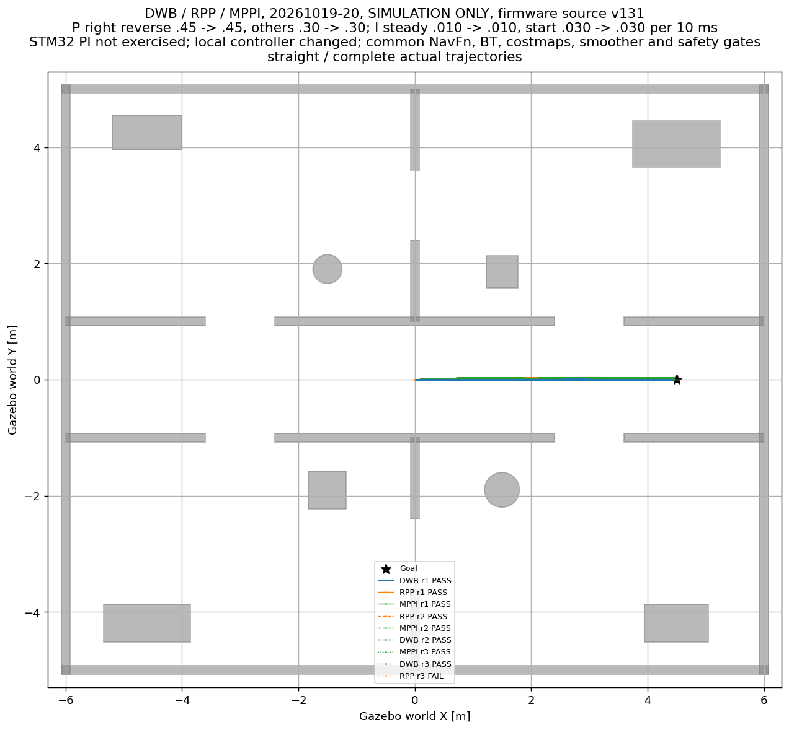
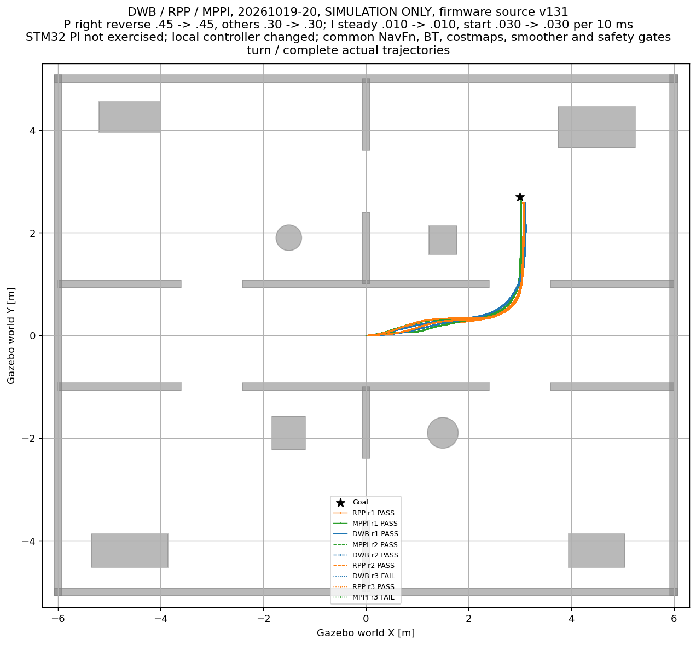
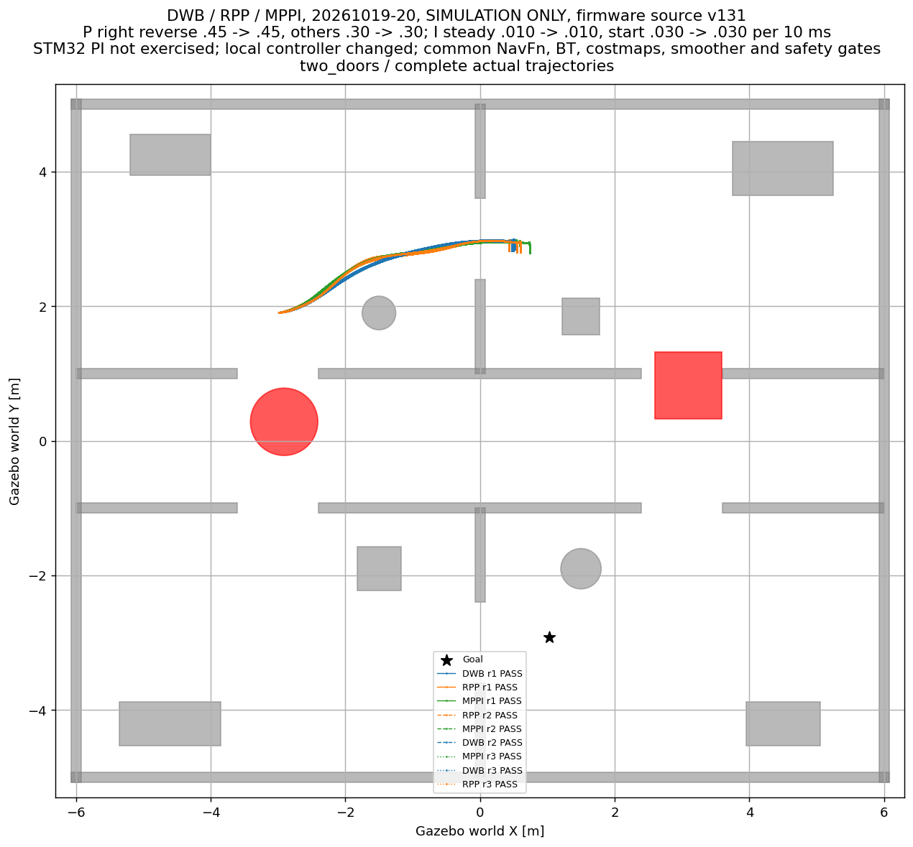

# DWB、RPP、MPPI 对比测试报表

记录 36/36 轮；推荐：**尚无满足全部试验要求的控制器**。
结论仅适用于当前两轮差速模型、办公室地图、冻结参数和本机负载，不代表算法在所有机器人上的普遍排名。

| 控制器 | 可达目标完成 | 封堵正确失败停车 | 模型重叠轮次 | 可达任务平均仿真秒 | 平均路程m | CPU%（一个核=100） | 合格后归一化代价↓ |
|---|---:|---:|---:|---:|---:|---:|---:|
| DWB | 5/9 | 3/3 | 0 | 17.996 | 4.603 | 12.857 | 缺测 |
| RPP | 7/9 | 3/3 | 0 | 30.948 | 7.626 | 6.448 | 缺测 |
| MPPI | 7/9 | 3/3 | 0 | 28.497 | 7.519 | 8.818 | 缺测 |

汇总耗时/路程/CPU均值为成功轮次混合均值，各控制器成功场景数量不同，不能直接据此推断性能差值；比较以分场景表为准。

**工程候选：MPPI，优先作下一步验证；不自动替换默认RPP。** 严格合格者仍为上面的结论。
这是事后探索：先取任务正确次数并列最多且无模型重叠者，再按原权重比较其成功场景均值，失败仍保留；不是冻结协议的正式胜者。探索代价（低者优先）：RPP=0.633, MPPI=0.367。
该探索代价对权重及min-max归一化敏感，毫米级路程差异也可能占据一个指标权重；需结合分场景原始差值判断，不能只读分值。
本轮没有控制器全部通过，不能宣称已选出经完整验收的最优算法。还需排除启动异常及主机负载影响，扩大路线覆盖和重复数。

| 控制器 | 已发目标轮次 | 启动未就绪、未发目标 | 目标墙钟超时 |
|---|---:|---:|---:|
| DWB | 11 | 1 | 1 |
| RPP | 11 | 1 | 1 |
| MPPI | 11 | 1 | 1 |

阶段 FORMAL，每种控制器正式计划4场景×3重复，顺序交错、每轮新建独立ROS域及Gazebo分区。直行目标(4.5,0,0)，转弯过门目标(3,2.7,π/2)，中途障碍为(2,0)处0.4×0.5×0.6m箱体，双出口封堵期望ABORTED并持续停车。
三种配置共享10Hz配置控制频率、0.30m/s前进上限、最终0.60rad/s角速度限幅、0.15m/0.20rad到达容差。统一最终角速度由共同平滑器保证：本测试将其上限由默认±0.8降至±0.6，仅改测试副本，不修改生产默认参数；RPP的rotate_to_heading参数本身只管原地转向。NavFn、1Hz重规划、代价地图、同一速度平滑配置、最多4轮恢复和所有保护完全相同。DWB使用ObstacleFootprint，MPPI使用DiffDrive和完整footprint成本；RPP插件参数保留现有配置。

选型先要求所有计划任务结果正确且停车证据通过，并要求没有二维带padding车体与障碍模型重叠；可达任务按场景等权。合格者再比较场景内min-max归一化代价：仿真时间40%、路径长度25%、角速度总变差/仿真秒20%、控制器进程CPU15%。代价不是成功概率，也不是统计显著性。只有一个合格者时，零代价仅表示无需进一步排序。
耗时与效率表只统计可达且完成的任务；失败不从任务正确率分母删除。封堵失败是正确结果，不能将其混同导航成功。目标完成还检查Gazebo世界终点误差<0.25m、朝向误差<0.30rad与连续停车，防止只看动作SUCCEEDED。

## 实测明细

| 控制器 | 场景 | 重复 | 原验证结果 | 任务及停车正确 | 仿真秒 | 墙钟秒 | 路程m | 最小模型间隙m | 终点误差m | 控制超期条数 |
|---|---|---:|---|---|---:|---:|---:|---:|---:|---:|
| DWB | straight | 1 | PASS | True | 17.177 | 49.202 | 4.417 | 0.732 | 0.080 | 0 |
| RPP | straight | 1 | PASS | True | 16.565 | 48.906 | 4.416 | 0.705 | 0.084 | 0 |
| MPPI | straight | 1 | PASS | True | 16.150 | 45.051 | 4.426 | 0.711 | 0.058 | 0 |
| RPP | turn | 1 | PASS | True | 19.698 | 52.954 | 4.969 | 0.347 | 0.116 | 0 |
| MPPI | turn | 1 | PASS | True | 18.573 | 48.597 | 4.918 | 0.304 | 0.081 | 0 |
| DWB | turn | 1 | PASS | True | 18.729 | 51.211 | 4.885 | 0.261 | 0.142 | 0 |
| MPPI | detour | 1 | PASS | True | 56.024 | 157.352 | 14.718 | 0.316 | 0.111 | 9 |
| DWB | detour | 1 | FAIL | False | 92.595 | 195.902 | 4.332 | 0.279 | 6.776 | 0 |
| RPP | detour | 1 | PASS | True | 60.755 | 126.351 | 14.829 | 0.352 | 0.100 | 0 |
| DWB | two_doors | 1 | PASS | True | 22.844 | 143.904 | 3.873 | 0.275 | 5.771 | 175 |
| RPP | two_doors | 1 | PASS | True | 23.413 | 148.761 | 3.840 | 0.321 | 5.779 | 4 |
| MPPI | two_doors | 1 | PASS | True | 22.440 | 145.502 | 3.933 | 0.337 | 5.766 | 1 |
| RPP | straight | 2 | PASS | True | 16.779 | 102.807 | 4.426 | 0.710 | 0.068 | 0 |
| MPPI | straight | 2 | PASS | True | 16.286 | 103.558 | 4.430 | 0.719 | 0.054 | 1 |
| DWB | straight | 2 | PASS | True | 17.400 | 116.644 | 4.418 | 0.740 | 0.079 | 211 |
| MPPI | turn | 2 | PASS | True | 18.721 | 113.403 | 4.921 | 0.305 | 0.087 | 2 |
| DWB | turn | 2 | PASS | True | 19.384 | 126.757 | 4.872 | 0.251 | 0.142 | 195 |
| RPP | turn | 2 | PASS | True | 19.862 | 116.207 | 4.994 | 0.354 | 0.142 | 0 |
| DWB | detour | 2 | FAIL | False | 38.639 | 240.007 | 3.911 | 0.234 | 6.614 | 431 |
| RPP | detour | 2 | FAIL | False | 38.736 | 240.006 | 8.802 | 0.356 | 5.338 | 0 |
| MPPI | detour | 2 | FAIL | False | 36.760 | 240.004 | 8.459 | 0.328 | 5.471 | 4 |
| RPP | two_doors | 2 | PASS | True | 22.718 | 138.759 | 3.942 | 0.343 | 5.747 | 0 |
| MPPI | two_doors | 2 | PASS | True | 22.532 | 130.903 | 3.991 | 0.346 | 5.755 | 1 |
| DWB | two_doors | 2 | PASS | True | 22.586 | 145.230 | 3.847 | 0.260 | 5.770 | 180 |
| MPPI | straight | 3 | PASS | True | 16.266 | 102.448 | 4.421 | 0.710 | 0.068 | 0 |
| DWB | straight | 3 | PASS | True | 17.289 | 83.139 | 4.422 | 0.738 | 0.074 | 38 |
| RPP | straight | 3 | FAIL | False | 缺测 | 缺测 | 0.000 | 0.745 | 缺测 | 0 |
| DWB | turn | 3 | FAIL | False | 缺测 | 缺测 | 0.000 | 0.745 | 缺测 | 0 |
| RPP | turn | 3 | PASS | True | 19.974 | 37.803 | 4.998 | 0.363 | 0.127 | 0 |
| MPPI | turn | 3 | FAIL | False | 缺测 | 缺测 | 0.000 | 0.745 | 缺测 | 0 |
| RPP | detour | 3 | PASS | True | 63.003 | 194.491 | 14.750 | 0.359 | 0.080 | 3 |
| MPPI | detour | 3 | PASS | True | 57.461 | 113.252 | 14.801 | 0.322 | 0.128 | 0 |
| DWB | detour | 3 | FAIL | False | 96.682 | 153.153 | 4.447 | 0.213 | 6.666 | 0 |
| MPPI | two_doors | 3 | PASS | True | 23.267 | 38.202 | 4.144 | 0.348 | 5.721 | 0 |
| DWB | two_doors | 3 | PASS | True | 22.426 | 33.403 | 3.892 | 0.273 | 5.786 | 0 |
| RPP | two_doors | 3 | PASS | True | 22.848 | 33.851 | 4.010 | 0.336 | 5.737 | 0 |

## 失败及关闭异常

- runs/08_dwb_detour_r1：分类=TASK_CHECK_FAILED，action=6，失败检查=expected_action_result; actual_vehicle_detours; reached_goal_area，无进展日志5条，模型重叠0点。详细原因须结合原始日志及轨迹判断。
- runs/19_dwb_detour_r2：分类=GOAL_WALL_TIMEOUT，action=5，失败检查=目标执行超时，无进展日志1条，模型重叠0点。详细原因须结合原始日志及轨迹判断。
- runs/20_rpp_detour_r2：分类=GOAL_WALL_TIMEOUT，action=5，失败检查=目标执行超时，无进展日志0条，模型重叠0点。详细原因须结合原始日志及轨迹判断。
- runs/21_mppi_detour_r2：分类=GOAL_WALL_TIMEOUT，action=5，失败检查=目标执行超时，无进展日志0条，模型重叠0点。详细原因须结合原始日志及轨迹判断。
- runs/27_rpp_straight_r3：分类=STARTUP_NO_GOAL，action=None，失败检查=60 秒内未就绪；生命周期：{'amcl': 'unconfigured', 'behavior_server': 'inactive', 'waypoint_follower': 'inactive', 'planner_server': 'inactive', 'map_server': 'inactive', 'smoother_server': 'active', 'bt_navigator': 'inactive', 'velocity_smoother': 'inactive', 'controller_server': 'active'}，无进展日志0条，模型重叠0点。详细原因须结合原始日志及轨迹判断。
- runs/28_dwb_turn_r3：分类=STARTUP_NO_GOAL，action=None，失败检查=60 秒内未就绪；生命周期：{'map_server': 'active', 'bt_navigator': 'unconfigured', 'velocity_smoother': 'unconfigured', 'controller_server': 'inactive', 'amcl': 'active', 'planner_server': 'unconfigured', 'waypoint_follower': 'unconfigured', 'smoother_server': 'inactive', 'behavior_server': 'unconfigured'}，无进展日志0条，模型重叠0点。详细原因须结合原始日志及轨迹判断。
- runs/30_mppi_turn_r3：分类=STARTUP_NO_GOAL，action=None，失败检查=60 秒内未就绪；生命周期：{'map_server': 'active', 'amcl': 'active', 'waypoint_follower': 'unconfigured', 'controller_server': 'inactive', 'smoother_server': 'unconfigured', 'planner_server': 'unconfigured', 'behavior_server': 'unconfigured', 'bt_navigator': 'unconfigured', 'velocity_smoother': 'unconfigured'}，无进展日志0条，模型重叠0点。详细原因须结合原始日志及轨迹判断。
- runs/33_dwb_detour_r3：分类=TASK_CHECK_FAILED，action=6，失败检查=expected_action_result; actual_vehicle_detours; reached_goal_area，无进展日志5条，模型重叠0点。详细原因须结合原始日志及轨迹判断。
STARTUP_NO_GOAL表示未通过启动就绪检查、没有发目标，不能归因为局部控制算法失败；仍保留在计划执行率分母。GOAL_WALL_TIMEOUT表示到达墙钟预算后主动取消，并不等于导航器自行判定无路。
关闭阶段存在内部进程退出升级（SIGTERM/SIGKILL）日志的轮次：runs/08_dwb_detour_r1, runs/10_dwb_two_doors_r1, runs/11_rpp_two_doors_r1, runs/15_dwb_straight_r2, runs/16_mppi_turn_r2, runs/25_mppi_straight_r3, runs/27_rpp_straight_r3, runs/28_dwb_turn_r3, runs/29_rpp_turn_r3, runs/30_mppi_turn_r3。这些记录保留并单独报告，不等同任务运行期间失败；每轮关闭后的进程组检查见result.json。

## 逐点波形与完整轨迹

STM32源码v131，P右反0.45→0.45、其它0.30→0.30；I稳态0.010→0.010、启动0.030→0.030，每10ms按电机轴rpm误差累计，D0。PI未改、未运行。改变的是ROS局部控制器；全局算法与保护不变。以下均为本轮ROS/Gazebo实收点，无平滑、补点、删异常；长缺口断线，不是实车左右轮速或电机电流。

### straight

### turn

### detour

### two_doors

## 适用边界

- 模型间隙由Gazebo世界位姿、配置的带padding矩形与场景二维碰撞几何派生；不是接触传感器，不能据此独立证明无碰撞或实车间隙。
- CPU和RSS采样来自实际safe_controller_server进程，包括本地代价图和DDS，不是纯优化器耗时；超期为真实控制循环日志计数。
- 墙钟时长受用户现有GUI与虚拟机负载影响，同时提供仿真时间、RTF与主机load；不将仿真运行速度当算法运动速度。
- MPPI/AMCL/传感器随机性未固定种子，三次重复只能给出描述性结果，不证明普遍最优或显著差异；没有进行全参数搜索。RPP沿用本项目已有调参，DWB/MPPI按同版官方示例适配，调参投入并不等同。
- 目录日期为开始日期，试验跨2026-10-19—20；观察到系统日历与单调计时相差约3653秒，原因未确认。时间指标使用单调时钟和ROS仿真时间，另存calendar_clock_observation.json；不由UTC相减计算耗时。
- 用户Gazebo/RViz与默认控制器未自动修改，未连接硬件、未实现实车桥，未提交/推送/合并本轮修改。
- 预检与正式试验分开归档。初始配置核查矩阵未继续执行，原因是发现RPP旋转参数不等价于全局限幅；此前两次完整结果及一次关闭阶段主动中断记录均保留，不混入统一最终限幅后的正式36轮。

参数参考：[Nav2 1.1.20 DWB官方配置](https://github.com/ros-navigation/navigation2/blob/1.1.20/nav2_bringup/params/nav2_params.yaml)、[同版MPPI官方说明](https://github.com/ros-navigation/navigation2/blob/1.1.20/nav2_mppi_controller/README.md)。实际测试以configs内完整YAML及哈希为准。

[冻结协议与参数](protocol.json) · [全部试验CSV](trials.csv) · [分场景均值/标准差](case_summary.csv) · [汇总CSV](summary.csv) · [机器可读结果](comparison.json)
