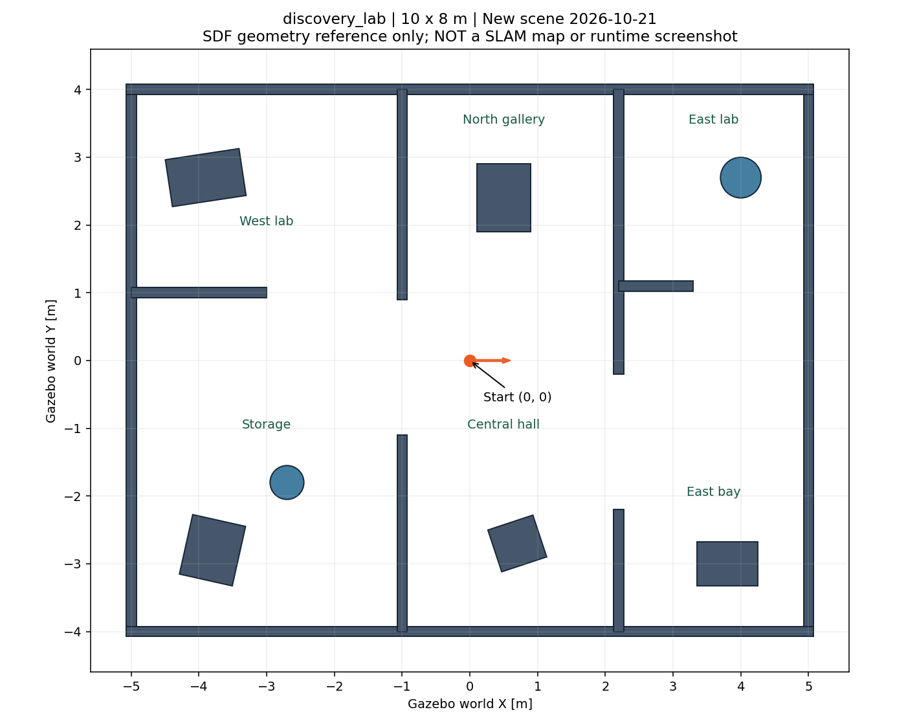

# 全新discovery_lab场景及用户验收准备 · 2026-10-21

用户要求构建此前未在本项目出现的场景，由用户亲自验收未知地图能否自动构建完成。新增`discovery_lab.sdf`：10×8m非对称实验室，错位门洞、西侧/东侧遮挡房间、工作台、箱体与圆柱。全部墙体和障碍布局在本轮新定义；复用仿真引擎/地面/光照与车模基础设施，不复用旧办公室布局。没有预制这个场景的导航地图，SLAM每次从零开始。[启动和验收步骤](../../DISCOVERY_LAB_ACCEPTANCE.md)

## 检查范围与全部尝试

| 记录 | 真实结果 | 结论 |
|---|---|---|
| baseline，域158 | 静止SLAM20秒，已知栅格2910→2910，位移约零 | 新场景雷达/地图可用，未产生自主移动 |
| startup_01，域159 | FAIL；90仿真秒未发目标，`WAIT_LOCALIZATION`；停车保存部分图 | 门控漏收静止SLAM一次性pose，原记录未删除 |
| diagnostic，域160，修复前 | 捕获首帧pose后3个目标、1.363m，40秒预算保存部分图 | 启动时序影响结果，不因复测能动就忽略失败；只读探针确认`/pose`为VOLATILE |
| late_gate，域162，修复后 | 首次地图3.016秒后才创建门控；此前1个pose、此后0个pose；定位就绪，输出始终零 | 直接验证晚加入不再依赖一次性pose |
| smoke，域161，修复后 | PASS；90仿真秒自动5目标，4到达、末个预算取消；行驶4.047m；已知2967→22194、自由2879→20900 | 正常停车且保存PGM/YAML/posegraph/data；`TIME_LIMIT_PARTIAL / complete=false`，不是全图完成 |
| 软件检查 | 三包构建、64项colcon检查，0错误/失败/跳过 | 非实车、非GUI或完整覆盖验收 |

初次离线几何检查将南侧探针(1,-3)放入箱体安全边界内，检查FAIL；`source/geometry_probe_01.json`保留。修正检测点为(0,-3.3)后，0.40m安全半径下各房间探针连通，场景几何本身未改。该静态探针不是探索器输入或人工导航路线。

## 本轮启动修复

旧建图门控依赖`/pose`首帧。只读探针实收表明SLAM静止时可能仅发一次且不持久保存，晚订阅会一直等待，无法发首个自动目标。改为唯一SLAM地图源、10秒内有效地图与原TF时间窗口（落后≤1.5秒、超前≤1秒）共同确认SLAM定位；检查TF数值有限及单位四元数，时间回退清除地图就绪状态，等待新地图。原速度/扫描/里程计/时钟/近障、odom→base_footprint检查及失联锁存保留；AMCL定位订阅保持。

**STM32源码v131：P右反0.45→0.45，其余0.30→0.30；I稳态0.010→0.010、启动0.030→0.030，每10ms按电机轴rpm误差累计，D0。** PI未改、未运行。探索、SLAM Toolbox、NavFn A*、RPP本体和建图专用0.20m/s、±0.35rad/s不变；本轮新增场景与修复SLAM门控启动。曲线为实收ROS/Gazebo消息全部点，长缺口断线，不平滑、插值或删异常；不是电机轴实测轮速/电流。基线没有Nav2安全指令话题，图中未补造该曲线。

面积增长不是地图精度或全覆盖率。本轮只验证新场景可启动、自动移动/更新和停车保存，未完成整张新场景探索，也未做该场景的独立几何精度验收或导出地图重载导航。GUI未自动打开；用户命令会打开Gazebo和RViz，完整完成判据见操作说明。

## 可追溯性

- `runs/`保存5次全部原始日志、CSV、JSON、源码快照和已生成地图；每次ROS域与Gazebo分区均独立，最终无自建进程残留。
- `source/`保存新场景、生成/静态检查/绘图脚本、最终门控/探索源码；各run源码表示当时实际版本。只读pose探针结果保留，未向车辆发速度或导航目标。
- 验证器仅新增可配置有限仿真时间预算与场景源码冻结。90秒用于本轮短测，产品入口默认预算不变；用户验收建议1800仿真秒，仍有墙钟上限。
- [原始哈希核对](integrity.json)、[前轮证据保持不变](previous_evidence_integrity.json)、[进程审计](process_audit.json)、[版本与范围](provenance.json)、[最终文件清单](SHA256.json)。
- HEAD仍为bef40ae9a8cca4eee6004a7495876a11e89495a5，分支feat/ros2-simulation-navigation；PR #1检查时open、未合并。未提交/推送/合并、未连接硬件，实车桥未实现。
