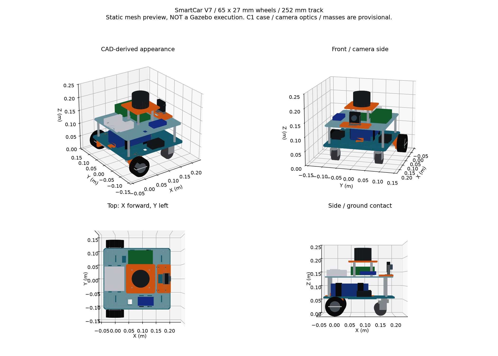

# SmartCar V7 基础仿真：Ubuntu 22.04 / ROS 2 Humble / Gazebo Fortress

## 交付范围与状态

目标：显示双层整车、用键盘前后行驶和左右转弯、观察轮子状态与里程计；另提供 C1 扫描和摄像头图像配置。

本包从既有 ROS 仿真工作空间导入本仓库，已包含模型、运动仿真与传感器配置。原工程的 Ubuntu 历史运行记录保留在来源工作空间；本轮新目录构建、软件测试与隔离运行需查看 [本轮验收目录](../../../docs/evidence/ros2-integration-20261018/)，不能将旧静态或运行结果直接当作新目录通过。**本包不连接 STM32/C610，不改变现有固件 P/I 或运动算法；实车联调尚待验证。**本包提供基础仿真；工作空间另有 `smartcar_slam` 包接入二维SLAM，见 `../smartcar_slam/README.md`，以及 `smartcar_nav2` 包提供已保存地图上的AMCL/Nav2导航，见 `../smartcar_nav2/README.md`。建图与导航分别启动。

## 已确认与估算的参数

| 项目 | 当前采用值 | 来源/状态 |
|---|---|---|
| 主动轮 | 直径65、宽27 mm | 用户实测确认 |
| 主动轮中心距 | 252 mm | 按 V7 轮胎原点±139及旧26宽计算中心±126；保留中心位置 |
| 主底板 | 220×240×5，底部加强筋4 mm | V7引用的V6打印网格 |
| 二层板 | 210×230×4 mm；层间净高65 mm | 原模型 |
| 万向轮 | 轮径40、宽22.5、安装面离地59 mm | 用户图纸；内部叉架和转轴高度简化 |
| 雷达 | 思岚RPLIDAR C1；360°、10Hz、500点/圈、0.05～12m | 官方典型扫描参数；12m对应70%反射率目标 |
| C1外壳与扫描高度 | 60×60×45 mm包络，扫描面高220 mm | 暂定，未取得可核验安装图，不作为机械制造尺寸 |
| 摄像头 | 用户1080P、2.8mm无畸变镜头款；完整模式1920×1080 | 视场90°、15fps、理想无畸变均为暂定仿真参数 |
| 摄像头预览 | 640×360 | 降低虚拟机负担，不代表实物只能输出该分辨率 |
| 车体质量/重心/惯量/摩擦 | JSON中明确标为ESTIMATED | 尚未实测；不用于实车性能或强度结论 |

所有数值配置在 `config/robot_parameters.json`。固定车架、电子设备、电机等合计暂按3kg；另有两个0.08kg主动轮、两个0.04kg万向轮、两个0.02kg叉架、0.11kg雷达和0.08kg摄像头，合计约3.47kg，**全部为估算质量**。



C1的黑色10%反射率目标官方上限为6m。理想射线仿真没有复现反射率、阳光干扰、拖尾或2.5D输出，不把12m理想扫描当成实物保证。摄像头2.8mm焦距无法在缺少传感器尺寸或标定结果时确定视场。

## 1. 仓库中的工作空间

`ros2_ws` 是本仓库内独立的 ROS 2 工作空间。所需网格已包含在源码中，不需要 SolidWorks，也不依赖原开发机的 Windows 或 Linux 绝对路径。

```text
ros2_ws/
├── tools/                  # 环境、安装、构建与测试入口
├── maps/office_01/          # 办公室导航示例地图
└── src/
    ├── smartcar_sim/        # 模型、Gazebo、键盘、传感器与仿真保护
    ├── smartcar_slam/       # 二维建图与保存
    └── smartcar_nav2/       # AMCL、规划、避障与导航
```

每个新终端从本仓库根目录执行：

```bash
source ros2_ws/tools/env.bash
```

脚本按自身位置导出 `SMARTCAR_WS` 并加载 Humble 与本工作空间。默认 `ROS_DOMAIN_ID=86`、`ROS_LOCALHOST_ONLY=1`；隔离实验可在 source 前显式指定其他域。同一个仿真的终端必须使用同一域。部分原始运动/保存检查工具仍限制域 86，不能在未核对脚本限制时直接用它们测试其他域。

## 2. 安装依赖

从本仓库根目录执行：

```bash
bash ros2_ws/tools/install_dependencies.bash
```

入口要求 Ubuntu 22.04 与已安装的 ROS 2 Humble，安装 Fortress、ROS 桥接、SLAM Toolbox、Nav2、RViz、编译与绘图依赖。需要联网，sudo 密码仅在本机终端输入。

## 3. 编译、测试并检查模型

```bash
bash "$SMARTCAR_WS/tools/build.bash"
source "$SMARTCAR_WS/tools/env.bash"
bash "$SMARTCAR_WS/tools/test.bash"
check_urdf "$SMARTCAR_WS/src/smartcar_sim/urdf/smartcar.urdf"
```

构建成功应安装三个 ROS 包；软件测试和 URDF 解析通过只证明对应软件与模型检查通过，实际运动和传感器还需要 Gazebo 验收。构建后可用 `ros2 pkg prefix smartcar_sim` 确认运行的是本仓库 `ros2_ws/install` 中的包。

## 4. 第一次只启动运动仿真

终端A：

```bash
source "$SMARTCAR_WS/tools/env.bash"
ros2 launch smartcar_sim sim.launch.py
```

作用：打开 Gazebo 和 RViz，加载小车与 `smartcar` 房间，保留已有墙体、隔墙和障碍物，开始物理仿真。默认关闭雷达和摄像头，先验证基本运动，减轻虚拟机负担。工程自带 Gazebo GUI 配置，初始视角对准小车；也可在实体树选择 smartcar 并聚焦。

Gazebo 启动时单独设置 `QT_XCB_NO_XI2=1`，使用普通滚轮事件，解决 VMware / XWayland 下滚轮缩放迟钝的问题；相机灵敏度保持原默认值。来源工作空间曾手动观察到改善；本轮是否完成 GUI 验收以独立记录为准。直接从终端启动 Gazebo 时，可用 `QT_XCB_NO_XI2=1 ign gazebo ...` 应用同一设置。

终端B：

```bash
source "$SMARTCAR_WS/tools/env.bash"
ros2 run smartcar_sim keyboard_drive.py
```

作用：按 **W/S前后、A/D左右转、空格停止、Ctrl+C退出**。短按点动，按住利用系统键盘自动重复继续运动；首次长按的键盘重复延迟可能产生短暂停顿。不收到按键超过0.2秒时键盘节点发送零指令；整个键盘节点失联后，独立保护节点在0.3秒后输出零指令。

键盘 W 前进速度为 **0.30m/s**（2026-10-18按用户要求从0.15翻倍），S后退保持0.15m/s，A/D保持0.8rad/s。配置文件 `config/robot_parameters.json` 的 `keyboard_forward_mps` 单独控制前进，`keyboard_linear_mps` 保留为后退及旧配置回退速度；保护节点和Gazebo差速插件的线速度上限同步为0.30m/s。更改后需要重新构建并重启仿真与键盘节点，运行中的节点和Gazebo不会自动重读文件。

Gazebo的理想DiffDrive自身不提供这个消息超时保护。保护节点退出时，启动器会关闭整个仿真，避免Gazebo保持最后的指令；桥接若被强杀，仍应结束仿真。本软件保护不是实车急停或固件保护的替代品。

若要先看模型而不运行物理仿真，关闭终端A后使用：

```bash
ros2 launch smartcar_sim display.launch.py
```

这个入口只打开RViz和关节滑块，不证明Gazebo物理运行正常。

## 5. 保存本次实际运行的验收记录

新终端先source环境，然后执行只读观察：

```bash
ros2 run smartcar_sim check_runtime.py --output "$SMARTCAR_WS/verification_runs/observe_01"
```

作用：等待并记录ROS时钟、关节状态与里程计，不发送运动。成功时 `result.json` 中为PASS；目录同时保存原始`motion.csv`和逐点PNG/SVG。旧目录拒绝覆盖，下一次用新的名称。失败、超时和中断同样保存。

**先退出键盘节点，确认仿真车周围无障碍，再运行动作验收：**

```bash
ros2 run smartcar_sim check_runtime.py --motion --output "$SMARTCAR_WS/verification_runs/motion_01"
```

作用：只向`/sim/cmd_vel`发送前进、后退、左转、右转、停止及停发消息的测试序列。脚本根据**实际收到的Gazebo里程计和保护节点输出**检查方向和停止行为；不会用离线公式补造结果。若虚拟机非常慢、测试未达到最小位移，则保留 FAIL 记录，先检查实际运行速度，不自动放宽阈值。

## 6. 启用 C1 和摄像头

先关闭当前仿真，再任选一个入口启动：

```bash
# C1扫描，保持摄像头关闭
ros2 launch smartcar_sim sim.launch.py lidar:=true

# C1和640×360摄像头预览
ros2 launch smartcar_sim sim.launch.py lidar:=true camera:=true

# C1和1920×1080摄像头，虚拟机负担更大
ros2 launch smartcar_sim sim.launch.py lidar:=true camera:=true camera_profile:=1080p
```

查看图像：新终端加载环境后执行 `ros2 run rqt_image_view rqt_image_view`，选择 `/sim/camera/image_raw`。

对应传感器验收例子：

```bash
ros2 run smartcar_sim check_runtime.py --lidar --camera preview --output "$SMARTCAR_WS/verification_runs/sensors_01"
```

作用：确认500条C1扫描、有效返回点、图像分辨率、CameraInfo和光学坐标系。完整1080P模式将 `--camera preview` 改为 `--camera 1080p`。应在选定模式运行，缺少传感器时会FAIL，不会伪报通过。

## 虚拟机图形问题

GPU雷达与摄像头依赖Ogre2/OpenGL。若Gazebo黑屏、闪退或传感器无数据，先保留终端报错，并检查VMware虚拟机3D加速和Ubuntu图形驱动。不要通过同时打开多个Gazebo重试。主机内存不足时先关闭无关大型程序，不盲目增加虚拟机内存。

只验证物理/话题、不打开任何GUI时可用：

```bash
ros2 launch smartcar_sim sim.launch.py headless:=true rviz:=false
```

这不验证Gazebo/RViz窗口显示和GPU传感器。运行 `bash "$SMARTCAR_WS/src/smartcar_sim/tools/check_environment.bash"` 可收集版本、包路径和可用的OpenGL信息。

## 主要接口

场景可通过 `world` 参数切换。例如 `ros2 launch smartcar_sim sim.launch.py world:=office_loop lidar:=true`，或使用 `smartcar_slam mapping.launch.py world:=office_loop` 同时建图。默认 `world:=smartcar` 保留现有房间。新增四房间布局、切换步骤及自定义 SDF 规则见 [worlds/README.md](worlds/README.md)。切换前结束旧仿真和 SLAM，新场景单独建图及保存。

| ROS话题 | 内容 |
|---|---|
| `/sim/cmd_vel` | 键盘/测试输入，geometry_msgs/Twist |
| `/sim/drive_cmd_vel` | 超时与限速后的仿真指令 |
| `/sim/odom` | 基于轮子转角的里程计，不是世界真值 |
| `/joint_states` | 六个活动关节的位置与速度 |
| `/clock` | Gazebo仿真时间 |
| `/tf`、`/tf_static` | odom→base_footprint→base_link→传感器/轮子 |
| `/sim/scan` | C1名义二维LaserScan，需启用雷达 |
| `/sim/camera/image_raw`、`camera_info` | 模拟图像和理想相机内参，需启用摄像头 |

车体坐标：X前、Y左、Z上；`base_link`在主动轮轴中心，离地32.5mm；`base_footprint`在其地面投影。左轮定义为ROS Y正方向。CAD网格采用绕Z负90度的右手旋转，不能按文件旧Left/Right标签做镜像。

## 修改模型和再检查

修改JSON后，在源码包目录执行：

```bash
python3 tools/generate_model.py
python3 -m unittest discover -s tests -v
```

作用：从包内保留的CAD源网格及坐标重新生成全部模型，再检查尺寸、关节、惯量、光学方向、网格和指令失效逻辑。质量和位置参数改变后仍需要重新运行Gazebo验收。C1实物安装孔与原生CAD小板适配未包含在本次仿真工作中。


## 历史运行范围与新增证据

来源工作空间曾完成编译、Gazebo GUI、双轮与万向轮状态、前后行驶、左右转向、停车和断流停车验收；640×360、1920×1080 摄像头及 C1 名义雷达数据曾实际接收。原始失败与修复日志仍保留在来源工作空间，没有随本仓库导入。这些是历史事实，不表示本轮重新执行过全部检查。摄像头历史实际接收帧率尚未达到 15 fps；质量、惯量、摩擦、FOV 等估算值没有实物验证结论。

新仓库本轮结果记录在 [docs/evidence/ros2-integration-20261018](../../../docs/evidence/ros2-integration-20261018/)，并由 [docs/ACCEPTANCE.md](../../../docs/ACCEPTANCE.md) 区分构建、软件测试、实际仿真与硬件状态。历史失败、传感器或软件渲染告警不能用新摘要掩盖。

`tools/verify_delivery.py` 仅做单包静态检查，必须用 `--output` 指定尚不存在的结果目录，不能代替 Gazebo 运行验收。原单包 `tools/package_delivery.py` 已停用，避免交付时漏掉 SLAM、Nav2 和工作空间脚本；应克隆或归档整个 Git 仓库。本轮统一使用工作空间 `tools/build.bash`、`tools/test.bash` 及独立运行证据目录。包内 `verification/` 和 `SOURCES.md` 保留历史来源，原绝对路径不是新仓库运行依赖。

`check_runtime.py` 现在额外保存 `joints.csv`、`commands.csv`、`world_pose.csv`。停发阶段没有伪造零输入。`motion.csv` 的 input 列表示最后一次已发布指令，停发期间会保持最后值；是否实际发布，以 `commands.csv` 的 input 事件为准。各动作后的停车分别检查；超时计时采用墙钟，配置0.3秒，采集验收上限0.45秒包含调度和接收余量，不代表实时保证。

若要独立验证 Gazebo 车体世界位姿，在另一个加载环境的终端运行：

```bash
ros2 run ros_gz_bridge parameter_bridge \
  '/world/smartcar_world/dynamic_pose/info@tf2_msgs/msg/TFMessage[ignition.msgs.Pose_V' \
  --ros-args -r /world/smartcar_world/dynamic_pose/info:=/sim/world_pose
```

再执行（目录必须尚不存在）：

```bash
ros2 run smartcar_sim check_runtime.py --motion --world-truth \
  --output "$SMARTCAR_WS/verification_runs/motion_next"
python3 "$SMARTCAR_WS/src/smartcar_sim/tools/plot_runtime_evidence.py" \
  "$SMARTCAR_WS/verification_runs/motion_next"
```

传感器开启时，可保存真实相机帧、单圈扫描、实际接收频率和TF：

```bash
python3 "$SMARTCAR_WS/src/smartcar_sim/tools/capture_sensor_evidence.py" \
  --output "$SMARTCAR_WS/verification_runs/sensors_next"
```

世界位姿来自 Gazebo 的 scene broadcaster，与轮式里程计分开记录。Fortress 此桥接的 TFMessage 内时间戳为零，因此 `world_pose.csv` 明确使用接收墙钟与测试阶段，不将零时间戳伪称为仿真采样时间。
