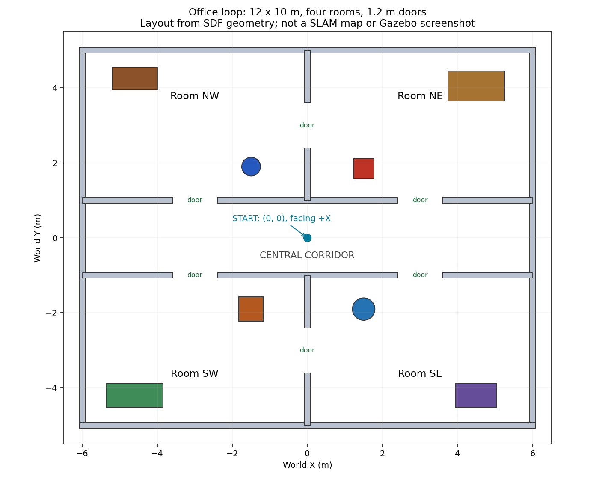

# 仿真场景

`world` 参数选择 Gazebo 的世界，不是 SLAM 保存的地图。所有场景沿用 C1 二维雷达和原车模型；摄像头是否开启由原有启动参数决定。`smartcar_slam mapping.launch.py` 始终启用 C1、关闭摄像头。

| world 参数 | 场景 |
|---|---|
| `smartcar`（默认） | 现有约6×6m房间，保留用户添加的隔墙 |
| `smartcar_original` | 用户此前备份的基础房间 |
| `office_loop` | 新增12×10m四房间场景，中央走廊和上下两条绕行通路 |
| `discovery_lab` | 2026-10-21独立新建的10×8m非对称实验室，错位门洞、遮挡房间、工作台及圆柱；用于用户自主建图验收 |

`discovery_lab`的墙体与障碍布局在本轮新定义，不复用旧办公室布局。场景文件是Gazebo物理环境，不是预先建好的二维导航地图；自主探索时SLAM从零生成`/map`。启动与完成判据见[新场景自主建图验收](../../../../docs/DISCOVERY_LAB_ACCEPTANCE.md)。

## 切换到四房间场景

先停车、按需保存旧地图，在旧仿真启动终端按 Ctrl+C；退出旧键盘节点和单独启动的旧 SLAM，确保同一 ROS 域中只有一个仿真和一个 SLAM。已独立打开的 RViz 可以继续使用。

```bash
# 从本仓库根目录加载环境
source ros2_ws/tools/env.bash
ros2 launch smartcar_slam mapping.launch.py world:=office_loop
```

默认不新开 RViz。如需要在此次启动时同时打开 RViz，自己追加 `rviz:=true`；若 RViz 随旧启动器退出，此选项也可使用。新终端加载同样环境后：

```bash
ros2 run smartcar_sim keyboard_drive.py
```

只仿真、不建图的对应入口为：

```bash
ros2 launch smartcar_sim sim.launch.py world:=office_loop lidar:=true rviz:=false
```

切回旧场景时，停车并结束当前仿真，然后使用 `world:=smartcar`。不同场景重新建图，不要把原房间的 `map_file` 加载到新场景。新地图保存到尚不存在的独立目录，例如 `$SMARTCAR_WS/maps/office_new_01`；仓库自带 `maps/office_01` 是导航示例，不要覆盖。

## 四房间布局及驾驶练习



以 Gazebo 世界坐标为准，+X 是小车初始前方，+Y 是初始左侧：

- 外墙中心位于 x=±6m、y=±5m；墙厚0.15m、高1.2m。
- 中央走廊位于 y=-1～1m，两侧墙内表面之间净宽1.85m。
- 四个房间通过中心位于 (±3,±1)m 的门口连到走廊。所有门口净宽1.2m。
- 上方两间房由 (0,3)m 处门口连接，下方两间房由 (0,-3)m 处门口连接，形成两条绕行通路。
- 起点为 (0,0)m，朝向 +X；起点和走廊中央留空。柜子、工作台、箱子及柱子布置在房间侧边，全部是静态实体，碰撞形状与显示形状一致。
- 无天花板和外部网格依赖，方便观察且控制软件渲染负担。工作台简化为实心箱体，未模拟桌腿、下方空间或材质反射率。

建议先沿走廊移动，再进入右前方房间，穿过房间之间的门口到另一间房，返回走廊。逐渐探索另外两间房。坐标仅用于理解布局，键盘控制仍需观察车体与障碍物。

RViz 设置：Fixed Frame=`map`，Map=`/map`、Reliable、Transient Local，LaserScan=`/sim/scan`。视野不够时将 Views/Orbit 的 Distance 从10增大到约18，Focal Point 设0/0/0；这只调整视角。SLAM 地图可显示门后的未知区域，移动到新的观察位置后再逐渐补全。

## 自定义世界文件

也支持 `world:=/绝对路径/your_scene.sdf`，或 `world:=office_loop.sdf`。自定义文件必须是包含一个 `<world>` 的本地 SDF 模板，并保留下面这个唯一的小车占位 include；启动器只替换它，不会误替换其他模型 include：

```xml
<include>
  <uri>__MODEL_SDF__</uri>
  <name>smartcar</name>
  <pose>0 0 0.003 0 0 0</pose>
</include>
```

复制 `office_loop.sdf` 后编辑是最直接的方法。保留物理、UserCommands、SceneBroadcaster 插件、地面和光源，确保出生点无碰撞。资源查找路径包含工程 models/ 和所选世界文件所在目录。当前接口没有验证任意 Fuel 在线场景或任意第三方模型包。

每次添加或修改源码场景后构建：

```bash
bash "$SMARTCAR_WS/tools/build.bash"
source "$SMARTCAR_WS/tools/env.bash"
bash "$SMARTCAR_WS/tools/test.bash"
```

历史复杂场景驾驶与建图记录留在原工作空间，没有随此源码导入。本轮目录移植结果见 [本轮验收目录](../../../../docs/evidence/ros2-integration-20261018/)。静态检查、实际驾驶、SLAM 和用户 GUI 观察分别记录，不能相互替代；通过选定路线不代表所有窄门、动态障碍或长时间运行都已验证。
