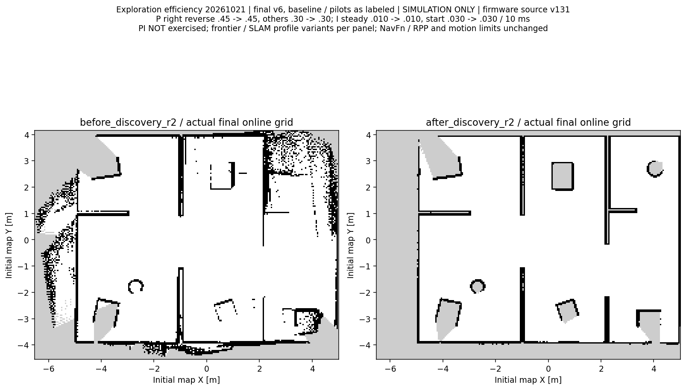
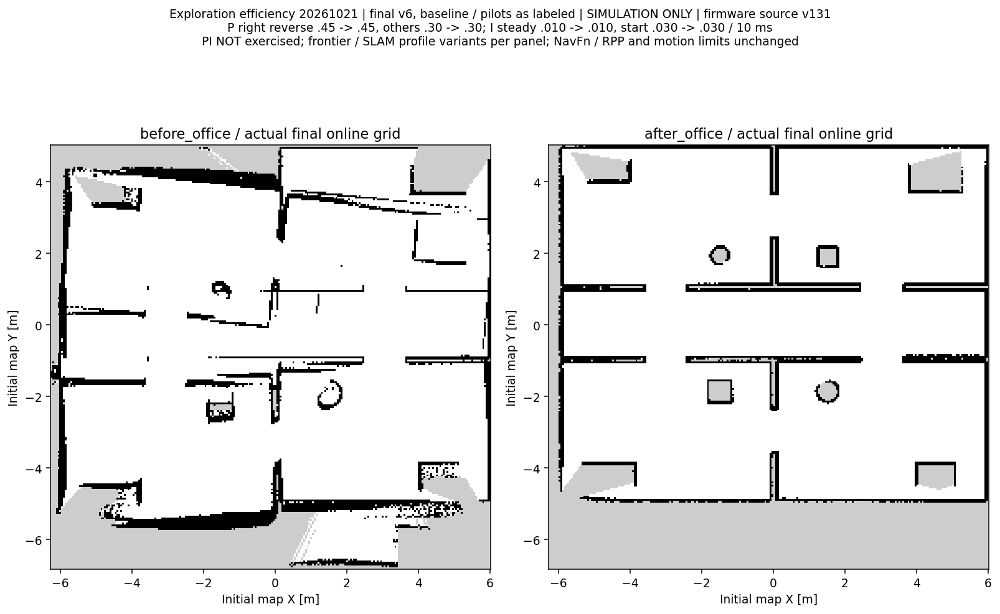
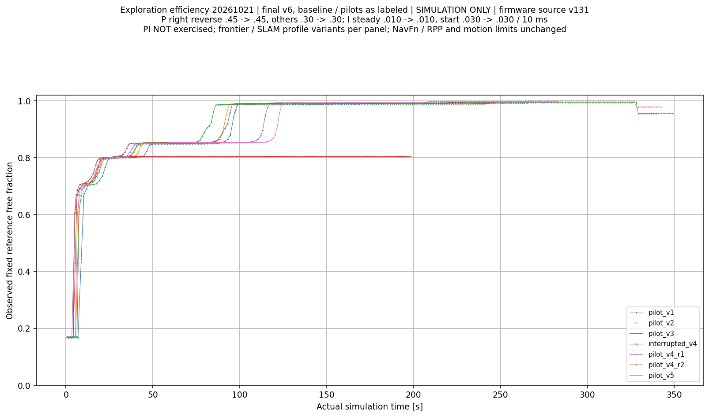
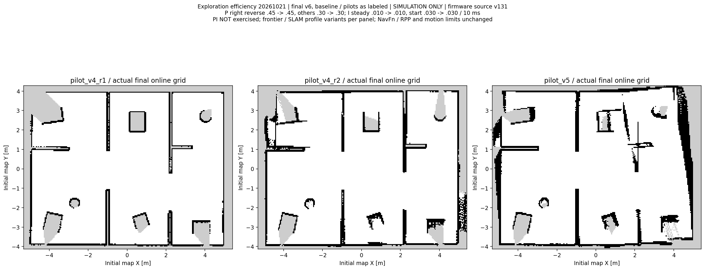

# 自主探索效率优化：2026-10-21—22

正式实验室两对重复：同一95%观测指标平均仿真用时 **371.608 → 114.425秒，减少69.2%**。
这不是全图完成时间或地图准确率；完整结束与部分地图逐轮单列。办公室场景另列，不混入实验室平均值。

固件源码v131；设备最后确认v127，本轮未连接/运行。P右反0.45→0.45、其余0.30→0.30；I稳态0.010→0.010、启动0.030→0.030，每10ms按电机轴rpm误差累加；D=0。PI未在Gazebo运行。

算法：基线为旧前沿策略，最终v6为信息收益/预计时间、附近补盲、到达切线及新地图驱动的目标交接，另有专用SLAM闭环匹配/Huber配置。v1—v6为探索配置编号，非固件版本。NavFn/RPP、0.20m/s与±0.35rad/s上限和停车保护不变。

## 正式对比

|运行|95%指标用时/仿真秒|最终参考观测比例|几何P95/m|0.15m内占据格比例|完整结束|结束原因|
|---|---:|---:|---:|---:|---|---|
|[before_discovery_r1](runs/before_discovery_r1/result.json)|262.950|95.75%|0.568|64.17%|False|NO_REACHABLE_FRONTIERS_PARTIAL|
|[before_discovery_r2](runs/before_discovery_r2/result.json)|480.267|98.36%|0.832|72.78%|False|NO_REACHABLE_FRONTIERS_PARTIAL|
|[after_discovery_r1](runs/after_discovery_r1/result.json)|123.760|99.68%|0.065|100.00%|False|NO_REACHABLE_FRONTIERS_PARTIAL|
|[after_discovery_r2](runs/after_discovery_r2/result.json)|105.090|99.68%|0.064|100.00%|False|NO_REACHABLE_FRONTIERS_PARTIAL|
|[before_office](runs/before_office/result.json)|442.327|93.20%|1.071|52.00%|False|NO_REACHABLE_FRONTIERS_PARTIAL|
|[after_office](runs/after_office/result.json)|114.972|100.00%|0.076|100.00%|False|NO_REACHABLE_FRONTIERS_PARTIAL|

|最终正式导出图|实际PGM几何P95/m|0.15m内占据格比例|
|---|---:|---:|
|after_discovery_r1|0.070|100.00%|
|after_discovery_r2|0.060|100.00%|
|after_office|0.080|100.00%|

实际PGM另外核验，避免用保存之后的在线末帧代替交付地图；地图保存器YAML原点的小数位也会造成少量量化差异。所有正式最终导出图仍须满足同一0.15m/95%几何门槛。

|实验室两轮平均|优化前|最终v6|
|---|---:|---:|
|任务结束/仿真秒（均为部分地图）|558.464|346.659|
|任务墙钟秒（受VM负载影响）|754.175|519.427|
|里程计路程/m|32.287|42.462|
|累计转角/rad|87.342|45.466|
|低速静止/仿真秒|93.320|23.676|
|近原地转向/仿真秒|180.542|55.595|
|目标数|25.000|10.000|

最终v6第二轮路程增加，不能宣称所有路线更短或达到全局最优；两轮平均转向、停等及任务结束用时减少。前后均为部分结束，不能把此时间称为全图完成时间。基线地图质量较差，同一观测指标也不等于同等几何质量。

固定参考由SDF离线计算：与出生点连通、距障碍至少0.37m的机器人中心位置，以5cm采样。实验室分母38.615m²；不代表全部地面、全部障碍召回率或实车精度。连续3次实际地图更新确认阈值，不插值、不拟合坐标。地图质量为占据格中心到SDF表面距离的仿真代理，不能证明完整几何准确率。

原始地图在`runs/*/map_snapshots`逐帧保留；完整起停、目标、状态、故障、缺测在各轮CSV/JSONL及`mission/session.json`。所有地图/速度图保留异常和全部点，长缺口断线。

## 全部尝试（功能PASS不等于地图质量达标）

|运行|分类|功能结果|95%用时/秒|几何P95/m|结束原因|
|---|---|---|---:|---:|---|
|[before_discovery_r1](runs/before_discovery_r1/result.json)|FORMAL_COMPARE|PASS|262.950|0.568|NO_REACHABLE_FRONTIERS_PARTIAL|
|[before_discovery_r2](runs/before_discovery_r2/result.json)|FORMAL_COMPARE|PASS|480.267|0.832|NO_REACHABLE_FRONTIERS_PARTIAL|
|[pilot_v1](runs/pilot_v1/result.json)|DEVELOPMENT_PILOT|PASS|97.215|0.053|USER_FINISHED_PARTIAL|
|[pilot_v2](runs/pilot_v2/result.json)|DEVELOPMENT_PILOT|PASS|92.965|0.067|NO_REACHABLE_FRONTIERS_PARTIAL|
|[pilot_v3](runs/pilot_v3/result.json)|DEVELOPMENT_PILOT|PASS|84.848|0.589|NO_REACHABLE_FRONTIERS_PARTIAL|
|[interrupted_v4](runs/interrupted_v4/result.json)|ENVIRONMENT_INTERRUPTION|PASS|缺测|0.040|USER_FINISHED_PARTIAL|
|[pilot_v4_r1](runs/pilot_v4_r1/result.json)|DEVELOPMENT_PILOT|PASS|116.046|0.075|NO_FRONTIERS|
|[pilot_v4_r2](runs/pilot_v4_r2/result.json)|DEVELOPMENT_PILOT|PASS|94.346|0.187|NO_REACHABLE_FRONTIERS_PARTIAL|
|[pilot_v5](runs/pilot_v5/result.json)|DEVELOPMENT_PILOT|PASS|122.900|0.426|NO_REACHABLE_FRONTIERS_PARTIAL|
|[after_discovery_r1](runs/after_discovery_r1/result.json)|FORMAL_COMPARE|PASS|123.760|0.065|NO_REACHABLE_FRONTIERS_PARTIAL|
|[after_discovery_r2](runs/after_discovery_r2/result.json)|FORMAL_COMPARE|PASS|105.090|0.064|NO_REACHABLE_FRONTIERS_PARTIAL|
|[before_office](runs/before_office/result.json)|FORMAL_COMPARE|PASS|442.327|1.071|NO_REACHABLE_FRONTIERS_PARTIAL|
|[after_office](runs/after_office/result.json)|FORMAL_COMPARE|PASS|114.972|0.076|NO_REACHABLE_FRONTIERS_PARTIAL|
|[watchdog](runs/watchdog/result.json)|SAFETY_OR_COMPLETION_REGRESSION|PASS|缺测|0.055|USER_FINISHED_PARTIAL|
|[complete_room](runs/complete_room/result.json)|SAFETY_OR_COMPLETION_REGRESSION|PASS|5.063|0.041|NO_FRONTIERS|

v1由测试者提前结束，v2/v3暴露到达/定位问题；v4含一次宿主中断、一次完整完成及一次地图质量失败；v5功能通过但地图质量失败。这些轮次都未计为最终v6重复，也未删除原始样本。宿主中断时任务暂停并锁存，恢复后未自动续行；随后显式结束保存。

## 闭环诊断、导出与保护

离线读取v5保存的处理后扫描及原始轮式位姿，未用保存的修正位姿或场景真值作输入。原配置重放的最终栅格逐格等于实测失败栅格；271.5/327.5秒错误闭环细响应0.734/0.724。禁闭环消融与闭环仍启用、细响应门槛0.80重放均使P95从0.426m降至0.061m。离线诊断不代替新仿真。[输入来源](source/offline_replay_provenance.json)、[逐格一致性](source/offline_replay_fidelity.json)、[重放命令](source/offline_replay_commands.json)、[消融结果](source/offline_loop_ablation.json)、[重放源码](diagnostics/replay_probe/replay.cpp)。

自动导出free_thresh从0.25改为0.196，避免PGM未知灰度205被Nav2重载为自由。`diagnostics/map_reload_*`保留旧失败与新通过的真实地图服务器逐格结果；`diagnostics/new-map-navigation`为最终新地图重载导航。历史地图未改，手动保存工具未改。

任务进程SIGSTOP/SIGCONT、失联锁存、显式继续/暂停/结束及可观测房间自动完成见`runs/watchdog`、`runs/complete_room`；自建进程退出记录在各轮result.json。

## 可复核文件

- [逐轮汇总](summary.json)、[所有尝试指标](all_attempt_metrics.json)、[均值计算](comparison.json)
- [预定比较协议](source/protocol.json)、[发布质量门槛](source/final_acceptance_gate.json)、[v6方案记录](source/v6_protocol_update.json)
- [原始与源文件完整性](integrity.json)、[本轮所有文件SHA256](SHA256.json)
- [启动与范围说明](../../EXPLORATION_SPEED.md)

基线生产源码、工具和构建所需示例地图位于`source/before_ws/{src,tools,maps}`；复制到全新目录后运行其中`tools/build.bash`可重新构建。生产探索代码冻结，观察器曾同步增加只读位姿记录；各轮实际观察器源码和哈希另在`runs/*/source`，不能把观察器变化当探索算法变化。

所有原始记录保持本机实际路径、时间戳和退出值，路径是证据来源，不是新机器运行依赖。结论限于所列仿真场景；实车桥、实车速度/停距/地图精度均待验证。
