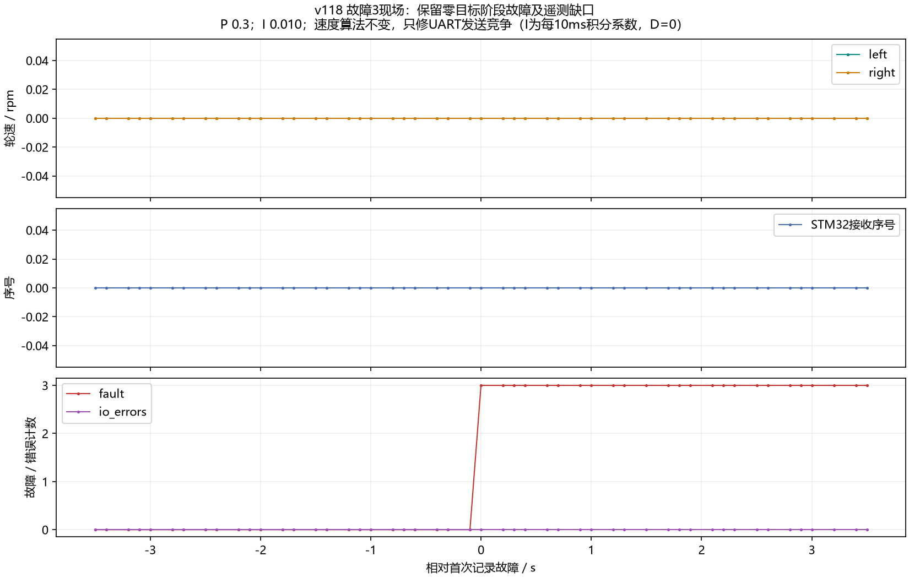

# 原始实测波形索引

图像来自随附 raw 快照，SHA256 见 manifest.json。未额外平滑、删异常点或补采样。
v114之前为C610原始速度字段；v114之后为固件实际闭环所用角度差分速度，二者不能当成同一测量方式直接比较噪声。
短时中断段不是完整稳态试验；统计仅辅助阅读，不自动判定验收通过。

|版本/段|目标rpm|记录非零目标时长s|左均值/标准差|右均值/标准差|
|---|---:|---:|---:|---:|
|[v118_trial_01](v118_trial_01.png)|5|5.90|4.99/0.41|5.26/1.07|
|[v118_trial_02](v118_trial_02.png)|5|5.70|5.00/0.35|4.94/0.47|
|[v118_trial_03](v118_trial_03.png)|5|5.80|4.97/0.35|4.97/0.46|

## v118_fault_3

[SVG矢量图](v118_fault_3.svg)

## v118_trial_01

[SVG矢量图](v118_trial_01.svg)

## v118_trial_02

[SVG矢量图](v118_trial_02.svg)

## v118_trial_03

[SVG矢量图](v118_trial_03.svg)
