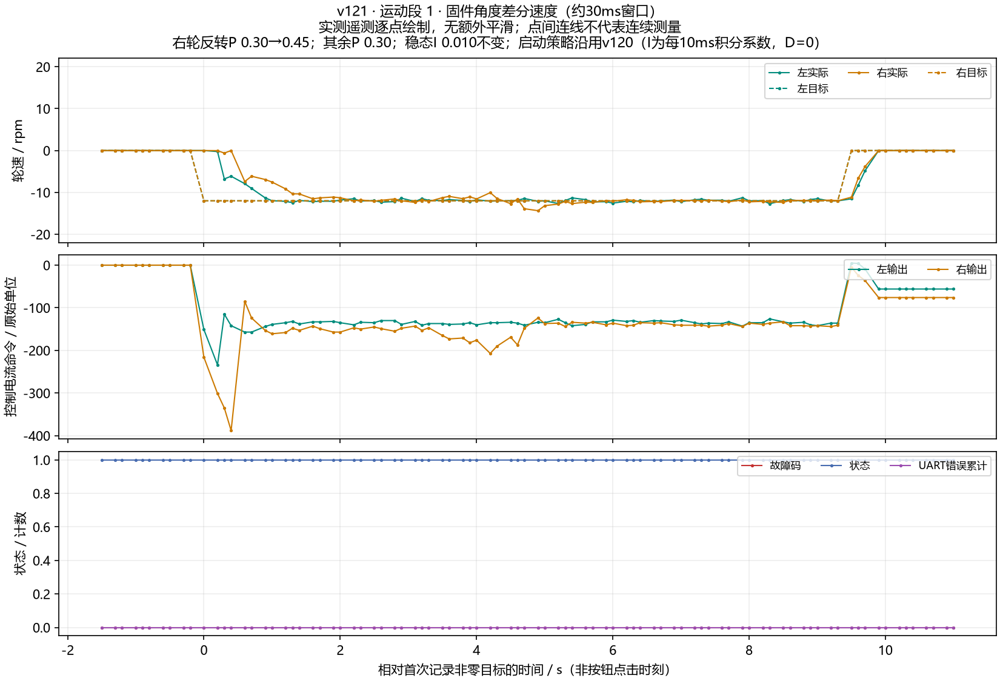
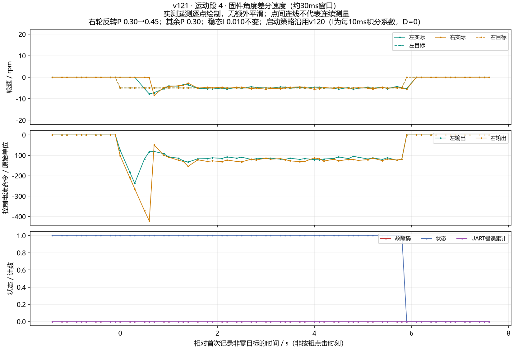

# 原始实测波形索引

图像来自随附 raw 快照，SHA256 见 manifest.json。未额外平滑、删异常点或补采样。
v114之前为C610原始速度字段；v114之后为固件实际闭环所用角度差分速度，二者不能当成同一测量方式直接比较噪声。
短时中断段不是完整稳态试验；统计仅辅助阅读，不自动判定验收通过。

|版本/段|目标rpm|记录非零目标时长s|左均值/标准差|右均值/标准差|
|---|---:|---:|---:|---:|
|[v121_trial_01](v121_trial_01.png)|-12|9.30|-11.94/0.29|-12.03/0.16|
|[v121_trial_02](v121_trial_02.png)|-12|5.80|-12.03/0.32|-11.98/0.19|
|[v121_trial_03](v121_trial_03.png)|-12|5.90|-11.97/0.20|-11.94/0.17|
|[v121_trial_04](v121_trial_04.png)|-5|5.80|-4.94/0.35|-5.06/0.32|

## v121_trial_01

[SVG矢量图](v121_trial_01.svg)

## v121_trial_02

[SVG矢量图](v121_trial_02.svg)

## v121_trial_03

[SVG矢量图](v121_trial_03.svg)

## v121_trial_04

[SVG矢量图](v121_trial_04.svg)
